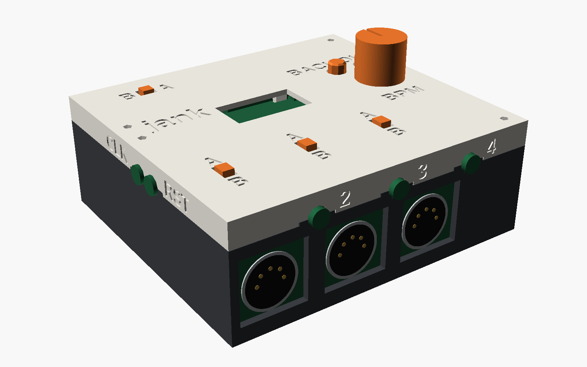
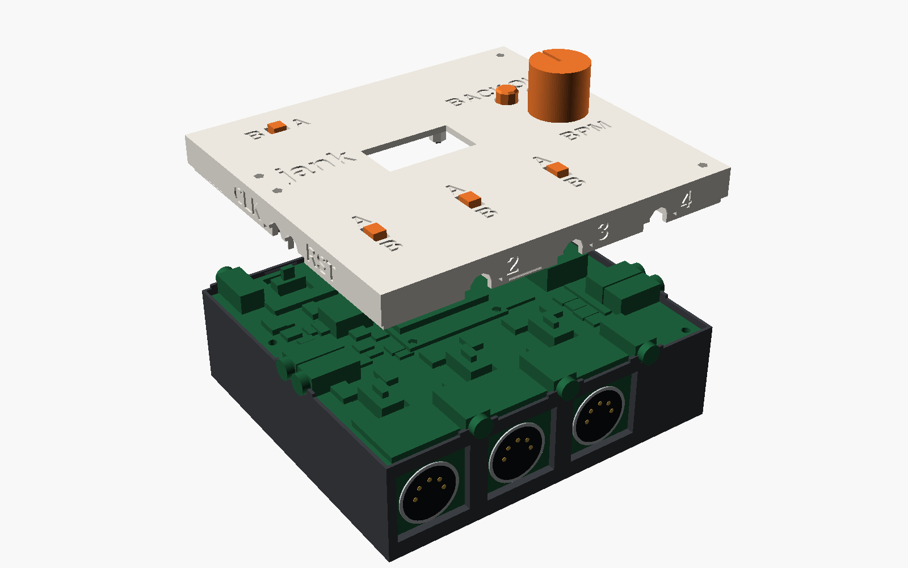

# jank

**Ableton Link with no router.** jank protocol brings computers, MIDI gear and modular gear into a
**jank** session: the group mode of [Optimist](https://github.com/w0ts/optimist), the open firmware for the FM-1 synth
(**MODE JANK**, first called jam).

## No router

Link normally needs every player on the same network: a Wi-Fi router or access point that somebody sets up, joins and
keeps running. In jank there is none. The units send open Wi-Fi frames straight to each other on the group's channel,
with no association, no password and no host; the ones set to the same GROUP (1..9) hear each other and form one Link
session. Switch on, pick the group, play: on a stage, outdoors, wherever there is no network. How the frames look:
[docs/air.md](docs/air.md).

FM-1s running Optimist do this by themselves. **The jank device** speaks the same air format, so whatever is plugged
into it joins the group too.

## What joins through it

- **A computer, over the network.** On the device's USB port the computer sees a USB network adapter on the group, so
  any app with Ableton Link (Live, Bitwig…) joins the same session as the FM-1s.
- **A computer or a USB device, by MIDI clock.** The device is a USB-MIDI device for a computer, and a USB-MIDI host for
  gear with a USB port.
- **MIDI gear.** MIDI outputs send clock, start and stop locked to the session.
- **Modular gear.** Clock outputs, 5 V pulses.

It plays no sound: it follows the group's tempo and phase and sends them on. Link is Ableton's trademark; jank is not an
Ableton product.

## Two devices

- **The stick:** a bare Seeed XIAO ESP32-S3 (about US$7.50) in a computer or any USB host that speaks MIDI clock or Link (network driver). One button, one LED.
- **The jank box:** the same firmware on its own board, in a printed box.

The box has:
- 3 MIDI outs
- 1 MIDI in/out (TRS + DIN)
- 2 modular clock outs

## Build it

- [PCB](hardware/pcb/README.md)
- [Box](hardware/box/README.md)
- [Firmware](docs/firmware.md)

Details: [on the air](docs/air.md), [USB](docs/usb.md), [MIDI clock](docs/midi.md), [boards and pins](docs/boards.md).

## Licensing

The firmware (`firmware/`, `core/`, `tests/`, `scripts/`) is GPL-3.0-only, as it links Optimist's `link.c`
(`third_party/link`, copied from fm1-base, see its README). The control page and its test are MIT. The hardware
scripts carry GPL-3.0-only SPDX tags (`hardware/pcb/lib/stitch.py` CC0-1.0); the KiCad footprint of the XIAO is Seeed's,
CC BY-SA 4.0. See [LICENSE](LICENSE).

The pictures (`docs/img/`) are rendered from the box and board models by `docs/img/hero.scad`.
