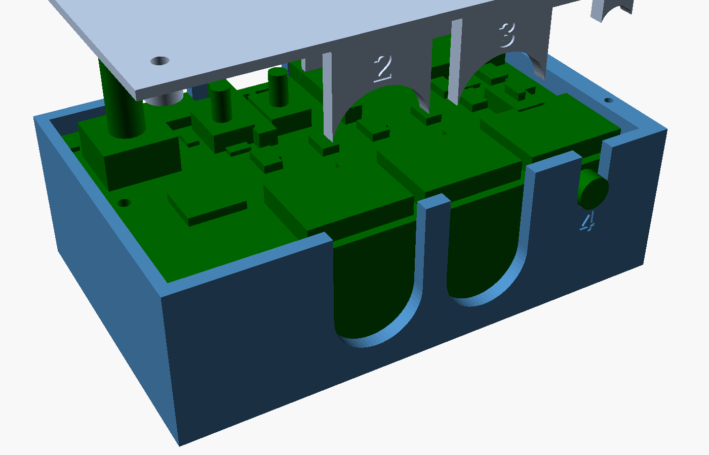

# jank box: the printed box of the jank board (round 7 / v4)

The box for the board in [`../pcb`](../pcb/README.md), **v4: 84.0 x 52.0 mm**, OUT2..OUT4 on the front edge, OUT1 (MIDI
IN capable) on the back edge beside the two USB-Cs, and on the face: MODE and PLAY/STOP (9.5 mm buttons), a push
encoder (ALPS EC11E09244BS), two LEDs and an A/B switch on each jack channel. OpenSCAD, parametric, one STL per printed part, each one
closed manifold solid.

> **Stage: designed and checked in OpenSCAD only (2026-11-08).** Nothing printed, no part measured. Every number marked
> *unverified* comes from a datasheet drawing or an estimate.

**First requirement (the user's ruling, 2026-11-08):** *the 3D print must brace the DIN sockets to relieve the stress
from the PCB.* Plugging and unplugging a DIN or a TRS plug loads the box, not the solder joints, on every channel.
**Second (2026-11-08):** the A/B knobs stay reachable by finger: the lid stays at 3.6 mm above the face where they are.
**A/B switches only on jack channels (2026-11-08):** "we don't need the A/B switch when we have the DIN plug". The switch
swaps a jack's tip and ring only, so a DIN channel leaves it unfitted. The lid has a slot (and its A / B letters) only
for a TRS channel: `DDDT` has one, for OUT4 (SW5).
**Third (2026-11-08):** every wall opening is a U open to the top, so the board with its connectors goes straight in,
and the lid's tongues close the upper part of each. Every bore and slot is round at its bottom in the wall and completed
by a half-round in the lid's tongue or key (the jack's way, the user's choice for the DIN too).

**The set the user builds: `DDDT`** (DIN on OUT1, OUT2, OUT3, a TRS jack on OUT4).



## Files

| File | What |
|---|---|
| `jank_box.scad` | The box, the lid, the wall test strip, the checks. `outs` picks the connectors, `part` the output |
| `make_stl.sh` | Exports every set's STLs, runs the collision, drop and brace checks, renders the PNGs, runs `../check_stl.py` (one body, 0 open edges, 0 non-manifold, 0 misoriented) |
| `stl/jank_box_<set>_box.stl`, `stl/jank_box_<set>_lid.stl` | The printable parts, already in print orientation |
| `stl/jank_box_front_test.stl` | A 41 x 26 mm strip of the 2.5 mm connector wall with one whole 16.0 mm DIN bore and one jack U-slot: try the plugs first |
| `renders/open_<set>.png`, `box_`, `front_`, `back_`, `lid_`, `lid_top_` | Box with the board in it (lid lifted), the empty box, the front wall, the back wall, the lid as printed (its underside: tongues, keys, ribs), the lid's top with its labels |

```
sh hardware/box/make_stl.sh               # the five sets below (about 15 s)
SETS="TDDD" sh hardware/box/make_stl.sh   # any other combination
```

## The sets

`outs` lists **OUT1..OUT4**: `D` = DIN (CUI SDS-50J), `T` = TRS (CUI SJ1-3523N). **OUT1 is the back one.** Seen from
the front with the lid up, the front wall carries **OUT2, OUT3, OUT4 from left to right**; OUT1 is at the back, behind OUT4
(the board lies face up, so KiCad's x is mirrored: face x = 84 - x). The encoder is in the back left corner (seen from
the front), the buttons right of it.

| Set | Outer size X x Y x Z (lid included) | Note |
|---|---|---|
| **`DDDT` OUT1-3 DIN, OUT4 TRS (the user's)** | **90.6 x 57.2 x 29.9 mm** | |
| `DDDD` all DIN | **90.6 x 57.2 x 29.9 mm** | the DIN's 21.1 mm sets the depth |
| `TTTT` all TRS | **90.6 x 57.2 x 21.2 mm** | the standing 33 ohm resistors (11.5 mm, *estimate*) set the depth |
| `DDTT` OUT1-2 DIN, OUT3-4 TRS | **90.6 x 57.2 x 29.9 mm** | any set with one DIN is as deep as `DDDD` |
| `DTTT` OUT1 DIN (MIDI IN), the rest TRS | **90.6 x 57.2 x 29.9 mm** | |

Not counted in Z: the encoder's body stands 1.4 mm and its shaft 14.9 mm above the lid; the buttons 4.4 mm.
X: -X wall 2.0 + 0.3 + board 84.0 + 0.3 + **+X wall 4.0** (it takes two lid screws). Y: front wall 2.5 + 0.1 + board
52.0 + 0.1 + back wall 2.5 (flat, OUT1 and the USB-Cs alike). Z: floor 2.0 +
floor-side parts + board 1.6 + **3.6** to the lid + lid **1.5**.

## How the board lies

Upside down, as the board README asks: **the face side (KiCad bottom: the buttons, the encoder, the LEDs, the A/B
switches) looks up at the lid; the XIAO, the resistors and the connectors' bodies hang towards the floor.** The DIN's
far edge (21.1 mm from the board) is the part closest to the floor, so the floor itself carries it.

## Bracing (the first requirement): the same on every channel, front or back

Every channel is built in its own frame (origin on the board edge, +y into the board) and placed on the front wall
(OUT2..OUT4) or mirrored onto the back wall (OUT1). Only the cradle lip's height differs (below).

### DIN: CUI SDS-50J

Verified from the drawing (Same Sky datasheet SDS-J, rev 1.08 dated 09/12/2024, page 3, tolerance +/-0.3 mm; read
2026-11-08): a **square front plate 20.0 wide x 21.1 tall x 1.8 mm thick**, the socket axis 10.0 mm above the board,
a housing **18.0 mm tall** behind the plate, 15.8 mm overall depth (max); insertion force up to **6.5 kg**, withdrawal
**0.5 to 5 kg**.

**The DIN sits behind the wall, the plug's bore is split between the wall and the lid.** The plate sits behind a
full **2.5 mm wall**. The wall has a **round 16.0 mm bore** (`din_bore`, for the plug's shell) on the socket's axis.
Its lower half is in the wall and its upper half is open to the wall's top as a U. The lid's **tongue** fills the U.
The tongue is 15.7 mm wide (0.15 a side) and 2.5 mm thick, flush with the outside. Its lower end is a **half-round
16.0 mm**, so wall and tongue make one round bore, as the jack keys do for the bushings. The plate slides down behind
the wall into its slot (wall to cradle) when the board is lowered in; `check_board_drop` lowers the board with every
part straight into the box and finds nothing in the way.
**The DIN face is 2.6 mm behind the wall's outside** (wall 2.5 + 0.1), which the user accepts; the plug's metal shell
must reach 2.6 mm further than on a bare socket (*unverified* with the user's plugs: print `front_test.stl`).

| Force | Path | Play (design) |
|---|---|---|
| **Pull-out** | the plate's front on the wall round the bore's lower half and on the tongue round its upper half: about 220 mm2 (20 x 21.1 minus the 16 mm bore) | 0.1 mm |
| **Push-in** | the plate's back on the **cradle's face** in a **3.0 mm band** along its far edge, where the plate stands 3.1 mm above the 18.0 mm housing (60 mm2); the housing's back on the cradle's **lip** (1.4 mm) | 0.2 mm, 0.15 mm |
| **Towards the floor** | the plate's far edge on the floor; the housing's top on the cradle | 0.1 mm each |
| **Towards the lid** | the housing on the board, the board on the lid's rib over that connector | 0.05 mm |
| **Sideways** | the plug's shell in the bore; the plate in its slot | the plug decides |

**The lip's height** (the cradle's lip behind the housing): on the front channels it reaches down to 2.0 mm above the
board (the A/B switches' legs, 1.5 mm, stand behind the housing there). **On OUT1 it stops 12.5 mm above the board**,
because OUT1's resistor groups (11.5 mm standing, *estimate*) start 0.8 mm behind its housing.

`din_slot_play` (0.2) is the one value to correct if a real plate measures over 1.8 mm (the drawing's +/-0.3 allows 2.1).

### TRS: CUI SJ1-3523N

Verified from the drawing (Same Sky SJ1-352XN, 09/12/2024, page 2): body 12.0 x 11.0 x 5.0 mm; **bushing 6.00 mm,
plain: no thread and no nut drawn**, 3.30 mm past the body's front, axis 2.50 mm above the board; insertion/withdrawal
0.3 to 3 kg. Nothing clamps the wall, so the box holds the body:

| Force | Path | Play |
|---|---|---|
| **Pull-out** | the body's front face on the wall's inside beside the slot (2 x 2.9 x 5 mm) | 0.1 mm |
| **Push-in** | the body's back on the **cap's back stop** (1.6 mm) | 0.15 mm |
| **Down / sideways** | the bushing in the wall's **U-slot** (6.2 mm, round at the bottom); the body in the **cap** (a saddle from the floor with two cheeks) | 0.1 a side / 0.15 mm |
| **Up** | the body on the board, the board on the lid's rib; the **lid's key** closes the U-slot over the bushing | 0.05 / 0.15 mm |

The jack's body front is on the board's edge, 2.6 mm behind the outside; the bushing (3.3 past the body) stands
**0.8 mm proud** of it, so a plug seats against it. The key (5.9 mm, 0.15 a side) comes down with the lid.

### OUT1 and the USB-Cs on the back wall

The back wall stands 0.1 mm behind the board's back edge and is **2.5 mm thick all along** (flat outside):
- **OUT1:** the same bore and tongue, or U-slot and key, as the front channels.
- **The XIAO's socket overhangs the board by 1.5 mm and sits in the wall's own thickness**, in its U-opening, its face
  1.1 mm short of the outside. A plug's overmold enters the 12.5 x 7.0 opening; J1 (no overhang) is 2.6 mm in. It works
  because the openings are U's open to the top: the socket drops into its U as the board goes in.
- **Each USB opening** is a U **12.5 mm wide** from its rounded bottom (r 1.5) to the wall's top. The lid's **tongue**
  (12.2 wide) closes it down to **7.0 mm** height. The tongue stays 0.55 mm behind the board's edge (J1's shell legs,
  0.545 past the edge in the mockup).

### The board itself

- **Connector edges:** clamped between the lid's **ribs** (0.2 to 1.3 mm from the edge, over each connector's 20.5 mm,
  front and back) and the connectors' housings (the DIN plate stands on the board along its first 1.8 mm; the jack
  body's front on the edge), which stand on the floor (DIN) or on their cap (TRS): plastic on board, never a solder joint.
- **H1 (80.8, 25.0) and H2 (80.8, 48.8)**, the only holes, both on the -X side: **standoffs** (5.5 mm, webbed to the
  -X wall).
- **The +X corners** (no holes: OUT1 and OUT2 own them): two **ledges** on the +X wall, under the board's last 0.5 mm,
  4.0 mm deep.
- **Design gaps:** every bearing surface stops **0.05 mm** short of the board (`contact`) so the checks stay clean;
  in print that is contact.

## Lid

**Height:** the inside **3.6 mm above the face** everywhere, **1.5 mm thick** (outside at 5.1): the A/B knobs (5.0 mm)
end 0.1 mm under the lid's top, in their slots, finger-reachable as in the board README's sum.

**The encoder: a window, not a raised boss.** The lid has a **13.3 x 13.3 mm opening** round the encoder's body (the
mockup's 12.5 x 12.5 body + 0.4 a side); the body (6.5 mm, *unverified*) stands **1.4 mm through the lid**, the shaft's
top (20 mm from the face, *unverified*) **14.9 mm above it**. Why not a boss (the lid raised to 7.0 inside over the
encoder, its top 3.4 mm above the lid, a 7.0 mm shaft hole):
- **A boss cannot be printed without supports.** The lid must print top face down (its keys, ribs, LED shroud and
  spacers grow from the underside); a boss on the top would sit on the bed and leave the whole 90 x 58 mm plate hanging
  3.4 mm above it. A separate cap would be one more part to print and hold.
- **The window does not depend on the encoder's height**, the one number the board README could not verify (6.5 mm,
  "as read from the PDF's text"): a taller body just stands further out; a boss built for 6.5 would collide.
- What the window gives up: the encoder's body shows (0.4 mm gap round it) and does not get a 7 mm collar round its
  shaft. A knob on a D shaft sits 13.5 mm of shaft above the body: a push-on knob's skirt clears the body's 1.4 mm.
- The window is 1.35 mm from H1's spacer (H1's screw head, 3.8 mm, 1.95 mm from it) and far from every rib.

**Fixing: four M2 screws, the lid comes straight down** (no hinge: the encoder's 16.4 mm of shaft above the lid's
underside would sweep 1.7 mm sideways under a hinged lid, more than any clean hole allows):
- **-X side:** **2 x M2 x 12 self-tapping (pan head)** through the lid, a 5.0 mm spacer, the board's H1 / H2 and into
  the standoffs (pilot 1.7 mm, 8 mm deep). They hold the lid and clamp the board.
- **+X side (no board holes there):** **2 x M2 x 6 self-tapping** into the **4.0 mm +X wall** (pilot 1.7 mm, 8 mm deep,
  1.15 mm of wall each side of it), 10 and 42 mm from the board's front edge.

**Openings** (KiCad coordinates, face x = 84 - x in brackets):

| Opening | Centre | Size | Note |
|---|---|---|---|
| MODE (SW1) | 47.75 (36.25), 13.8 | 4.0 mm round | plunger 3.4 (HRO); stands 4.4 mm out; its body (3.5, *unverified*) under a 0.4 mm recess |
| PLAY/STOP (SW6) | 58.55 (25.45), 13.8 | 4.0 mm round | as MODE |
| Encoder (SW7) | 75.5 (8.5), 14.5 | 13.3 x 13.3 window | the body through it (above) |
| LED1, LED2 | 45.5 (38.5) and 49.85 (34.15), 4.0 | 3.2 x 3.6 | one light shroud (0.5 mm walls, 1.15 between the windows, down to 0.3 above the face), cut back where the XIAO's header pins stand; the lid's top **skin of 0.6 mm stays over the windows** (`led_skin`): print the lid translucent, or set `led_skin = 0` |
| A/B, jack channels only | SW2 (25.2, 10.75) for OUT1, SW3 / SW4 / SW5 (51.75 / 31.25 / 10.75, 32.25) for OUT2 / OUT3 / OUT4 | 2.0 x 4.5 | only where the channel is a TRS (in `DDDT`: SW5, OUT4); the board README's slot: handle 1.5 x 2.0 + 2.0 travel along y + 0.25 round; body (3.5) under a 0.4 mm recess |
| USB-C | XIAO (45.2), J1 (64.5), back wall | 12.5 x 7.0 | U-openings closed by the lid's tongues; for a plug's overmold (*unverified* against the cables) |

## Markings

`markings = true` cuts labels 0.4 mm deep in Liberation Sans Bold. The capitals are 4.0 mm tall (`mark_size` 4.2) and
the stems 0.84 mm wide, so a 0.4 mm nozzle leaves them open.
The user's rule (2026-11-08): the controls are labelled on the lid's top, the plugs on the sides, each once; the LEDs
carry no label (a lid label must not repeat a side's).
- **Lid top:** MODE right of its button, PLAY under its button, BPM over the encoder's window, an A and a B at the two ends of each A/B slot (jack channels only), and "jank" (6.0 mm capitals) in the front right
  corner.
- **Lid tongues** (flush with the walls, over the bore): the channel number of each DIN ("1 / IN" on OUT1's; in
  `DDDT` "1 / IN", "2", "3").
- **Walls:** a jack's channel number under its bushing (in `DDDT` "4"). On the back: "USB" beside the
  XIAO's socket and "PWR" under J1, because there is no room above them under the lid.
- **The lid prints top face down**, so its labels are the first layers. Where a label lies over a switch recess, 0.7 mm
  of lid remains; `check_text` checks that the labels stay 0.3 mm above every recess, 0.6 mm from every opening, and on
  their tongues.
- **A/B caveat:** which end of a slot is A is not verified (`ab_a_end`, default "back"). Check one switch with a meter
  before trusting the letters.

## Checks (`make_stl.sh`, last run 2026-11-08, OpenSCAD 2026.10.11, manifold)

The board model is the board's v4 `../pcb/mockup-din.stl` turned over into the box. The connectors, the buttons and the
A/B switches are redrawn from the datasheets: the mockup draws the DIN as a full 21.1 mm block and the buttons and
A/B switches as full-height blocks. The buttons here are a 3.5 mm body plus a 3.4 mm plunger to 9.5. The A/B switches
are modelled only on the jack channels, where they are fitted. Each A/B switch
is a 3.5 mm body plus its knob swept over the whole travel. Each jack is its body plus the bushing past the edge. The
encoder is the mockup's own (12.5 x 12.5 x 6.5 body, 6 mm shaft to 20).

| Check | Must be | DDDT | DDDD | TTTT | DDTT | DTTT |
|---|---|---|---|---|---|---|
| `check_box`: box against the board and every part | empty | empty | empty | empty | empty | empty |
| `check_lid`: lid against the board and every part (buttons, encoder, knobs, leads, LEDs) | empty | empty | empty | empty | empty | empty |
| `check_lidbox`: lid against box (lifted 0.01: it rests on the walls) | empty | empty | empty | empty | empty | empty |
| `check_drop`: the lid, with its tongues and keys, lowered straight down from 22 mm, every 0.25 mm, against box and board | empty | empty | empty | empty | empty | empty |
| `check_board_drop`: the board with every part lowered straight in from 24 mm, every 0.5 mm, against the box (the plates behind the walls, the bushings and the XIAO's socket into their U's) | empty | empty | empty | empty | empty | empty |
| `check_text`: every label 0.6 mm clear of the openings, inside the lid's / wall's edges, 0.3 mm above the lid's recesses, the tongue labels on their tongue | empty | empty | empty | empty | empty | empty |
| `brace_pull`: plates and jack bodies moved 0.15 mm outwards (both walls): they meet the wall and the tongue | contact | contact | contact | contact | contact | contact |
| `brace_push`: plates moved 0.25 mm inwards | contact | contact | contact | (no DIN) | contact | contact |
| `brace_trs`: jack bodies moved 0.2 mm inwards | contact | contact | (no TRS) | contact | contact | contact |
| `brace_floor`: plates moved 0.15 mm to the floor | contact | contact | contact | (no DIN) | contact | contact |
| `brace_lid`: board lifted 0.1 mm meets the lid's ribs and spacers | contact | contact | contact | contact | contact | contact |
| `brace_ledge`: board lowered 0.1 mm meets the ledges and standoffs | contact | contact | contact | contact | contact | contact |
| `check_stl.py` (box, lid) | OK | OK | OK | OK | OK | OK |

All 60 checks give the required result. All 11 STLs are one body with 0 open edges, 0 non-manifold edges and 0
misoriented edges (`front_test` included). **Negative controls** show that the checks can fail. Each of these
collides: `enc_clr = -0.1` (the window on the encoder body), `button_hole = 3.2`, `face_h = 3.4` (the lid on the DIN
leads), `ab_slot = [1.4, 4.5]` (a slot on its knob), `din_lip_stop = [2, 10]` (OUT1's lip on its resistors), `lid_play = -0.1`
(a tongue in its U), `usb_tongue_y = 0.3` (the USB tongue on J1's legs), `mark_depth = 1.2` (a label into a recess);
`check_board_drop` fails with `usb_open = [8, 7]` (the XIAO's socket on its U) and `bush_slot = 5.9` (a bushing on its
slot).

## Print

| Part | Orientation (as exported) | Supports | Notes |
|---|---|---|---|
| box | **floor on the bed**, open top up | none | every wall opening is a U open to the top: no bridge, no overhang |
| lid | **top face on the bed** | none | flat top; labels, LED skin and switch recesses are the first layers; tongues, keys, ribs, shroud and spacers grow up; no overhang |
| front_test | standing, as the walls print, on a foot | none | |

PETG or PLA, 0.2 mm layers, **4 perimeters** (cradles, caps, connector walls and the +X wall's screws), 25 % infill;
the lid translucent if `led_skin > 0`. Printed holes come out 0.1 to 0.2 mm small (*printer dependent*): ream the
6.2 mm U-slots to a slip fit on the bushing if tight.

## Assembly order (who does what)

1. **User solders the board** in the board README's order: **the LEDs, C6, C7 and MODE (legs trimmed to 1.5 mm or
   less) first, then the XIAO's headers, then the XIAO**, then the rest; DIN and header leads 3.5 mm or less on the
   face side (the lid's inside is 3.6 mm above the face).
2. **User prints** `front_test.stl` and tries a MIDI DIN plug through its 16.0 mm bore into a socket held behind it
   (it must go fully home through the 2.5 mm wall) and a 3.5 mm jack's bushing in its slot. If one does not fit, Claude
   changes `din_bore` / `bush_slot` / `conn_t` and runs `make_stl.sh` again.
3. **User prints** the box and the lid of the chosen set (`outs`, OUT1 first).
4. **User lowers** the board, face side up, straight down into the box, OUT1's edge to the back wall: the DIN plates
   slide down behind the walls (housings onto the cradles), the bushings drop into the U-slots, the XIAO's
   socket into its U, the board onto the standoffs and ledges.
5. **User lowers** the lid straight down: the tongues complete the DIN bores and close the USB U's, the keys the jack slots,
   the encoder body comes through its window, the buttons and knobs through their openings.
6. **User screws** 2 x M2 x 12 at H1 / H2 and 2 x M2 x 6 into the +X wall, snug only (PLA strips). Then the knob on
   the encoder's shaft.

## Unverified, all in one place

- **The DIN bore 16.0 mm** for the user's plugs' shells, and a plug going fully home with the socket's face 2.6 mm
  behind the outside (the shell's length).
- **The markings:** which end of an A/B slot is A (`ab_a_end`, default "back", not checked against the switch); the font is the one OpenSCAD reports as
  Liberation Sans Bold (it substitutes silently if a font is missing).
- **The SDS-50J housing:** 18.0 mm over its whole depth and width (the side view gives 18.0, the width behind the plate
  is not dimensioned, so the cradle bears only above the housing); its back flat where the lip bears; the plate 1.8 mm
  (+/-0.3); its front exactly on the board edge (a hand-soldered part may sit 0.1 to 0.3 off).
- **The SJ1-3523N:** the plain 6.0 mm bushing, no nut (drawing only).
- **The encoder:** body 12.5 x 12.5 (README 11.7 x 12.5) x 6.5 mm, shaft top 20 mm from the face (from the mounting
  surface?): the window works for any height; only how far it stands out changes.
- **The buttons' body height** (3.5 mm taken; 0.1 + 0.4 mm recess under the lid) and **the A/B switch's** body 3.5 /
  knob 5.0 / handle 1.5 x 2.0 / travel 2.0 (the board README's reading of the MSS22D18G2 drawing).
- Everything the board README marks *estimate*: the resistors' 11.5 mm (sets the TTTT depth and OUT1's lip), the XIAO's
  socket height and 1.5 mm overhang, J1's 3.3 mm, the face-side leads (DIN 3.5 untrimmed: 0.1 mm under the lid), the
  board's 1.6 mm.
- M2 self-tapping in PLA/PETG at 1.7 mm (in a 4.0 mm wall on the +X side); the USB-C plugs' overmold size; the LEDs'
  brightness through the 0.6 mm skin; printer hole shrink. None of it printed or fitted.
