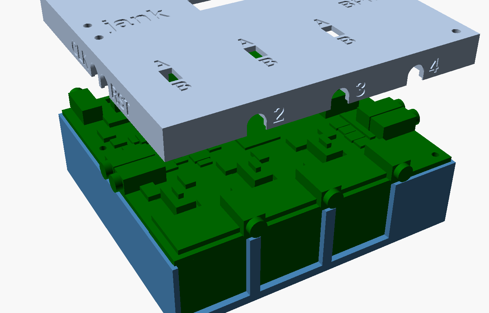

# jank box: the printed box of the jank board (modular v5c)

The box for the **modular** board in [`../pcb`](../pcb/README.md) (`jank-pcb-mod`, v5c), **87.0 x 79.5 mm**.

**The board's top (the lid side):**
- the XIAO, the 0.91" OLED, OK, BACK, the encoder, the beat LED;
- the four MIDI jacks (XKB PJ-320D-B-SMT), each **beside** its DIN;
- the four mono CLOCK / RESET jacks (XKB PJ-320A) on the side edges;
- the A/B switches (SW2 surface-mount, SW3..SW5 through-hole).

**Its bottom:** the four DINs (HOOYA DIN-504B-M10), 19.6 mm deep, so the board stands about 20 mm above the floor on
them.

**Outputs:** OUT2, OUT3, OUT4 on the front, **2, 3, 4 left to right** seen from the front with the lid up. OUT1 is on
the back beside the XIAO's USB-C and the power USB-C.

OpenSCAD, parametric, one build. Every STL is one closed manifold solid.

> **Stage: designed and checked in OpenSCAD only (2026-11-09).** Nothing printed, no part measured. Every number marked
> *unverified* comes from a drawing or an estimate.

**First requirement (the user's ruling, 2026-11-08):** plugging and unplugging loads the box, not the solder joints, on
every jack and every DIN. **Connectors at the wall (the user's ruling, 2026-11-08/09):** see "Connectors at the wall"
below.



## Files

| File | What |
|---|---|
| `jank_box.scad` | The box, the lid, the caps, the knob, the wall test strip, the checks (`part` picks the output) |
| `make_stl.sh` | Exports the STLs, runs the checks, renders the PNGs, runs `../check_stl.py` |
| `stl/jank_box_box.stl`, `stl/jank_box_lid.stl` | The base and the lid, in print orientation |
| `stl/jank_box_button_cap.stl` (print 2), `stl/jank_box_slider_cap.stl` (print 3), `stl/jank_box_slider_cap_smd.stl` (print 1), `stl/jank_box_knob.stl` (print 1) | OK / BACK caps, the A/B slider caps (SW3..SW5, SW2), the encoder knob |
| `stl/jank_box_front_test.stl` | A 23.0 mm strip of the front edge as built: one DIN window and one jack slot; try the parts first |
| `renders/open.png`, `box.png`, `front.png`, `back.png`, `left.png`, `right.png`, `lid_underside.png`, `lid_top.png`, `caps.png` | The box with the board (lid lifted), the empty base, the four sides, the lid as printed, the lid's top with its labels and caps, the closed box |

```
sh hardware/box/make_stl.sh               # about 15 s
```

## Size

**Outer: 89.0 x 81.5 x 32.0 mm** (X x Y x Z, lid included).
- **X:** 1.0 + board 87.0 + 1.0.
- **Y:** 1.0 + board 79.5 + 1.0.
- **Z:** floor 2.0 + 0.1 + DIN 19.6 + board 1.6 + **7.2** to the lid's inside + lid 1.5.

**Standing out (not counted):**
- the MIDI jacks' bushings 1.5 mm (front and back), the side jacks' bushings 1.0 mm;
- the XIAO's USB-C 0.5 mm (back);
- the knob 13.3 mm, the button caps 3.0 mm, the slider caps 1.0 mm above the lid.

**Parts to print:** box, lid, 2 button caps, 3 + 1 slider caps, 1 knob (and `front_test` first).

## Connectors at the wall

**How:** on every edge (all four carry connectors) **the board's edge comes 1.0 mm inside the box's outer face**
(`edge_in`). The wall there is in two parts:
- **the base's wall** from the floor up to the board's bottom, 1.9 mm (1.0 outside the board, 0.9 under it);
- **the lid's skirt** from the board's top up to the lid, 2.3 mm (1.0 outside the board, 1.3 over it).

The board's 1.6 mm edge is clamped between them (0.05 design gaps) and screwed at H1..H4.

**Where each connector face ends up** (measured on the board model in the box):

| Connector | Its face | Distance from the outside | Why |
|---|---|---|---|
| MIDI jack body (front, back) | 0.5 past the board's edge | **0.5 mm inside**, the bushing **1.5 mm proud** | the skirt keeps a **0.4 mm web** in front of the body (0.1 gap): the pull-out bears on it |
| DIN plate (front, back) | 1.0 behind the board's edge (the footprint's `DIN_BACK`) | **2.0 mm inside** | see the note below |
| CLOCK / RESET jack body (sides) | on the board's edge | **1.0 mm inside**, the bushing **1.0 mm proud** | a 0.9 mm web in front |
| XIAO USB-C | 1.5 past the board's edge | **0.5 mm proud** | |
| Power USB-C (J1) | on the board's edge | **1.0 mm inside** | |

**Note on the DINs: flush jacks and flush DINs together are not possible.** On the v5c footprint the DIN's plate is 1.0
mm behind the board's edge and the MIDI jack's front 0.5 mm past it, so the two faces are 1.5 mm apart in depth. With
the board's edge 1.0 mm in (the brief's number):
- the jacks get a 0.4 mm web in front (pull-out braced) and 1.5 mm proud bushings;
- the DIN plates end **2.0 mm** behind the outside, not flush.

To make the DINs flush instead, the base's wall would have to step 2.0 mm in from the skirt (a stepped box), or the
footprint's `DIN_BACK` change. That is *the user's call*; `edge_in` is one parameter.

**The DIN window:** each DIN shows through a **19.9 x 19.1 mm window** in the base's wall. The window is the plate's
20.9 x 19.6 face less a **0.5 mm lip** on its two sides and its floor edge. The lip takes the pull-out (1.9 mm thick).
The window is open at the top to the board, and the plate slides down behind the lip when the board goes in. The
plate's own socket opening is the plug's way in. OUT2's plate is flush with the board's left edge, and the left base
wall leaves it room.

**Print and fit:** the skirt's jack slots are open downwards: round at the bushing's axis, 5.2 mm, 2.5 mm above the
board. The XIAO's opening is open full height through the lid's edge. J1's opening is 12.5 x 5.15, open downwards.

## Bracing

| Part | Pull-out | Push-in | Down / up | Sideways |
|---|---|---|---|---|
| **DIN** (HOOYA: plate 20.9 x 19.6 x 1.8, body to 13.6) | the plate's front on the window's 0.5 lip (sides, floor edge) | the body's back on a **lip** from the floor (1.4 mm, 20.9 wide, to 5.0 mm under the board) | the plate's far edge on the floor (0.1); the board above | the lip round the window |
| **MIDI jack** (PJ-320D-B-SMT, 6.0 x 12.2 x 5.0, front 0.5 past the edge) | the body's front on the skirt's 0.4 web (0.1) | the body's back on the **lid's cap** (back stop 1.6, 0.15) | the board below, the cap's roof above | the cap's cheeks; the bushing in its slot |
| **Side jack** (PJ-320A) | the body's front on the skirt's 0.9 web (0.1) | one **cap per side wall** round both jacks (6.7 apart) | as above | as above |
| **The board** | | | clamped all round between the base's wall (0.9 under it) and the skirt (1.3 over it); four M2 x 20 into webbed columns | the walls (0.1 at the connectors) |

**Unverified:**
- The jacks' webs (0.4 at the MIDI jacks) take a 3–20 N pull together with the jacks' own SMD pads and pegs; *not
  computed*.
- The DIN lip stops 5.0 mm under the board; *unverified* that the DIN's 2-pin legs stay within that.

## Lid

**Height:** inside 7.2 mm above the board, 1.5 mm thick. The XIAO's 7.0 sets it.

**Openings** (KiCad coordinates, y from the back):

| Opening | Centre | Size | Note |
|---|---|---|---|
| OLED window | 45.0, 28.55 | 24.4 x 7.6 | the glass 2.1 under the lid |
| BACK, OK | 69.15 / 78.75, 25.45 | 6.0 round | the button caps' 5.4 stems |
| Encoder | 73.9, 38.7 | 7.0 round | under the 14 mm knob |
| LED | 33.0, 4.2 | 3.5 x 3.7 | a shroud to 0.3 over the LED, a 0.6 mm skin over it (`led_skin`): print the lid translucent |
| SW2 (OUT1, surface-mount) | 17.5, 8.1 | **6.0 x 3.5**, along x | the cap (3.15 square) and its 1.5 travel along x, 0.175 round |
| SW3..SW5 (OUT2..OUT4) | 10.45 / 33.45 / 56.45, 60.5 | 3.5 x 6.0, along y | the cap (3.15 x 3.65) and its 2.0 travel |
| Screws H1..H4 | (83.8, 3.2), (83.8, 76.3), (3.2, 26.0), (3.2, 34.0) | 2.4 | **4 x M2 x 20 self-tapping** through the lid, a 5.0 spacer, the board, 9.7 into a column |

**Under the lid:** the skirt, the jack caps, the spacers, the LED shroud, and a rib over the OLED module's far end. The
far end has nothing under it: **User puts a 2.5 mm foam pad there.**

## Printed caps and knob

| Part | Shape | Fit | Print |
|---|---|---|---|
| **Button cap** (2) | a 5.4 mm stem 3.0 above the lid; an **8.0 mm flange, 1.0 thick, 0.3 under the lid**; a **blind bore 3.45 mm**, 3.6 deep, on the plunger | +0.05 on the 3.4 plunger: a light press once printed | flange on the bed |
| **Slider cap** (3, SW3..SW5) | 3.15 x 3.65 block, 1.0 above the lid, a **pocket 1.55 x 2.05 x 1.3** | +0.05 on the 1.5 x 2.0 handle | top on the bed |
| **Slider cap, SMD** (1, SW2) | 3.15 x 3.15 block, 1.0 above the lid, a **pocket 1.55 x 1.55** to the knob's top (3.2 + 3.0) | +0.05 on the 1.5 knob; **the knob's length along its travel taken as 1.5: unverified** | top on the bed |
| **Encoder knob** (1) | 14 x 12, a **D bore 6.1 / 4.6** (the shaft's 6.0 / 4.5, *unverified*), 10 deep, a pointer groove | 0.1 play | top on the bed |

## Markings

0.4 mm deep, Liberation Sans Bold, capitals 4.0 mm. **Controls on the lid's top, plugs on the walls, each once.**
- **Lid:** BACK and OK above their buttons, BPM under the knob, A / B at the ends of each slot (SW2's left and right),
  "jank" at the left.
- **Front (on the skirt):** "2", "3", "4" right of each jack.
- **Back:** "1 / IN" beside OUT1's jack (skirt); "USB" under the XIAO and "PWR" under J1 (base's wall).
- **Sides (on the skirt):** "CLK" and "RST" beside their jacks.
- **Caveat:** which end of a slot is A is not verified (`ab_a_end`, `ab_a_end_x`). Check each switch with a meter.

## Checks (`make_stl.sh`, last run 2026-11-09, OpenSCAD 2026.10.11, manifold)

The board model is `../pcb/mockup-mod.stl` (v5c), with the buttons, the A/B switches (body plus the knob over its
travel) and the OLED redrawn.

| Check | Must be | Result |
|---|---|---|
| `check_box`: the base against the board and every part | empty | empty |
| `check_lid`: the lid (skirt, caps, shroud, spacers) against the board and every part | empty | empty |
| `check_lidbox`: lid against base | empty | empty (the board is between them) |
| `check_drop`: the lid lowered straight down over the board and the caps | empty | empty |
| `check_board_drop`: the board lowered straight into the base (the DIN plates behind their lips) | empty | empty |
| `check_text`: labels clear of every opening, slot, cavity and keep-out, inside the edges | empty | empty |
| `check_caps`: caps at rest / pressed / both ends of travel against the lid, the board, the shaft; each knob in its pocket | empty | empty |
| `brace_caps`, `brace_pull` (DINs on the lips), `brace_pull_jack` (MIDI jacks on the webs), `brace_push`, `brace_trs`, `brace_floor`, `brace_lid`, `brace_ledge` | contact | contact |
| `brace_side_pull` / `brace_side_push`, each side jack | contact | 8 of 8 |
| `check_stl.py` (box, lid, button cap, both slider caps, knob, front_test) | OK | OK: one body, 0 open edges, 0 non-manifold each |

**Negative controls collide as they should:**
- `gap_out = -0.05` (a jack body into its web);
- `band_in = 2.0` (the skirt onto the DIN legs);
- `base_in = 1.1` (the base's wall into the DIN plates);
- `standoff_d = 6.0`.

## Print

| Part | Orientation | Supports |
|---|---|---|
| box (base) | floor on the bed | none: the DIN windows are open at the top |
| lid | top face on the bed | none: the skirt's slots and openings are open at its free edge |
| caps, knob | as listed above | none |
| front_test | standing on its foot | none |

PETG or PLA, 0.2 mm layers, 4 perimeters, 25 % infill.

## Assembly (who does what)

1. **User solders the board** (board README).
2. **User prints** `front_test.stl`. Check that a DIN plate slides behind its lip and that a plug seats with the plate's
   face 2.0 mm in. Check that a jack's bushing comes through the skirt's slot with its body against the web.
3. **User puts** a 2.5 mm foam pad under the OLED's far end, and presses the button caps onto OK and BACK and the slider
   caps onto the four A/B knobs.
4. **User lowers** the board straight into the base. The DIN plates slide down behind their lips onto the floor, and
   the board's edge comes to rest on the base's wall and the four columns.
5. **User lowers** the lid straight down. The skirt comes down over the bushings and onto the board's edge, and the
   caps come through their openings.
6. **User screws** 4 x M2 x 20 self-tapping at H1..H4, snug only. Then the knob on the encoder.

## Unverified, all in one place

- **The DINs:**
  - the 2.0 mm recess of their faces (flush would need a stepped base or another `DIN_BACK`, above);
  - a plug seating with the face 2.0 mm in;
  - the HOOYA's body height and width behind the plate (taken as the plate's) and its 2-pin legs within 5.0 of the
    board.
- **The jacks:**
  - the PJ-320D-B-SMT's body (the mockup's 6.2 x 12.2 x 5.0) and its 5.0 bushing;
  - the 0.4 mm web's strength.
- **SW2:** its knob's length (1.5 taken), its travel direction, which end is A.
- **The board:**
  - its outline against the 0.1 mm gaps at the connectors (JLCPCB ±0.2: the board's edges are clamped, not fitted
    between walls, so the gap only limits how far the board can shift before a connector bears);
  - the mockup's positions (the PCB files are the board session's).
- **Other:** the XIAO's 7.0 height, the OLED's heights, the encoder's 6.5 and 20, the buttons' 3.5 body, the cap press
  fits, the EC11 D flat, M2 into PLA, the USB overmold sizes, the font.
