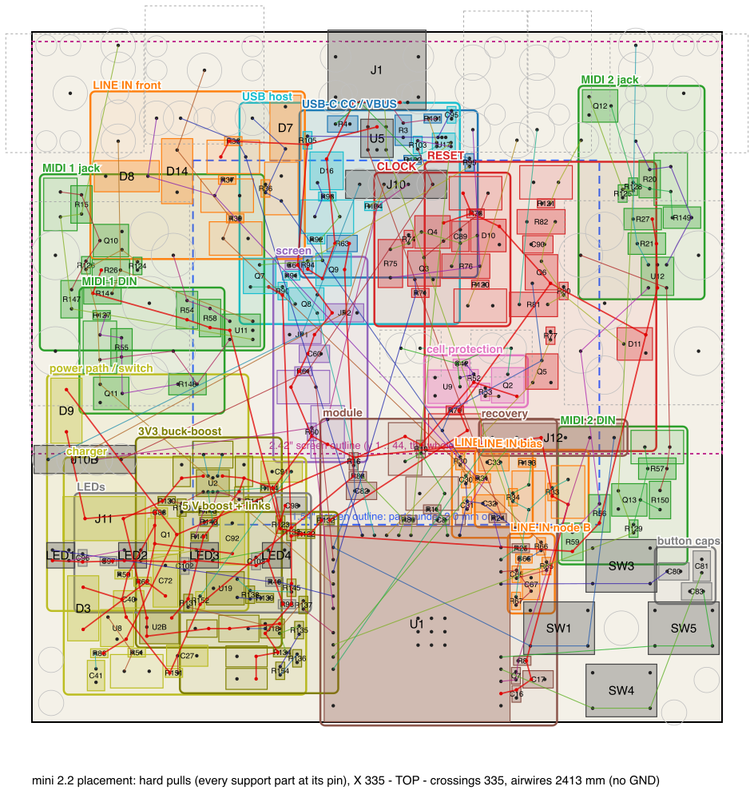

# jank mini 2.2: one board, two orders (USB only, or with a 1S cell), two MIDI OUTs, LINE IN with plug detect, CLOCK / RESET outs, a D-pad over 4 buttons, LEDs or a screen, u.FL (branch hw/mini2.2)

**Stage 2 + review pass 1 (2026-11-15, 72 x 72 mm): placed, routed, simulated, the fab files written; NOT ordered, NOT built, NOT measured.**
`mini2.kicad_pcb` is the routed board; `fab/` holds the Gerbers and both orders' BOM / CPL; `sim/` the simulations;
`case/` the case. Each stage's section supersedes the older ones where they differ (2, 1f, 1e, 1d, then 1c); "mini 2.2
(stage 1)" and "1b" are superseded (the encoder and the RGB LEDs are gone); everything after them is mini 2's text.

## DIN-504B-M10 and PJ-320A pinouts: checked on paper (2026-11-15), confirm with a meter

Review pass 1's M5. A pinout agent checked the makers' drawings, EasyEDA's footprints, independent SDS-50J footprints
and CA-033 / DIN 41524, counting the bottom-side flip once (pictures: `~/GitHub/jank/worktrees/pinout-scratch/out/`).
Its verdict: **all correct**, so no swap jumpers.
- **DIN-504B-M10 (J5 / J6):** DIN 4 = pad 4 (the source, MD_R / MD2_R), DIN 5 = pad 2 (the sink, MD_T / MD2_T), DIN 2 =
  pad 3 (GND); pad 1 = DIN 3, pad 5 = DIN 1, pads 6 / 7 the shell.
- **PJ-320A (J13 CLOCK, J14 RESET):** the tip = contact D (CLK_OUT / RST_OUT), A = the sleeve (GND); **B is a second
  ring spring, not a switch**; C the ring.
- **PJ-307C:** the tip = pad 5, the ring = pad 2 (Type A), LINE IN's detect switch as wired.
- Still worth a meter on the first socket and jack before soldering a batch.

## Before ordering (checklist)

- The DIN / PJ-320A pinouts above: a meter on the first socket and jack.
- **JLC's placement preview** (review pass 1, LOW 9): the orientation of every IC (U1 the module, U2, U5, U6, U7, U8, U9,
  U11, U12, U15 .. U19), FET (Q2 .. Q13), diode (D3, D7 .. D11, D14, D16), LED (LED1, LED2), L4 / L5 and J1, before paying.
- `sh case/make_stl.sh` re-run on the final board before printing (review pass 1, LOW 5: **not re-run** this round (the coordinator: the STLs come later); J4 moved under the RF line, the case reads it (`place_args.py`)).
- **Check every cell's polarity** with a meter (pin 1, the square pad, = +) before plugging it: see "a reversed cell"
  below.
- The tantalums C86 (+3V3, battery order), C27 and C91 (VBUS): JLC's preview must show their band (+) on pad 1.
- The firmware (review passes 1 and 2, updated 2026-11-15): the brown-out detector on; **the cell "empty" at 3.3 V
  under load** (the TPS63802 buck-boost holds +3V3 to the end: sim/power.py; the 3.6 V / 3.7 V rules and the 2.42"
  switch-on rule are gone with the LDO); **the USB pull-up (D+) only while VBUS_SENSE (GPIO14) is high** (Espressif's
  self-powered device rule); the cell's ADC reading calibrated once per board against a meter.
- **The firmware, 2026-11-15 (required changes):**
  - **Flash: the WROOM-1U-N8R2 has 8 MB** (+ 2 MB quad PSRAM for the heap, BLE MIDI): usbaudio's `partitions_usb.csv`
    (2 x 2 MB OTA slots + a 2 MB FAT drive, 6.1 MB) fits again; the FH4R2's 4 MB plan (streaming the drive into the spare
    slot) is no longer needed. Today's images: 1.05 MB (build-xiao), 1.28 MB with BLE.
  - **LED_DATA is GPIO38** (2026-11-15 GPIO re-map: "The GPIO map" is the pin map).
  - **The digital LINE IN** (2026-11-15): the ADC's continuous pattern at 83,333 Hz with 12 entries,
    **[tip, sense] x 5 + [tip, cell]**: tip = GPIO9 (ADC1_CH8, node A), sense = GPIO8 (ADC1_CH7, node B), cell = GPIO10
    (ADC1_CH9); ATTEN3 (0 .. 2.9 V; both nodes centred at 1.467 V). The signal is A - B: **the sense samples are skewed
    by one ADC slot against tip: correct them with a 16-tap half-sample delay filter**; **subtract each slot's own offset**
    (A and B's DC from the bias, measured with no plug or averaged); **interpolate the missing sense sample** in the
    [tip, cell] slot; an optional per-board gain calibration (A against B, a test tone on the sleeve). The tip runs at
    41.7 kHz, the sense at 34.7 kHz; the anti-alias pole 13.3 kHz (-5.4 dB at 20.8 kHz). LIN_DET (GPIO48).
  - **The RGB LEDs** (GPIO38, WS2812B-2020 GRB, 800 kHz: RMT) run from the 5 V aux rail (VLED ~4.9 V): no dropout rule.
  - **MIDI OUT: invert the UART TX** (`uart_set_line_inverse(port, UART_SIGNAL_TXD_INV)` on UART1 / GPIO37 and UART2 /
    GPIO42): the pins drive the 2N7002s of the 5 V loops (idle low = no current). Drive strength no longer matters. If
    the escape hatch back to the 3.3 V drive is used (R122 / R123, R126 .. R129), un-invert it.
  - **The 5 V aux rail** (U18, the TPS61023): **GPIO41 (V5_EN_IO) switches it**; R131 100 k to +3V3 keeps it ON while
    the pin floats (reset, boot, erased firmware). Drive it low to turn the LEDs, the MIDI loops, CLOCK / RESET and the
    host signal off (at the cell's cutoff, in sleep: `gpio_hold_en` + `gpio_deep_sleep_hold_en`, GPIO41 is not an RTC
    pin). Hatch: lift R137 (0 ohm) and the rail is on for good. Turn it off only with HOST_EN low and the LEDs dark.
    **The charge pump is gone: no LEDC on GPIO35 (pump.c), no pump warm-up**; CLK / RST can be driven at once (0 / ~4.4 V
    into 10 k, ~4.85 V into 100 k: sim/cv.txt; the user accepts it in place of the earlier "5 V+" rule).
  - **USB host mode (battery order only):** the TUSB320LI at I2C 0x47 starts as a sink (PORT low). For host mode write
    DRP + Try.SRC (MODE_SELECT, SOURCE_PREF) with DISABLE_TERM set around it (its 7.3.2 sequence); on INT (GPIO13,
    pull-up on) read ATTACHED_STATE: **Attached.SRC (a device) -> HOST_EN (GPIO47) high and the S3's USB-OTG in host
    mode; anything else (detached, Attached.SNK: a charger or a host) -> HOST_EN low first**, then device mode. V5H comes
    from the 5 V aux rail (no pump): **usbport's prep_ms ~0** (the aux rail is already up; the TPS61023's soft start is
    ~0.7 ms after the switch-on: its sheet). HOST_EN never high while unattached (Type-C: no VBUS before an attach). Device mode keeps the review-pass-2 rules (VBUS_SENSE, the D+ pull-up). The
    usb order has no U17 / Q9 (R3 / R4 / R63 fitted): device only.

## Experiment A (2026-11-15, the user's: "fewer part types, no change to how the circuit works")

On Standard every part type pays JLC's loading fee (~$1.53; the quote's $88.35 = 57 types), so the lever is the type
count. Each merge checked against the datasheets and the sims (`sim/`):

| Merge | Verdict |
|---|---|
| R51 12 k 0603 -> 0402 (C25752) | applied |
| R120 / R121 47 ohm 0603 -> 100 ohm 0402 (C25076) | applied; `cv.py` (the sleeve 100 ohm): 4.36 V into 10 k (typ), 4.79 V into 100 k |
| R40 33 -> 22 ohm (C25092) | applied |
| R88 / R89 22 k / 33 k -> 100 k / 150 k | applied; `power.py`: Q1 back on 0.30 .. 0.52 s after an unplug (was 0.16 .. 0.28: VBUS decays slower), D9 carries meanwhile, VSYS min unchanged |
| R136 18 k -> 20 k | applied: V5A 4.85 V (4.72 .. 4.97). `cv.py` 4.36 / 4.25 V into 10 k (was 4.44, the user accepted ~4.5), `midi.py` 5.24 mA typical (5.51), 3.37 mA at the worst corner (3.54), `host.py` 4.40 V into 100 k (4.46); the clamp's overlap with the boost 2 mA at most (was 7) |
| R141 56 k -> 100 k + 12 k (R146), R142 10 k -> 20 k | applied: 3.30 V, R2 20 k (TI: <= 100 k) |
| jack sources 3 x 680 -> 2 x 470; the four 220 ohm sinks -> 470 // 470 (R147 .. R150) | applied; `midi.py` above |
| C5 / C17 22 uF -> 10 uF | **rejected**: the TPS63802 needs >= 7 uF effective at VOUT > 2.3 V (SLVSEI3 8.3) and marks 10 uF nominal "not recommended" with 0.47 uH (Table 10-1); a 10 uF 0603 at 3.3 V is ~5 uF. C17 alone saves no type |
| C89 / C90 4.7 nF X7R -> 2.2 nF C0G (C2991172) | applied; `cv.py`: fall 29 us (57), the switch-on blip 239 mV for a 13.8 us rail rise (138 with 4.7 nF), 813 mV for a 1 us rise (545), 15 mV for the TPS61023's soft start |
| D3 B5819W -> SS34 (C8678) | applied (SMA, 2.3 mm: out from under the screen) |
| C27 / C91 tantalums -> 10 uF 25 V 0805 + 1 ohm each (R151 / R152, R86's type) | applied; `sim/vbus.py` (hot plug, 0.7 uH cable): VBUS peak 5.48 / 5.74 V at 5.25 / 5.5 V (the tantalums 6.08 / 6.37; through 4.7 ohm 6.99 / 7.32) |
| C86 removed | applied: TI's 7 uF minimum is met by C5 alone (~11 uF at 3.3 V); `power.py`'s U2 is behavioural, so it cannot show +3V3's bulk |
| R86 1 -> 10 ohm | **rejected**: the TP4054 sheet asks 1 ohm in series with a large ceramic, no model to test 10; the 1 ohm type stays anyway (R151 / R152) |

## Four beat LEDs (2026-11-15, the user's: "4 LEDs ... 4 beats")

- LED1 .. LED4, WS2812C-2020-V6 (C55109522), chained on LED_DATA (GPIO38, LED1 first), each with its 100 nF (C96,
  C97, C102, C103: the sheet's Cn); beat 1 .. 4 left to right as the user holds it; fitted on **every** board.
- **Where:** one row at y 54.6, x 3.0 / 11.17 / 19.33 / 27.5 (evenly 8.17 mm), turned 180 (DI left, DO right). The
  rule: never under either screen (+ 1.5 mm for the lid's frame): the **2.42"** hangs over y 1 .. 44 across the whole
  width, the **1.54"** over x 16.8 .. 59.2, y 13.4 .. 51.4. So the top edge is out and only the bottom band (y >= 52.9)
  is free across the middle; there the module (x ~31 .. 50) and the D-pad (x 51 .. 72) leave x 2 .. 29 (to the module's
  escape corridor). **An even row across the full width is not possible** (x 45 is the module); a wide uneven one
  would be 9 / 27 left of the module + the D-pad's two upper corners (~54.5 / ~68.5, y ~56): not taken.
- The lid: four holes or light pipes over the row (the case is not rebuilt: J11 moved above the row, rotated).
- **Supply:** all four white = 4 x 3 x 5 mA = 60 mA through R98 10 ohm: 0.6 V (36 mW of its 62.5), VLED >= 4.1 V at
  V5A's low corner (LED minimum 3.3 V); V5A in all ~95 mA (LEDs, four MIDI loops, CLOCK / RESET into 10 k, the host
  signal, the clamp), ~160 mA with every MIDI ring shorted: the TPS61023 (valley limit >= 2.7 A) has room.
  `sim/power.py`'s USB-unplug-in-a-burst case with the aux rail at 100 / 160 mA (was 50): +3V3 held (behavioural U2),
  VSYS min 2.74 / 2.68 V at a 3.3 V cell (2.79 at 50 mA). A beat's flash, a 60 mA step, reaches V5A through R98 / C98
  (~60 us): ~50 mV at most with 13 uF on V5A and a ~10 us boost response (an ESTIMATE, not simulated): ~1 % on the MIDI
  loops' current and on CLOCK / RESET's high. **WS2812B parts** (12 mA a channel, 144 mA) would need R98 ~1 ohm.

## The chain list (2026-11-15, the user's items 1-4: values already on the board, chained)

| | Change | Check |
|---|---|---|
| 1 | R98 4.7 ohm 0603 -> 10 ohm 0402 (R145's type) | the LEDs' RC 100 us; 0.3 V at 30 mA (both LEDs full): VLED >= 4.4 V |
| 2 | R60 / R61 3.3 k -> 2.2 k (R93's type) | inside the user's 2.2 .. 4.7 k; 1.5 mA sink |
| 3 | R138 / R139 47 k -> 20 k / 20 k, R92 47 k -> 20 k | the clamp's ratio unchanged (5.0 V), its REF current's error smaller; `sim/host.py`: Q9's gate 0.36 V in device mode (0.77), the host signal unchanged, +0.14 mA from V5A in host mode |
| 4 | R34 -> 100 k + R153 20 k (RT34 kept across the 100 k), R135 -> 100 k + R154 20 k | both exactly 120 k; `sim/linein.py` re-run |

Part types: battery order 57 (the JLCONE quote) -> 44 (experiment A) -> **40**; usb order 48 -> 39 -> **36**. `fab/cost.md`
re-prices it at Standard with the quote's fees: **USD 201.49 for 10 battery boards** (the quote: 233.20 for the old
BOM); a full board (DINs, 1.54" screen, the hand parts) 28.95; shipping, taxes and cells not included.

## Review pass 3 (2026-11-15, an adversarial review + the first real JLCONE quote): applied

| Finding | Change |
|---|---|
| **The order is Standard only.** JLCONE: U1 (every ESP32-S3 module at JLC), U17 and the WS2812B-2020 are "Standard only"; the dummy board (placed, no tracks, 10 pcs, battery order) **$233.20**: PCB $6.40, PCBA $226.80 (setup $25.75, stencil $8.27, parts $94.56, **feeder loading $88.35**, SMT $9.36, packing $0.51); shipping and the hand-soldered parts not included | `fab/cost.md` at the Standard tier, on that quote |
| JLCONE left LED1 / LED2 (C52917434) unselected | **WS2812C-2020-V6, C55109522**: the same land (its EasyEDA footprint, the same four pads), pins (1 DO, 2 GND, 3 DI, 4 VDD), VDD 3.3 .. 5.3 V and VIH 0.55 VDD (both World Semi sheets); 5 mA a channel instead of 12, so dimmer (green 250 .. 400 mcd against 425 .. 1700) |
| U19 (CJ431): the TPS61023 passes VREG through when VREG > 4.91 V (SLVSF14B 7.3.5); a 5.4 .. 5.5 V charger put V5A over the clamp's 5.11 V and nothing limited U19 (150 mA / 300 mW) | **R145 10 ohm** (C25077, Basic) in series with U19's cathode, the divider on the cathode, **R138 47 k** (5.0 V, 4.95 .. 5.05): `sim/clamp.py`: U19 <= 165 mW at VREG 5.3 V (was 2.7 W), the worst double fault V5A 5.17 V (WS2812: 5.3 V max; was 5.32), 7 mA through it at the boost's +2.5 % corner |
| J8 / J9 in parallel, outside Q2 / the XB5353A: a reversed second cell shorts into the first (H2 below) | **not changed: the user's own ruling (two cells, the risk accepted)**; the user decides again (one socket, or both with the risk) |
| TUSB320 alternatives (HUSB320 C7471906, WUSB3801Q C2931342) | **kept the TUSB320**: neither is register-compatible (HUSB320: I2C 0x42 / 0x62, its own register map; WUSB3801: 0x60 / 0x68, its own map) |
| `sim/power.py` models the TPS63802 as ideal (+3V3 held while VREG > 1.8 V) | for review pass 3: TI's models if obtainable, else stated as behavioural |

## Floorplan (2026-11-15, the user's: "a FRESH FLOORPLAN of the whole board ... block by block"; approved)

 (`floorplan-bottom.png`: the bottom, seen from below)

- **Fixed:** the 72 x 72 outline, the jacks (J2, J3, J7, J13, J14), the DINs, the USB-C and U5 under its data pads, J10 /
  J10B, the cells' sockets, the buttons under the cross, the LEDs under their window.
- **Placed by blocks:** 23 blocks (each MIDI connector's parts, CLOCK, RESET, LINE IN's front end, node A, node B and
  bias, the 3V3 buck-boost, the 5 V boost with its links, the charger, the power path, the USB-C's CC / VBUS parts, the
  host, the screen's, the cell's protection, the module's, ...), each started where its nets go, then the placer
  (`placer/`, simulated annealing) moved the parts: fewer ratsnest crossings, short weighted airwires (switch nodes,
  converter inputs, LINE IN's high-impedance nodes, the USB pair, feedback), decoupling and hatch lands pulled to their
  pins, each block kept together. **Hard rules:** courtyards 0.15 apart (twins 0.35), 0.8 mm round every through-hole
  pad, the D-pad's pivot and the lid's four feet clear; **nothing 2.0 mm or taller under the 1.54" screen's outline**
  (x 16.8 .. 59.2, y 13.4 .. 51.4: the module, the SMA diodes); **LINE IN's parts >= 10 mm from both converters**; a
  free escape corridor beside the module's pin rows (only its decoupling, EN RC, ADC cap and USB resistors there); J11
  by the left wall.
- **Where:** the module bottom middle, turned 180 (its u.FL to the bottom wall); the power block lower left (J11, the
  power path, the 3V3 buck-boost in the corner, the 5 V boost toward the module, the charger above toward the cells);
  the cell's protection between the sockets; the USB-C's parts and the host under the USB-C, the screen's under J10;
  CLOCK / RESET under their jacks; each MIDI connector's parts by it; LINE IN's front end by J7, its nodes and bias by
  the module's pins 17 / 12; the button caps by the cross.
- **The module's pins** (the user's pick, the option the placer offered): each signal moved to the pin that faces its
  block, within the rules in "The GPIO map". **Ratsnest crossings (GND left out): 620 before, 278 with the old GPIO map,
  242 with the re-map**; airwire 2818 -> 2338 mm.
- **Hard pulls (2026-11-16, the user's: "fix the PLACER, re-place, and do ONE clean route"):** a legality rule, not a
  weight. A 2-pad R / C whose non-GND nets go to one IC's pins only (not to a button) sits with each such pad within
  6 mm of its pin, pad to pad (`model.HARD_MM`). A part joined to a pulled one by a net with no IC (a divider's upper
  leg) sits within 4 mm of it (`CHAIN_MM`). The explicit list sits within 3.5 mm (`HARD_EXPLICIT`, `HARD_EXTRA`):
  U1 EN (C7, R8) and 3V3 (C16, C17); the USB resistors R24 / R25; the CC resistors R3 / R4 at J1; U2's FB / EN / MODE
  parts; R86 at U8 BAT, with C41 at R86; C40, C42 and C95 at their pins; each LED's cap. The 100 uF VSYS reservoirs
  C72 / C92 sit within 10 mm (`BULK`). The converter templates keep a 0.8 mm ground ring (`GND_RING`): only their own
  pulled parts go inside it. `placer/fix.py` lifts every pulled part off the board, places it at its pins, and
  re-places the parts it displaced. When a pulled part has no room, the small parts round its pins step aside
  ("make room"). If that fails, the whole cluster of pulled parts at those pins is re-placed together, in up to 40
  orders. A cool anneal follows. **Before -> after: 34 of 66 pulls over -> 0** (R8 23.3 -> 2.8 mm, C16 22.9 -> 1.7,
  C17 21.8 -> 3.5, C7 19.3 -> 1.6, R86 16.3 -> 2.8, R3 11.9 -> 2.6); **crossings 282 -> 335** (the price of pinning
  about 60 parts). Re-run: `python3 fix.py IN.json out.json 150000 8 1.0`, then `FIX_TOUCH=1 python3 fix.py out.json
  out2.json 300000 11 0.5` (a cooler anneal that moves only the illegal parts back), then `FIX_TOUCH=1 python3
  fix.py out2.json place.json 0`.
- `floorplan.json` holds every movable part's place (absolute mm, rotation); `make_board.py` reads it (FLOOR=none: the
  old PLACE / AUTO). Re-run: `cd placer; python3 init.py A start.json; python3 run.py start.json out.json 400000 3 6
  0.1; python3 export.py out.json ../floorplan.json; python3 render.py out.json ../floorplan` (`board.json`: the
  parts' dump, `dump.py` with KiCad's Python; `place.json`: the placement in use).
- `freeroute.py`: no tracks on top only over the module's EPAD (+ 1.6 mm): Espressif's ESP32-S3 Hardware Design
  Guidelines set no rule for tracks under a module's body (the antenna keep-out is for PCB-antenna modules).

## Review pass 2 (2026-11-15): the fixes on 3cec628 (`FIX-PASS2.md`; the user's answers in it)

Supersedes the pass 1 text below where they differ. Sim numbers: Claude's runs of the independent sim pass's decks
(`~/GitHub/jank/worktrees/sim-pass2/decks`, its models, its worst corner) and `sim/power.py`.

| Finding | Fix |
|---|---|
| **M2** the LDL1117's stability plot stops at 22 uF (49 uF of ceramics + 200 uF of tantalum on the board); the user can't bench-test | **U2 = TI TLV75733PDRVR** (C2868428, Extended, $0.34; SBVS322A: 1 A, VO +-1.5 %, dropout 475 mV max at 1 A, Iq 25 uA, **COUT 1 .. 200 uF in its recommended operating conditions**, WSON-6 with a pad, theta-JA 100 C/W: +27 C at 0.27 W on USB). +3V3: the ceramics (49 uF) + **one** 100 uF tantalum (C86) = ~150 uF, inside. The unplug ride-through moved partly to the LDO's input: **C72 + C92, 2 x 100 uF X5R on VSYS** (C15008, Basic, battery order). **D15** (B5819W, +3V3 -> VREG): TI's reverse-current note (a large COUT with the input collapsing: the toggle off with the S3 asleep) |
| sim FAIL 1 / 2 (low cell), the user's Q1 (c) | **D9 = SS34** (C8678, Basic, SMA: a lower drop for U15's 40 .. 90 us turn-on) and **the firmware's empty at 3.6 V under load**. Worst corner (VO -1.5 %, 475 mV, VON -250 mV, the Schottky at VF max (a B5819W stands in for the SS34: conservative), caps -20 %), the sim pass's load + 30 mA for the OLED, a 3.6 V cell, U15's tON 40 / 90 us: **+3V3 3.09 / 3.02 V at the USB unplug** (was 2.92 / 2.87 V at 3.5 V on 3cec628); the cell alone at 3.45 V and up stays >= 3.0 V. RP2_POWER |
| sim FAIL 5 (USB 556 .. 752 mA while charging in a burst) | **R51 12 k: ~83 mA charge** (C22790, Basic): 83 x 1.1 + 340 + 28.5 + 30 = **~490 mA worst**. ~6.5 h for a 550 mAh cell, ~3.5 h for 300 mAh, + the CV tail. RT51 (a 12 k there: ~167 mA) for a strong supply |
| sim FAIL 6 (CLK / RST 4.82 V worst into 10 k) | **accepted** (the user's). For the record (sim): R74 / R80 47 k: 4.97 V; the 1 k pair halved: 5.04 V; both: 5.20 V (slower falls; the halved pair over its rating at -12 V) |
| sim FAIL 7 (the 2.42" turn-on on the cell) | **The 2.42" kept on J10B (the user's: it costs nothing, pads only); the 1.3" dropped (J10 takes the 1.54").** A firmware fix suffices (sim, worst corner): switch the module on only while Wi-Fi is idle and set the empty at **3.7 V** when a 2.42" is fitted: switch-on 3.07 V, all white in a TX burst 3.07 V. Switched on during a burst it dips to 2.70 .. 2.90 V at 3.6 .. 3.8 V (the boost's ~470 mA start, ASSUMED): see "Screens" |
| **M1** no VBUS sense; sim 17 phantom VBUS 2.5 .. 2.7 V | **U5's REF moved from VUSB to +3V3** (the S3's D+ pull-up no longer reaches VBUS) and **VBUS_SENSE: R88 22 k / R89 33 k to GPIO38** (C25768 / C25779, Basic; 5 V -> 3.0 V, 4.35 V -> 2.61 V; GPIO38 has no power-up glitch). Firmware: the pull-up only while it is high |
| **L1** hot-plug ring: VSYS 6.30 V (LM66100 6.0 V abs max), usb VREG 6.46 V | **C27 + C91: two 10 uF 16 V tantalums on VBUS** (TAJA106K016RNJ, C7171, Basic; their 3 ohm ESR damps the cable's LC): 5.5 V source, 1 uH, caps -20 %: **VSYS 5.53 V, VREG (usb) 5.34 V**. ~+100 uC of USB inrush (the known, accepted FAIL). Re-run 2026-11-15 on the same decks with the VSYS bulk: VSYS 5.40 V (usb order, R63) / 5.11 V (battery order, Q9's 60 mohm in R63's place) |
| **L2** U15 without its output cap | **C88 1 uF** VSYS at U15 (C52923, Basic, battery order) |
| **L3 / sim 18** GPIO35 floating into U13 | **R87 100 k** PUMP_IO to GND |
| **L4 / sim 19** GPIO17's 60 us power-up low (a stray MIDI byte) | **MIDI OUT 2 on GPIO40** (MTDO, pin 45: not in the datasheet's Table 2-2 glitch list) |
| **L5** SDA beside LIN_GS | `lin_keep.py` also keeps LIN_GS and LIN_VB clear |
| **L6** dangling stubs | `repair.py` removes whole stubs (any length) until none hangs |
| **L7** the LINE IN sleeve unclamped | **D14 SMAJ5.0CA** LIN_S to GND, by R39 (C19077524, preferred) |
| **L8** crystal CL 6.5 .. 9 pF vs 8 pF | measure the frequency on the first board; trim with CT9 / CT10 |
| **L9** the PJ-307C pegs 0.4 mm from the edge | **J2 / J3 / J7 0.5 mm in** (J7 also 0.4 mm right, clear of J2); the case follows from `place_args.py` (the STLs later) |
| **L10 / L11** stale texts | parts.py and this README |
| the rocker (the user's) | **RS601HL-1010011BB** (C2885782) in cost.py, this README and the case plan (a ~10.5 x 15 mm cut-out instead of the 6 mm hole) |
| **USB host mode** (the user's option A, 2026-11-15; **battery order only**) | jank hosts SELF-POWERED gear and never powers it: a current-limited 5 V "signal" on the connector's VBUS. **U17 TUSB320LIRWBR** (C2836598, Extended, $0.77): the CC logic, a dual-role port, I2C 0x47 on SCL / SDA, INT_N to GPIO39; **unpowered it presents Rd 5.1 k +-20 %** (SLLSEP2D 7.3.3), so a dead cell or the switch off still charges; PORT low = a sink at power-up; VBUS_DET through R94 + R95 2 x 470 k (940 k: TI asks 855 .. 920 k; its 2.95 .. 3.80 V VBUS threshold becomes 3.06 .. 3.94 V). **U16 HT7550-1** (C16106, preferred, 5.0 V +-3 %, 30 V in) from CV_RAIL (the CLK / RST pump) -> V5H; **Q7** (AO3401A) switched by **Q8** (2N7002) from **HOST_EN = GPIO42** (R91 100 k down; GPIO39 is not usable for it: its JTAG pull-up is on at reset); **R93 2.2 k** (twin RT93) + **D16** (BAT54C, preferred, low leakage) onto VBUS. **Q9** (AO3401A, in R63's place): source on the connector's VBUS, drain on the board's, gate on HOST5: on in device mode / off / a dead cell, off in host mode, its body diode board -> connector. (A second LM66100 cannot do this: its OFF state is a diode from IN to OUT, Table 1.) R63 / R3 / R4 are fitted in the usb order only. **sim/host.py** (worst: U16 4.85 V, its 55 mV dropout, a 3.6 V cell, the pump's driver at 25 ohm): VBUS **4.38 V into a 100 k detect load** (4.52 V typical; 3.68 V into 10 k), a **short takes 2.05 mA, CLK / RST 5.24 -> 4.87 V** (R93 1 k: 4.3 mA, 4.50 V; 470 ohm: 7.6 mA, 3.98 V); **a legacy charger (5.25 / 5.5 V) plugged in host mode: nothing back into V5H** (18 uA = the 20 uA of D16 leakage the sim assumes for a hot board), Q9 off (0 .. 0.37 mA through it at 5.5 V) until the firmware drops HOST_EN, then the board's VBUS 5.13 V and the charger runs; device mode: Q9 on with 378 mA through it (30 mV), its gate 0.77 V with that leakage; switch-on with a host plugged: HOST5 under 0.84 V (Q9 stays on). The roles (DRP, Try.SRC, a charger seen as a source) are the TUSB320's datasheet behaviour, not simulated. ~1 cm2 in the band under the screen + U17 by the USB-C |
| **The indicator: two RGB LEDs** (the user's, 2026-11-15; both orders) | **LED1 / LED2 = WorldSemi WS2812B-2020-V6** (C52917434, Extended, $0.086; its sheet: VDD 3.3 .. 5.3 V, **VIH 0.55 x VDD**, 1 uA idle), chained, on **GPIO33** through R40 33 ohm, 100 nF each (C96 / C97); GPIO34 freed; red LED1 / green LED2, R41 and the twins RT40 / RT41 gone. VDD = **VLED: V5A (the 5 V aux rail, since the power change) through R98 4.7 ohm + C98 10 uF** (the user's filter; first VREG). VIH <= 2.7 V at VLED 4.9 V: GPIO33 drives it with no level shifter. (Not taken: the SK6812MINI-E, VDD from 3.7 V, above VREG at the 3.6 V cutoff; a 74LVC1G125 on VREG as a level shifter: TI gives VIH 0.7 x VCC at 4.5 .. 5.5 V and nothing at 3.6 .. 4.5 V.) Hot plug (the sim-pass2 decks with C27 / C91, a 5.5 V source, 0.7 .. 1 uH): **usb order (R63, 0 ohm) VREG peaks 5.37 V, over the LED's 5.3 V: with the filter VLED 5.00 V**; battery order (Q9's 60 mohm and the VSYS bulk) VREG 5.11 V, VLED 4.94 V; 24 mA drops 0.11 V in R98. (The VREG-fed version's limit, VLED under 3.3 V in bursts below a ~3.8 V cell, is gone with the 5 V aux rail.) ~+$4.8 for 10 boards (one fee + the LEDs) |
| **Power: B + C** (the user's, 2026-11-15; POWER-STUDY.md) | **+3V3 from U2 = TI TPS63802** (C2845237) buck-boost from VREG, in the TLV75733P's place (the same fee): +3V3 regulated while VREG > ~1.8 V. **sim/power.py**: USB unplugged in a burst at the worst corner, cells 4.2 .. 3.2 V: **+3V3 min 3.247 V** (typ 3.280), VSYS 2.70 .. 3.78 V; **the cell's empty point 3.3 V** under load. **A 5 V aux rail V5A from U18 = TI TPS61023** (C919459) boost from VREG (4.91 V: R134 1 M / R135 120 k + R136 18 k): the RGB LEDs, the MIDI loops, CLK / RST and the host signal, each through its own 0 ohm link (R98 / R122 / R132 / R133). **One 0.47 uH type for both**: Murata DFE201612E-R47M (C668312, 5.5 A, TI's list). **U19 CJ431** (C3113, Basic) with R138 51 k / R139 47 k clamps V5A at 5.21 V (5.11 .. 5.32 V). Escape hatches: below. The converters' copper >= 12 mm from LINE IN's front end (check_board); the power block at the lower left |
| **CLK / RST from the 5 V aux rail** (the user's, 2026-11-15) | **The charge pump is gone** (U13, C84, C85, C87, D12, D13, R83, R84, R87; GPIO35 free; U13's Extended fee). The stages are as before (2N7002, AO3401A, BAV99, 1 k) on V5C (V5A through R132). **sim/cv.py**: **4.44 V into 10 k, 4.85 V into 100 k** (4.33 / 4.73 V with the boost at -2.5 %); rise 0.21 us, fall 57 us. **+12 V into CLK and RST at once, the rail unloaded: V5A 5.11 .. 5.32 V** (U19 sinks ~11 mA, 60 mW of its 300; each 2 k 24 mW); -12 V: 17 mA, 145 mW in each 2 k (250 mW parts), V5A undisturbed. The WS2812B-2020's 5.3 V is passed by 20 mV only at the clamp's worst-high tolerance in a double fault |
| **MIDI OUT: a true 5 V current loop** (the user's, 2026-11-15) | Every connector its own loop from V5M (V5A through R122): sources 3 x 680 ohm 0805 (jacks, 227 ohm) / 2 x 470 ohm 0805 (DINs, 235 ohm), sinks 220 ohm 0805, a 2N7002 per connector (Q10 .. Q13) on the inverted UART TX, R124 / R125 100 k gate pull-downs; U11 / U12's REF on V5M. **sim/midi.py: 3.54 .. 5.82 mA** in a receiver over the corners (4.79 .. 5.03 V, resistors 1 %, receivers 5 %, 1.2 .. 1.7 V optos, with or without a series diode); a ring / DIN-4 short 22 mA (38 / 54 mW per 0805); the GPIOs drive only gates. Fallback lands back to the 3.3 V drive: below |
| **USB host signal from the aux rail** | V5H = V5A through R133 (U16 HT7550, C93, C94, R97 gone). **sim/host.py**: VBUS 4.46 .. 4.58 V into 100 k, 3.68 .. 3.78 V into 10 k; a VBUS short 2.0 mA, V5A stays at 4.78 V; a charger plugged in host mode: 18 uA back (the assumed D16 leakage), Q9 off until HOST_EN drops; **the aux rail dead: Q9 stays on, 378 mA into the board (device mode and charging unaffected)** |
| **The ESD arrays U5 / U11 / U12** (the user's, the BOM study) | **Hongjiacheng SRV05-4** (C7420376, preferred, $0.085) in the ProTek's place (C85364): its Rev 2.2 pin functions are the same (5 the rail, 2 GND, I/O 1 / 3 / 4 / 6), 5 V, 1 pF. JLC's land for it is the old one turned 90 (pads 2.4 mm apart, not 2.7): its own footprint, U5 at 0 and U11 / U12 at 90 instead of 270 / 0; the drawn USB tracks follow the pads |
| **The power path: Q1 again** (the user's, the BOM study) | **Q1 AO3401A** (Microchip AN1149's load-sharing switch: drain BAT_P, source VSYS, gate VBUS, **R50 100 k** to GND) and D9 (SS34) in the LM66100's place (its Extended fee gone). With the TPS63802 behind it the old Q1's gap no longer matters: **sim/power.py, USB unplugged in a burst, worst: +3V3 min 3.247 V at cells 4.2 .. 3.2 V, VSYS min 2.67 V at 3.2 V** (D9 carries the ~0.23 .. 0.28 s until VBUS has drained and Q1 turns on); the cell alone in Wi-Fi bursts at 3.3 V: +3V3 3.247 V, VSYS 3.09 V. Reverse paths: USB present, the charger off: 9 .. 14 uA into the cell (D9's and Q1's off leakage, the model's); no USB: VBUS 0.04 V (D3's leakage), Q1 stays on; switched off: 27.8 uA from a 4.2 V cell |
| **The digital LINE IN** (the user's, the BOM study) | **U6 LMV321, U7 XC6206 and the op-amp's parts gone.** Two matched passive networks: tip and ring each 20 k + 1 uF into **node A (GPIO9)**, the sleeve through two identical 20 k + 1 uF branches into **node B (GPIO8)**, each node 12 k to the bias (R33 / R34 from +3V3, 1.467 V, C33 10 uF) and 2.2 nF C0G 5 % (C2991172, Extended: no Basic C0G of that value) to GND; R36 / R37 100 k stay (the jack side's DC and the plug detect), R39 100 ohm and the three TVS stay; the matched resistors lose their twins. **sim/linein.py**: A - B = 0.273 x ((tip - sleeve) + (ring - sleeve)); the same signal on both channels clips at +7.6 dBu (one channel +13.6 dBu), +7.1 / +0.9 dBu with a 100 mV / 1 V earth difference; **the analog rejection of an earth difference (5000 boards, 1 % R, 5 % C0G, 10 % coupling caps, a 600 ohm source): 50 Hz median 42.5 dB, 1 % worst 35.3 dB; 1 kHz 43.1 / 35.7 dB; 10 kHz 34.5 / 24.8 dB**; a +-12 V square on the tip: the TVS holds +-7.1 V (49 mA), node A -0.27 .. 3.79 V (the pin's diodes take < 0.1 mA); a steady +-12 V never reaches a pin (the caps). Anti-alias: 13.3 kHz (-5.4 dB at 20.8 kHz); a second RC was not added. Firmware: above |
| **Ground parts** (POWER-STUDY.md 7) | **R39 100 ohm** (C25076), **C67 2.2 nF fitted** (C1531): LINE IN's ground-loop rejection 38.5 / 45.6 / 25.8 dB at 50 Hz / 1 kHz / 10 kHz (sim/linein.py; ~29 dB at 50 Hz at the 1 % worst corner). **R120 / R121 47 ohm 0603** (C23182) from the CLK / RST sleeves to GND with twins RT120 / RT121 (a 0 ohm grounds a sleeve solid) |
| **U1 = ESP32-S3-WROOM-1U-N8R2** (the user's, 2026-11-15, after the FH4R2 below; the u.FL version: the USB-C keeps its edge) | C3013944, Extended ($4.51 at 1, ~$4.00 at 10), 18 x 19.2 mm, turned 180 at (38.6, 61.5): its u.FL toward the bottom edge (the lid's FPC antenna plugs into it, unchanged), its top pin row (LINE_IN, I2C, BTN_UP, MIDI_TX) toward the LINE IN block and the header, USB (13 / 14) at its upper right. **8 MB quad flash + 2 MB quad PSRAM**. Gone with the bare chip: Y1, C9, C10, R17, CT9 / CT10, L2, L3, C23, C24, C26, R19, J4, the RF line, C11 .. C15, C18 .. C22, C28, the EPAD vias (four GND vias round the module's EPAD instead); **4 Extended types fewer** (Y1 C254377, L2 C76769, L3 C87532, J4 C88374). Decoupling per its Figure 9-1: **C17 22 uF + C16 100 nF** by pin 2; EN keeps R8 10 k / C7 1 uF. LED_DATA moved to GPIO35 (GPIO33 is not on the module). No top-layer track or via under the module's body (freeroute.py) |
| **U1 = ESP32-S3FH4R2** (superseded the same day by the WROOM-1U above) | C3013940, Extended, $3.42, in the FN8's place (no new fee): 4 MB quad flash + 2 MB quad PSRAM in the package. Datasheet v2.2: its flash / PSRAM use pins 28 (SPICS1 = GPIO26) and 30 .. 35, all open here; GPIO33 .. 37 are taken only by octal PSRAM (Table 2-14); VDD_SPI 3.3 V and -40 .. 85 C as the FN8; **the same land pattern except a 5.7 mm EPAD** (Figure 7-2): `make_footprints.py` writes the EP5.7 copy; its 9 vias 1.8 mm apart, paste 50 %. **4 MB flash: the firmware's partition table must change** (checklist above) |
| sim 12 / 13 / 14 / 15 / 20 / 21 | notes: R15 at 96 % of its 0805 rating in a tip short (fast corner); 30 mA into a pin in a tip-to-ring short; a 5 V MIDI OUT plugged into ours lifts an idle board's +3V3 to 3.61 V through U11 / U12's REF; the cell ADC: a one-point calibration per board; the TP4054's termination / 8 mV over-charge margin; switched off, 30 .. 48 uA from the cell at 25 C (~100 uA at 75 C) |

### Ground loops: the hum-free way to run jank

jank has three ground paths into other gear: USB (a computer or a hosted device, usually earthed), the LINE IN sleeve (a
mixer) and the CLK / RST sleeves (a modular case). MIDI OUT is opto-isolated at the receiver; Wi-Fi, Link, the jank
radio and the cell are isolated. **For a hum-free rig, run jank on its cell with Wi-Fi / Link or the jank radio, and no
USB cable to an earthed computer.** With USB to an earthed computer and an earthed case on CLK / RST, an earth
difference between them lands on the gate (±0.14 V at 100 mV, harmless; ±1.4 V peak at 1 V: a module with a ~1 V
threshold could false-trigger). There is no USB isolator on the board (cost, size, host mode). The study of lifted
sleeves (LINE IN 100 ohm with the ground-sensing difference input, CLK / RST 47 ohm) and its simulations:
`POWER-STUDY.md`, section 7.

### Escape hatches (the user's rule, 2026-11-15: no bench test, so every risky new block has a hand fix)

**Hard rule (check in pass 3): USB device mode (enumeration, OTA, the rescue path) and charging work with every USB-host
part AND the 5 V aux boost dead, misplaced or removed.** Each fix needs only an iron (the X2QFN U17 and the VSON U2 need
hot air to remove: the links below avoid that). +3V3 itself (U2) is the one supply device mode needs: its fallback is
the U2B land.

| Block | If | Do |
|---|---|---|
| U17 TUSB320 (CC) | it misbehaves, is turned, or is dead | **lift R101 / R102** (CC1 / CC2, by R3 / R4 under the USB-C), **R103 / R104** (SDA / SCL) and **R105** (its VDD), all fitted 0 ohm 0402, by U17: it is out of the circuit (its other pads: GND, VBUS_DET through 940 k, INT_N on a GPIO input). Then **fit 5.1 k 0603s on R3 / R4** (the usb order's Rd lands, empty here): a plain sink that chargers and computers recognise. Unpowered, a healthy U17 presents Rd itself (SLLSEP2D 7.3.3), so a dead cell or the switch off still charges without this |
| Q9 (VBUS isolation) | it fails open or shorted, is turned, or its gate is stuck high (Q7 shorted) | **fit a 0 ohm 0603 on R63** (the usb order's VBUS link, empty here, beside Q9); for a shorted / turned Q9 lift Q9 too. The board then takes VBUS as the usb order. **Also lift R93** (the host signal would otherwise reach the board's VBUS through it) |
| the host 5 V signal | anything on the host side misbehaves | **lift R93** (2.2 k, its twin RT93 empty): nothing of Q7 / Q8 / D16 reaches VBUS; **lift R133** to cut the host side off the aux rail |
| U18, the 5 V aux boost | dead, shorted, or noisy | **GPIO41 low** (the firmware): the aux rail off; by hand **lift L5** (no inductor, no switching; that V5A then stays at 0 V is read from its true-disconnect feature, *unverified*). **Its enable dead or the firmware wrong: lift R137** (GPIO41's 0 ohm link): R131 100 k holds EN high, the rail on for good. Device mode and charging never use it (sim/host.py: the aux rail dead, Q9 still on). A shorted load group: lift its link, **R98** (LEDs), **R122** (MIDI), **R132** (CLK / RST), **R133** (host) |
| U2, the TPS63802 (+3V3) | dead | **lift R130** (its EN link; R140 holds EN low) and **solder a SOT-23-5 3.3 V LDO on U2B** (pin 1 VIN, 2 GND, 3 EN, 5 VOUT: ME6211 / AP2112 / XC6220; VREG in, EN on VIN): today's LDO circuit, empty at 3.6 V again |
| | its light-load bursts reach LINE IN | **lift R143 and bridge R144** (MODE high: forced PWM, at more quiescent current) |
| the MIDI loops | a FET or the aux rail fails | back to the 3.3 V drive: **lift R122, bridge R123** (+3V3 to the sources), **lift the dead FET (Q10 .. Q13) and bridge its land R126 .. R129** (its sink node to its GPIO); the firmware un-inverts the TX (~2.7 mA a receiver) |
| Q1 AO3401A (cell -> VSYS) | fails open | nothing: D9 (SS34) beside it carries the load (0.3 .. 0.45 V lower VSYS, inside the TPS63802's range) |
| | fails shorted (USB would push VSYS into the cell through D3) | **lift Q1** (SOT-23): D9 carries the cell |
| the RGB LEDs | their supply misbehaves | **lift R98** (4.7 ohm 0603): VLED off |
| | they fail (pinout, a dead part) | **lift LED1, solder a 0603 LED across LED1's pads 3 (anode, DI) and 2 (cathode, GND)**, 1.72 mm apart, right under the window, and **swap R40 (33 ohm) for 1 k**: a plain LED on GPIO33, active high |
| the DIN pinout (M5) / the PJ-320A tip | | none: the pinout check (2026-11-15) found both as the footprints have them |

**Routing:** RP2_ROUTE

**Checks:** RP2_CHECKS

**Costs** (`fab/cost.md`): RP2_COST

## Review pass 1 (2026-11-14): the fixes on 60c2f3a (`~/GitHub/jank/worktrees/review-pass1/FINDINGS.md`)

Each fix below supersedes what the stage 2 text further down says about the same thing.

| Finding | Fix (what the board has now) |
|---|---|
| **H1** the HT7833 (SOT-23-5, 500 C/W) ~100 C over ambient on USB; **M1** the AMS1117's 1.1 V dropout (2.93 V from a 4.5 V host); **M2** no cap within 10 mm of the AMS1117 | **One regulator for both orders, U2 = ST LDL1117S33R (C435835)** on the SOT-223 footprint (the AMS1117's pinout: 1 GND, 2 OUT, 3 IN, tab OUT); U10 removed. Its datasheet (DocID030319 Rev 3): 1.2 A, **dropout 350 mV typ / 600 mV max at 1.2 A** (by the R_on reading ~90 mV typ / 150 mV max at 300 mA), **Iq 250 uA** typ, **theta-JA 120 C/W**, stable with ceramics (1 uF in, 4.7 uF out; its plan: 1 .. 22 uF, ESR 0.02 .. 10 ohm). Extended, $0.49 (1 pc), 51k in stock; no Basic or preferred low-dropout SOT-223 at JLC (searched: AP2114H 450 mV typ at 1 A, $0.24; TLV1117LV 455 mV; the AMS1117 / 1117 clones ~1.1 V). **Thermal on USB: 1.35 V x 200 mA = 0.27 W x 120 C/W = 32 C rise** (the HT7833: ~135 C at 0.27 W). C3 (in) 0.6 mm from pin 3; C5 22 uF / C6 100 nF (out) 0.6 mm from the tab; CT3 (C3's twin) dropped, no room. |
| **M3** the RF feed not 50 ohm (0.2 .. 0.5 mm, doglegs to C26) | **One straight grounded-coplanar line** down x = 40.8 from L3's corner to J4 (moved under the line, turned 180), **1.2 mm wide, 0.2 mm gaps** (the pours' clearance, uniform), the bottom pour under it, GND vias both sides every 0.9 mm; R19 in the line; **C24 and C26 across the right gap** (signal pad on the line's edge, ground pad on the pour): no stubs, no doglegs. Impedance per segment (`rf_line.py`, Wadell, 1.6 mm FR-4, er 4.5 ASSUMED, 1 oz): the pin's neck 0.2 mm 88 ohm (~1.1 mm), C23 -> L3 0.3 mm 78 ohm (~1.4 mm), out of L3's pad 0.5 mm 67 ohm (0.6 mm), **RF and UFL 1.2 mm 50.5 ohm** (RF 2.2 mm and UFL 1.9 mm at 1.2 mm; the necks into R19 0.5 mm, 0.85 mm each side (67 ohm), C24 / C26 joins 0.5 mm), the shunts' joins 0.5 mm (0.4 mm). The chip side (pin -> C23 -> L3, ~3 mm, 1/25 wavelength) is set by the 0402 match and the 0.4 mm pitch: lumped with the match. A tune on the real board is still planned (the match's values are the XIAO's). |
| **M4** USB pulled during a Wi-Fi burst: +3V3 2.58 V on a 3.4 V cell (the sim pass: 2.69 V for 34 ms; 2.99 V on 3.7 V) | **Q1 / R50 replaced by U15, a TI LM66100 ideal diode (C2869734, Extended, $0.19)** from BAT_P to VSYS, CE on VSYS (its "always-on reverse current blocking"): it conducts once VSYS falls 150 mV under the cell (tON 40 us) instead of waiting ~25 ms for VBUS to drain below the cell (Q1's gate); D9 kept for those 40 us; **+3V3 bulk: C72 and C86 fitted, two 100 uF 6.3 V tantalums (TAJB107K006RNJ, C16133, Basic), battery order only** (their ESR, ~0.9 ohm each ASSUMED, sits in the LDL1117's 0.02 .. 10 ohm window; their 200 uF lies past its plotted 22 uF: UNVERIFIED). `sim/power.py`, the sim pass's load (the S3 80 mA, bursts to 340 mA, MIDI 22 mA, derated caps, 1 uH cable), typical / worst (the LDO's 600 mV dropout, the LM66100's VON -250 mV and 125 mohm): **cell 3.7 V 3.16 / 3.12 V, 3.5 V 3.07 / 3.02 V, 3.4 V 3.02 / 2.96 V**. Tried and dropped: a 100 uF X5R on VSYS (no gain: VSYS sits on D9 either way; more USB inrush), R50 1 k / C40 1 uF (Q1 sooner, the dip unchanged), one tantalum (2.94 V). The cell alone at 340 mA: 3.07 V typ / 3.00 V worst at 3.4 V. **Firmware: treat ~3.5 V under load as empty** (the margin under that is the LDO's tolerance). |
| **M6** the pump's 52 .. 78 mA edges from a GPIO | **U13, a TI SN74LVC1G125 buffer (C23654, Extended, $0.07)** on +3V3 with C87 100 nF, OE tied low, between GPIO35 and R83 (R83 stays 22 ohm). `sim/cv.py`: **5.29 V into 10 k from a 3.4 V cell** (5.05 V with the buffer's worst-case output, 25 ohm; PASS either way), rise 0.20 us; the edges 59 mA (ns) in steady state, 95 mA at the pump's start (start it softly); the 74LVC1G125's limit is +-50 mA continuous, the average is a few mA. R83 33 ohm would cut the edges to 49 mA but leaves 4.87 V with the worst driver: kept 22 ohm. |
| **M7** no ESD on the MIDI connectors | **U11 / U12: SRV05-4 (C85364, the USB's part: no new type)**, one per output, its I/O on the jack's tip / ring and the DIN's 5 / 4, REF on +3V3, GND; between the connectors and their resistors (U11 at (8.0, 22.0), U12 at (64.0, 22.0)). Two, not one: each output has four lines. |
| **H2** a reversed cell beside a correct one: an unprotected short | **Not protected: the user accepts the risk.** J8 / J9 sit in parallel (pins 1 both BAT_C, pins 2 both BAT_N); Q2 and the XB5353A are after them, outside the J8-J9 loop: a cell plugged the wrong way round next to a correct one is shorted by it through the sockets (only the cells' own protection, if any, limits it). **Check the cells' polarity** with a meter (pin 1 = +, the square pad) before plugging, every cell. The user will confirm the tinywhoop cells' polarity later. |
| **M5** the DIN-504B-M10's pin numbers, the PJ-320A's tip contact | checked on paper 2026-11-15 (the top of this README): all correct, no jumper pads |
| **LOW 1** digital tracks beside the summing node (UDN 0.35 mm x 4.9 mm, SDA, MIDI_TX2) | `lin_keep.py` (new): no other net's track within 1.0 mm (same layer, edge to edge) of LIN_SUM / LIN_OUT for more than 2 mm in all; after Freerouting it removes such tracks and `repair.py` joins those nets again round a 1 mm keep-out (the drawn USB pair stays: LIN's own tracks near it are rerouted instead). U6 / C32 / C33 0.6 mm right (LIN_SUM's pads 1.2 mm from the USB pair). `check_board.py` reports it: after the repair, CHIP_PU 5.5 mm (joined round the chip without the keep-out: no other way; a DC net held by 10 k / 1 uF), VUSB 1.8, UDN 1.7 (the drawn pair, fixed), +3V3 1.6, SCL 0.9 mm (under 2 mm). LINE_IN's column straightened too (C36 turned, its GND pad right; R35 turned): its old dogleg over pins 15 .. 17 blocked UP / SCL. | |
| **LOW 2** the crystal's load asymmetric | **C9 now C10's mirror through Y1's centre** (each 2.95 mm from it, the same turn), CT9 right under C9 again; C9's ground via 1.1 mm beside its pad (off CT9's bigger pad). Routed: XTAL_X1 8.0 mm + R17 / XTAL_P 1.2 mm, XTAL_N 14.5 mm, one via each: the load caps are symmetric, the chip-to-crystal tracks are not (the router's). | |
| **LOW 3** the exposed pad's paste 35 % | **50 %**: a lattice of paste strips across and down between the nine via rings (each ring + 0.05 mm), 0.1 mm trimmed off each strip's inner sides (`make_board.windowpane`). |
| **LOW 4** stale parts.py comments | VBAT on GPIO4 / ADC1_CH3, the MIDI sinks 68 ohm, the DINs' source 2 x 100 ohm, R50 10 k, UP / DOWN / YES on GPIO10 / 37 / 36, the LIN_DET / MIDI_TX2 comment unspliced, C17634 removed, the HT7833 / AMS1117 lines replaced. |
| **LOW 5** the case not re-checked | **not re-run** this round (the coordinator: the STLs come later); J4 moved under the RF line, the case reads it (`place_args.py`) |
| **LOW 9** JLC's orientations | in "Before ordering" above. |
| **LOW 10** J10B on SMD pads | **through hole** now (the 1 x 4 2.54 mm header's footprint, J10's), in the iron-room lists; C86 (now a fitted tantalum, above) 0.7 mm right of it. |
| **sim pass 2** phantom VBUS: the S3's D+ pull-up through the SRV05-4's steering diode into R50 (2.4 V), Q1 half on: +3V3 2.75 V | **Gone with Q1 / R50** (U15 has no gate on VBUS). `sim/power.py` with the pull-up modelled (1.5 k into VUSB): +3V3 3.02 V on a 3.4 V cell, the same as without it (60c2f3a's circuit with the LDL1117: 2.71 V). VBUS itself still floats up to ~2.7 V with no host (TP4054 under its UVLO, D3 reverse-biased): harmless. |
| **sim pass 3** the cell's ADC reading 30 .. 131 mV low (up to 0.64 V): 500 k into the sampling cap shared with LINE_IN at 41.7 kHz | **R10 / R11 100 k / 100 k (Basic, C25741; 50 k Thevenin)**: the shift scales with the source resistance: **3 .. 13 mV low** (the cap keeping the other channel; 15 .. 64 mV if it resets each sample: Cs 2 .. 10 pF, unknown). Cost: **21 uA from the cell at 4.2 V while switched off** (was 2.1 uA: a 550 mAh cell still lasts >2 years on it). Cheaper than a buffer (a part) and robust without a firmware rule; the firmware averages it and may take a 0.5 % correction after a meter check. |
| **sim pass 4** MIDI loop current under 5 mA (1.5 V opto, the GPIO's resistance counted) | **Not both possible, so not changed: a decision for the user** (`sim/midi.py`, now with the pins' resistance: drive 3 17.7 / 16.5 ohm from Table 5-4, drive 2 35 / 33 ohm ESTIMATED). At 3.3 V with a 1.5 V opto (jack / DIN), and the faults: see "MIDI trade-off" below. The board keeps 68 ohm; **the firmware sets drive 3** (5.03 / 4.79 mA; tip short 39 mA, 104 mW in the 125 mW sink). 5 mA on both needs 47 ohm and drive 3: a tip short then pulls 52 mA from the pin (its 40 mA typ) and 127 mW in a 125 mW 0805. |
| **sim pass 5** CLK / RST blip at power-on (0.61 V for ~19 us on the toggle, ~0.9 V on USB plug-in, 2.0 V at a 1 us rail rise): the P-FET's drain-source capacitance into R74 / R80 10 k | **C89 / C90, 4.7 nF (C1538, Basic) from each node N to GND** (C89 over D10, C90 by R80). `sim/cv.py`, the rail rising in 1 / 13.8 / 26 / 100 us: **144 / 115 / 104 / 57 mV at most** (the same model without them: 1.01 V / 0.49 / 0.29 / 0.09 V; the sim pass's vendor model gave ~2x mine). A gate-to-rail cap was tried first: no help (the blip does not come through the gate). Cost: the output's fall 9 -> **57 us** (the node's 4.7 nF through R74 // the load); the rise stays 0.2 us. |
| **sim pass 6** USB inrush 143 .. 185 uC (USB 2.0: 50 uC) | **Noted, not reduced** (a soft-start would cost a P-FET and an RC): the usb order is unchanged; the tantalums are battery-order only, and in that order +3V3 is already charged from the cell at the plug-in (with no cell fitted, they charge through the LDO's current limit, ~0.5 ms). C72's old VSYS bulk (100 uF X5R) would have added ~190 uC: not fitted. |
| **sim pass 7** LINE IN headroom ends near +7 dBu (+10 dBu clips, THD 7.9 %); ground-loop rejection 25 dB at 1 kHz, 5 .. 6 dB at 10 kHz | **Noted.** A hot source: a part on RT32 (R32's twin) lowers the gain (5.6 k // 5.6 k: -6 dB, clipping near +13 dBu). The ground sensing helps at low frequencies only (C67, a DNP 2.2 nF land across R66, matches C32: 46 dB at 1 kHz in sim/linein.py). |
| **sim pass 8** the TP4054's sheet: 1 ohm in series with a large ceramic on BAT with no cell | **R86, 1 ohm 0402 (C25086, preferred: no fee), in series with C41** (battery order). |
| **sim pass 9** -12 V into a high CLK / RST: 29 mA on GPIO35; CHIP_PU after a 5 ms cut stays above 1.2 V | **Now on U13, not the GPIO:** 34 .. 36 mA average, 51 mA peak (`cv.py`, VREG 3.4 / 4.6 V), under the 74LVC1G125's +-50 mA continuous. **CHIP_PU:** C7 (1 uF) holds it after a short cut (no clamp to VDD documented): **the firmware must enable the brown-out detector** so short cuts reset the chip. |
| **sim pass 10** my sims and stale texts | midi.py counts the pins' resistance (above); cv.py takes the rail's rise from 1 us (the sim pass's worst), C85 derated to 4.2 uF at 7 V, the driver's resistance; the AO3401A's fall (the sim pass's vendor model: 31 .. 39 us without C89 / C90) is not modelled here (a generic VDMOS): the fall with C89 / C90 is ~60 .. 90 us. Stale: parts.py's MIDI lines, LINE IN's impedance (~16.6 k at 1 kHz, 7.2 k at 20 kHz), C86 ("on VSYS": it is +3V3), the old LINE IN section (U7 / PESD5V0S2BT / J7) marked superseded. |

**MIDI trade-off** (`sim/midi.py`; a 1.5 V opto behind 220 ohm; jack / DIN; the sources stay 33.3 / 50 ohm; the GPIO's typical figures: 40 mA IOH, 28 mA IOL; the 0805 sink 125 mW):

| sink | drive | 3.3 V | + series diode | 3.0 V | tip short, pin high | tip to ring, pin low | both tips of one output |
|---|---|---|---|---|---|---|---|
| 68 ohm | 2 | 4.61 / 4.39 mA | 3.04 / 2.90 | 3.87 / 3.68 | 33 mA, 72 mW | 24 mA | 49 mA |
| 68 ohm | 3 | 5.03 / 4.79 mA | 3.30 / 3.16 | 4.22 / 4.02 | 39 mA, 104 mW | 28 mA | 65 mA |
| 56 ohm | 2 | 4.75 / 4.52 mA | 3.13 / 2.98 | 3.98 / 3.79 | 37 mA, 76 mW | 27 mA | 54 mA |
| 56 ohm | 3 | 5.20 / 4.94 mA | 3.41 / 3.25 | 4.36 / 4.15 | 45 mA, 116 mW | 31 mA | 74 mA |
| 47 ohm | 2 | 4.86 / 4.62 mA | 3.20 / 3.05 | 4.08 / 3.87 | 41 mA, 78 mW | 29 mA | 58 mA |
| 47 ohm | 3 | 5.34 / 5.07 mA | 3.49 / 3.33 | 4.47 / 4.25 | 52 mA, 127 mW | 34 mA | 82 mA |
| 39 ohm | 2 | 4.97 / 4.71 mA | 3.26 / 3.11 | 4.17 / 3.95 | 45 mA, 80 mW | 31 mA | 63 mA |
| 39 ohm | 3 | 5.46 / 5.18 mA | 3.57 / 3.40 | 4.58 / 4.34 | 59 mA, 138 mW | 37 mA | 92 mA |

The board keeps 68 ohm with drive 3 (the bold row's choice is the user's: 5 mA on both connectors costs the shorts' margins).

**Not changed** (LOW 6, 7, 8): the toggle's off state back-feeding +3V3 through R10 (~1 .. 1.5 V at uA), a weak USB host
with a cell (the cell feeds the load, the charger never terminates), the SMAJ5.0CA's capacitance on LINE IN (only with
~10 k sources): as the review describes them, unverified on hardware.

**Routing** (make_fab.sh ROUTE=1: the placement, Freerouting, `lin_keep.py`, `repair.py`, `fatten.py`): the placement as above, Freerouting (3 + 2 rounds and 3 moat rounds, ~1.7 h with the load pauses: 2 connections open), `lin_keep.py` (ripped CHIP_PU 2.9 mm, MIDI_TX2 3.0 mm, SDA 31.3 mm near LIN_SUM / LIN_OUT), `repair.py` (SCL, BTN_UP, SDA first: 8 pairs joined, CHIP_PU without the keep-out; 0 open), `fatten.py` (VBUS 16.1 mm at 0.5 + 14.0 at 0.4, VUSB 33.6 at 0.5 + 29.2 at 0.4, +3V3 162 at 0.5 + 41 at 0.4 + 127 at 0.3: narrowest VBUS / VUSB 0.4 mm, +3V3 0.3 mm). `repair.py` now keeps the bottom under U1 and Y1 free and drops vias left dangling.

**Checks:** ERC 0; **DRC 0 errors, 0 unconnected** (34 lib_footprint_mismatch, 7 track_dangling: warnings); `check_nets.py` 511 pins, 469 intended, 0 problems; `check_board.py` 181 parts, 262 vias, 2 problems: **a GND via on CT10's pad 2** (the DNP twin under C10: a hand-soldered cap there would wick; kept, it grounds C10) and **CHIP_PU 5.5 mm within 1 mm of LIN_SUM / LIN_OUT** (above). Separations: CLK / RST to LINE IN's ADC path 1.29 mm (same layer, no run within 1 mm); **CLK_OUT passes on the bottom under RT34's LIN_GS pad and a LIN_GS track** (a crossing on the other layer, not a parallel run); the pump 5.68 mm; RF / u.FL 5.00 mm. Both orders' BOM / CPL: every part within 0.01 mm of JLC's footprint.

**Costs** (`fab/cost.md`): `cost.py` ESTIMATES (the parts snapshot of 2026-11-14 and JLC's published fees; real orders have come in ~50 % higher): **usb 5 boards $77.44 ($15.49 each), 10 boards $108.61 ($10.86); battery 5 boards $90.32 ($18.06), 10 boards $125.95 ($12.59)**; Extended types 8 (usb) / 10 (battery). A JLC quote from `fab/` replaces these.

## mini 2.2, stage 2 (2026-11-14): placed, routed, simulated, fab files; NOT ordered, NOT built, NOT measured

The user's go: "time to build the board, place the components cleverly, route, and simulate", then the additions in
the order they came (twins, LINE IN pull-downs and plug detect, the switched jacks, the MIDI shorts, the u.FL, the
power toggle, the D-pad, the spare pads, the silkscreen, the ground sensing, the VBUS ferrite, the CLOCK / RESET
outputs and, for them, 66 x 64 mm, then **72 x 72 mm** for "one board, different screens"). Everything below was made and checked in software only.
Pictures: `render-top.png`, `render-bottom.png`, `render-3d.png`, **`render-3d-full.png` / `render-bottom-full.png`**
(every part the user solders fitted, the screen module, the cells, the FPC lead and the toggle as plain boxes),
**`render-silk-top-0..3.png` / `render-silk-bottom-0..3.png`** (the silk in quarters, readable on a phone),
`case/renders/` (`closed_*`, `open_full.png`, `section_button.png`: the D-pad cut through its pivot and two arms).

### What changed from stage 1f

| Change | Why |
|---|---|
| **72 x 72 mm** (was 66 x 58; 66 x 64 on the way): the 66 mm design stretched (`make_board.py`): a 14 mm band at y 36 (BAND / BAND_Y: the chip block, the power / charger block, the cross and the cells' band moved down 14 mm), 3 mm more in the middle and 6 mm more on the right (DX2: the chip's block and the parts placed at fixed x in the middle +3, the right side +6, the left third as it was); the top rows, the DINs, the LINE IN front end and the cell's protection keep their places relative to their edges | the user: "one board, different screens, as many versions as possible, with the pins in the same place", the 2.42" screen's 72 mm (screen-study.md); at 66 x 64 the routing stalled at 6 .. 8 open connections round the chip's corners (four runs) |
| **Screens: J10 and J10B** (review pass 2: the 1.54" on J10, the 2.42" on J10B; the 1.3" dropped), all DNP, on the same four nets (OLED_P1, OLED_P2, SCL, SDA; JP1 / JP2 pick GND / VCC for P1 / P2). **J10** (1 x 4, 2.54 mm, at (38.0, 15.9), pin 1 at x 34.19) takes the **1.3" and 1.54"** modules straight on their headers (the 0.96" is out: unreadable) (each centred on its 4 pins, hanging down from the row). **J10B** (four SMD pads, 2.54 mm, at (5.5, 44.6)) takes the **2.42"** on a short 4-wire lead: its own header (down its left side at board x 2.5, y 18.7 .. 26.3 when the module lies across the top) lands on J5's DIN pads, so no header can go there. C86, a 1206 land by J10B for a bulk cap (the 2.42"'s boost inrush) | "pins in the same place"; the per-module positions are in "Screens" below |
| **The power switch on the LEFT wall** (review pass 2: a snap-in rocker, RS601HL-1010011BB, C2885782, ~10.5 x 15 mm cut-out, not the MTS-102 toggle) (J11 at (5.0, 49.5), its axis at y 54.5), under the screen band; VSYS / VREG now ~10 mm from the power block | the 2.42" covers the top band, where the toggle's body was |
| **CLOCK and RESET outputs, 5 V+** (J13 CLK, J14 RST): two PJ-320A (SHOU HAN, C18185602) under the board at the top edge between the USB-C and J3, noses up through the case's top wall. **A charge pump** makes CV_RAIL: GPIO35 drives 416.7 kHz through R83 22 ohm into C84 1 uF, D12 / D13 (B5819W) from VREG, C85 10 uF 25 V (C15850), R84 100 k bleed: ~5.7 V from a 3.4 V cell, ~6.8 V on USB. Per output: a 2N7002 (C8545) with a 100 k gate pull-down, an AO3401A (C15127) from CV_RAIL with a 10 k gate pull-up to the rail (twinned), 10 k from the node to GND, a BAV99 (C2500) clamp to GND / CV_RAIL, **two 2 k 1206 (C17944) in parallel** (1 k, 0.5 W) to the tip; GPIO2 (CLK) / GPIO1 (RST); all Basic | the user's ruling: "a real 5 V+ output or no modular outputs at all". PASS in `sim/cv.py`: 5.18 V into 10 k from a 3.4 V cell (>= 5.0 asked), rise 0.20 us (< 10 us), 0.03 mV with the pump off. PJ-320A, not PJ-307C: two PJ-307C need 24 mm of edge, 17 mm were free. The gate pull-up goes to the rail, so the P-FET is fully off with its gate at the rail (a 3.3 V gate would leave it on). The node's 10 k: without it the switch-on put 0.77 V on the outputs |
| The **LEDs** (LED1, LED2) and R40 / R41 with their twins moved to the band's left end (x 4 .. 19, y 38 .. 42), outside the screen module's outline | the CLK / RST jacks took their top-edge spot; the LED lid's window follows them (`place_args.py`) |
| The jacks: **PJ-307C** (BOOMELE, C16684, switched TRS) for MIDI OUT 1, MIDI OUT 2 and LINE IN, under the board, DNP (the user solders them; bought with the order) | a switched jack for LINE IN's plug detect, the same part for all three |
| LINE IN **pull-downs** R36 / R37 100 k, **plug detect** on GPIO16 (J7's ring switch, R38 1 M up) | an open input is quiet; "something plugged in". Audio vs silence is firmware (RMS under -60 dBFS for 0.5 s = silence) |
| **LINE IN ground sensing**: the sleeve to GND through R39 22 ohm (twin RT39: a 0 ohm there grounds it solid), a matched divider R65 10 k / R66 5.6 k from the sleeve into the op-amp's reference side (R34's foot, C33's foot), C67 a DNP pad across R66; 3 parts, all Basic | the user's: hum from USB ground loops. sim: 39.6 dB rejected at 50 Hz, **25.4 dB at 1 kHz** (under the 30 dB asked, over the 20 dB floor), 5.4 dB at 10 kHz; with 2.2 nF on C67: 38.5 / 45.6 / 25.8 dB |
| **VBUS ferrite option**: R63 0 ohm 0603 (C21189) in VBUS after the ESD (VUSB -> VBUS), before the charger and the power path; C27 a DNP 0805 pad after it | swap R63 for a BLM18PG121SN1D (C14709, Basic, 2 A, 50 mohm: 25 mV at 500 mA) if USB noise shows; C27 for a bulk cap after it |
| **Twins** (the user's rule): 26 hand-solder lands, each joined to its part by two short top tracks, no via (the three under the board, CT8 / CT9 / CT10, by one bottom track and one via off their pads, the user's allowance), 1.0 mm or more of copper-free room round each: resistors `R_TWIN_HAND` (1.4 x 2.0 mm pads, 1.2 mm apart), the capacitors' `C_TWIN_HAND` (1.0 x 1.4 mm, 0.9 mm apart: an 0603 / 0805 by hand) | a batch is fixed with an iron, not a re-order: "Twins" below |
| **Spare pads** (the user's list, in order): J12 recovery pads, crystal load twins, regulator in / out lands, VSYS bulk, a pi at the u.FL, debounce pads, the LINE IN filter's and C7's twins, a +3V3 spare: "Spare pads" below says which fit | pads that could save a batch |
| **The u.FL (J4) beside the chip's match** | the RF line as routed: LNA_IN 3.1 mm (0.2 mm, the pin to C23), RF 5.5 mm (0.5 mm, the match to R19), UFL 4.0 mm (0.2 mm, R19 / C26 to J4: **not** a 50 ohm width; ~1/17 of the wavelength on FR-4 at 2.4 GHz, unverified, check on review); R19 (0 ohm) kept, C24 / C26 a pi round it |
| **D9** (B5819W) BAT_P -> VSYS beside Q1, **R50 10 k** | +3V3 at the USB unplug with a cell: "Simulations" |
| **The power toggle** (the user's: "off = off, still charges", then "a bigger flip / toggle through a round hole"): an MTS-102 panel toggle (CAX-MTS102-YB-10.5JL, C55159907, M6 x 0.75 bushing) in the case's left wall, two wires to **J11** (two 2 x 3 mm through-hole pads, 4 mm apart: VSYS, VREG); it cuts VREG (the regulators', U7's and the CLK / RST drivers' input) from VSYS after the charger and the power path. **R62** (0 ohm 0402) bridges J11 in the usb order only ("J11 = the power toggle; R62 ... bridges it" on the bottom's cheat sheet: the top had no room) | off, the board is dead even on USB; the cell still charges |
| **MIDI shorts** (the coordinator's decision on `sim/midi_faults.md`): every sink 68 ohm 0805 (C17802) with its twin, each DIN's source 2 x 100 ohm 1206 | every sustained single fault inside each part's rating |
| **The case: a D-pad** (one PETG cross rocker on a pivot) instead of the U-tongues; the toggle's hole and its nut's seat; the CLK / RST jacks' U-slots | `case/README.md` |
| **Silkscreen** (`silk.py`, on the routed board): references, purposes, pin names, block outlines; on the bottom the name, the date, a wordmark, a cheat sheet and the cell polarity warning | "Silkscreen" below |

### Screens (review pass 2: the 1.54" on J10, the 2.42" on J10B's lead; the 1.3" dropped, the user's; screen-study.md has the modules' data)

The modules' drawings (HanSheng / LCSC sheets, page 6; QDtech MC242GX for the 2.42"): both have GND VCC SCL SDA.
Board coordinates (mm, y down from the top edge); "pin 1" = GND on the module = J10's / J10B's pin 1 (OLED_P1: JP1 on
G, JP2 on V).

| | 1.54" (C7465999) | 2.42" (C7466000) |
|---|---|---|
| on | J10, plugged | **J10B, a 4-wire lead** (~3 cm: from its header at x 2.5, y 18.7 .. 26.3, 6 mm up, to the pads) |
| its pin row from its top edge | 2.5 | (down its left side, 2.5 mm in, pins 17.7 .. 25.3 from its top) |
| module outline on the board | x 16.8 .. 59.2, y 13.4 .. 51.4 | x 0 .. 72, y 1 .. 44 (hung from the lid's roof) |
| active area | x 20.48 .. 55.53, y 21.55 .. 39.07 | x 8.5 .. 63.51, y 6.11 .. 33.6 |
| lid window (`mini_lid_*.stl`), centre / size | (38.0, 30.3), 37.8 x 19.7 | (36.0, 19.9), 57.5 x 29.5 |
| height | on J10's 2.5 mm plastic: every part under it is lower (SOT-23 / SOD-123 1.1 mm, 0805 1.25, the QFN 0.9; the jacks' legs ~1.8 from the bottom side); its lower edge 1.4 mm above the D-pad's hole | its back parts 4.25 mm over the board, its glass 0.5 under the roof: over the USB-C (3.2) by 1.05; no top part taller than 2.3 mm (D7 / D8) in its area |

J10's pin 1 is at (34.19, 15.9), the four pins 2.54 mm apart along x; J10B's pins (through hole since review pass 1)
at y 44.6, x 1.69 / 4.23 / 6.77 / 9.31. The parts on the modules' backs are not drawn by the makers (the 2.42"'s
2.2 mm: QDtech's): unverified for the HanSheng parts.

**The 2.42" on the cell** (review pass 2; J10B costs nothing: pads only). The module draws up to ~196 mA all white
(Waveshare, screen-study.md) and its boost converter starts with ~470 mA for ~1 ms (the sim pass's model, ASSUMED).
Sim (the sim pass's deck, the board's pass 2 power path, the worst corner: TLV757P VO -1.5 % / 475 mV, LM66100 VON -250
mV, the Schottky at VF max, caps -20 %, the cell 0.30 ohm, Wi-Fi TX 340 mA + MISC 28.5 mA):

| cell | switched on during a TX burst | switched on with Wi-Fi idle (RX) | lit all white during a TX burst | lit, capped at 100 mA, in a burst |
|---|---|---|---|---|
| 3.6 V | 2.70 V | 2.97 V | 2.97 V | 3.06 V |
| 3.7 V | 2.80 V | **3.07 V** | **3.07 V** | 3.16 V |
| 3.8 V | 2.90 V | 3.17 V | 3.17 V | 3.24 V |

**Firmware with a 2.42" fitted** (no part needed): (1) switch the module on (its boost) only while Wi-Fi is idle, never
during a TX burst; (2) **the cell's empty at 3.7 V under load** (3.6 V with the 1.54"); then all white is fine (3.07 V
worst). On USB every case stays at 3.19 V or more (the sim pass).

### Placement

(The 72 x 72 stretch moved everything as the table above says; the coordinates quoted in this list are the 66 x 64
layout's. `make_board.py` and `render-top.png` hold the board's. On 72 x 72 also: J12 (recovery) left of the chip at
(19.5, 49.0), C86 below the left DIN, J11 / R62 by the left wall, R63 / C27 between J12 and the power block, the
LEDs and R40 / R41 with their twins at the band's left end.)

- **The band** (BAND 6 mm at y 36): moved down 6 mm: the chip and its block, the RF line and the u.FL, the power path
  (D3, Q1, D9, R50, C40, C41), the regulators (U2, U10, C3, C5, C6), the charger (U8, R51), R16, R63 / C27, C72, J12,
  the debounce pads and the four buttons (the cross's middle now (55.5, 54.2)). **Not moved:** the top rows (USB-C,
  the jacks, the MIDI resistors, the screen's header), the DINs, the LINE IN front end, the cell's protection (U9, C42,
  R52, Q2, R53: by the sockets as before), the cells' sockets J8 / J9 (y 33; the cells' band, now y 47 .. 64, is 6 mm
  further: their leads are 6 mm longer).
- **CLK / RST:** two rows of three SOT-23 (the 2N7002, the AO3401A, the BAV99) right of the cell's protection
  (y 38 .. 45); the four 2 k series resistors stacked on the right edge; the gate pull-downs (R71 / R77) between the
  rows and Q2, the nodes' pull-downs (R74 / R80) over them; R73 / RT73 left of the rows, R79 / RT79 on the right edge
  under the 2 k stack. **The charge pump** (R83, C84, D12, D13, C85, R84) between the chip's right side and the cross,
  ~6 mm from the pump's lane via; CV_RAIL runs to the drivers. **The pins:** the right side's pins 10 .. 13 (GPIO5 .. 8)
  cannot be routed (the fan-out lanes of pins 4 .. 9 rise past them: the first routing tries stalled there), so the
  RESET (GPIO1) and CLOCK (GPIO2) took the lanes of pins 6 / 7 toward their drivers, the cell's level (GPIO4) the
  innermost lane beside LINE_IN's way up; the free left side takes the LEDs (GPIO33 / 34, pins 38 / 39), the charge
  pump (GPIO35, pin 40: its parts at the board's lower left, far from LINE IN) and YES / DOWN (GPIO36 / 37, pins 41 /
  42, round the chip's foot; the LEDs left pins 43 / 44 to free the chip's bottom-left corner). From the left side
  RESET had run 6.7 mm beside LINE_IN (72 x 72 run 1). (the crystal's load twins CT9 / CT10 moved under the board, below). On the top side (tried:
  GPIO13 / 14 / 15) the top side's escapes ran out (UP, SDA, YES, DOWN, LIN_DET left open) and RESET ran 3.5 mm beside
  LIN_OUT. C80 (UP's debounce pad) on BTN_UP's way, left of U9.
- **J3's source trio** (R21 / R27 / R49) 3.2 mm up and R20 / RT20 0.6 mm down: out of J14's iron room.
- Everything else as stage 2's first placement (below in this section's history): the LINE IN front end in two blocks
  under the screen module, each MIDI connector's resistors by its legs, the USB pair drawn, J10 and its jumpers.

### Routing

Freerouting 2.5.0 (`freeroute.py`, `nice -n 19`, `-mt 1`), on the placed board, then `repair.py` and `fatten.py`
(`make_fab.sh`, ROUTE=1). **Result: 0 connections open, KiCad's DRC 0 errors** (the committed board). How it got there
(the user's "2-layer targeted fixes", at most 3 runs; 2 used):
- **Before the runs:** via keep-outs on every twin's pads (both layers, the pad + 0.35 mm, `freeroute.py`); LED_R /
  LED_G off pins 43 / 44 to GPIO33 / 34 (pins 38 / 39), freeing the chip's bottom-left corner; the RF parts' bottom kept
  1.0 mm clear of vias (was 0.4; BOOT's track had passed 0.4 mm from the u.FL's path); the hole-to-hole via, the
  dangling stubs: cleaned after routing (below).
- **The clear ring round U1** (the coordinator's "move parts away from the chip"): within ~4 mm only the decoupling, the
  crystal and its load caps, the RF match (C23 / L3 / C24), the VDD3P3 parts, R24 / R25 (the drawn USB pair's series
  resistors) and C8 / R35 / C36 (the ADC pins' RC, close by the timing study's request) stay; R8 / C7 (the reset RC)
  went 10 mm right of the chip's centre, J12 and C27 out to the power block.
- **U1's rotation** (a one-off script, not kept: the placed board's ratsnest length / crossings per rotation): 0 deg 505 mm / 167,
  90 deg 492 / 131, **180 deg (kept) 411 / 39**, 270 deg 460 / 99.
- **The seeded pass** (the open nets routed first, then the rest): worse than the plain order (more nets open), so off
  (`freeroute.SEED = []`, the code kept).
- **Run 1:** 11 connections open. **Run 2** (CT9 / CT10 under the board, RT39 placed by hand, the ring): 4 open
  (VBUS, +3V3, SDA, U0RXD).
- **`repair.py`** (new): KiCad's DRC lists the open pairs; each joined by route.py's grid router on the routed board
  (every other net's copper an obstacle, no via on or touching any pad, none in the hand-soldered parts' iron rooms or
  under the RF parts): VBUS 6.8 mm / 2 vias, +3V3 22.6 mm / 3 vias, SDA 6.8 mm / 1 via, U0RXD 26.8 mm / 4 vias (none
  under the crystal or across the RF keep-out). Then the twins' courtyards cut back to their pads (a twin abuts its own
  part by design; five hand-placed twins moved 0.15 .. 0.3 mm to clear their resistor's courtyard), stubs with a free
  end removed, a GND via moved off CT8's pad (to (38.65, 50.18)).
- **`fatten.py`** (new): VBUS / VUSB / +3V3 widened in steps (0.5, 0.4, 0.3 mm) wherever KiCad's DRC still passes:
  VBUS 18.9 mm at 0.5 + 14.3 mm at 0.4 (narrowest **0.4 mm**), VUSB 22.7 at 0.5 + 42.8 at 0.4 (narrowest **0.4 mm**),
  +3V3 141.1 at 0.5 + 108.4 at 0.4 + 79.2 at 0.3 (narrowest **0.3 mm**, at the pins; was 0.2 .. 0.25). One via size
  on the board, 0.6 / 0.3 mm, for every net.
- **CLK / RST and LIN_DET:** no CLK_ / RST_ track crosses LIN_DET or any other LINE IN net (LIN_*, LINE_IN, AVDD) on
  either layer (every segment pair tested for an intersection); the nearest CLK / RST copper to LINE IN's front end is
  1.06 mm (below).
- **Moats** (`moats.py`): a piece of GND pour ringed by tracks on both layers gets a short GND track to the main
  ground, the tracks it crosses are rerouted (up to 6 rounds); every twin's tracks are kept.
- **The USB pair is drawn** (`make_board.py`): U5 to R24 / R25, a coupled 0.2 / 0.2 mm pair on top, no via; 6 mm
  longer than at 66 x 58 (the band).
- Widths: VSYS / VREG 0.5 mm, VBUS / VUSB 0.3 mm and +3V3 0.25 mm as routed (then widened by `fatten.py`: above), BAT_P / BAT_N / BAT_C 0.4 mm; the MIDI connector nets
  0.5 mm from everything; every hand-soldered part's pads (DINs, jacks, sockets, header, J11, J13 / J14) with the
  0.8 mm via keep-out; the D-pad's pivot circle without vias.

### Checks (the routed board, the committed one)

`make_fab.sh` (ROUTE=0) on the committed board: ERC 0; **DRC 0 errors, 0 unconnected**, 35 warnings, all
`lib_footprint_mismatch` (the generated footprints differ from the library copies by design); `check_nets.py` 492
schematic pins, 449 intended connections, 0 problems; `check_board.py` 177 parts, 248 vias, 26 twins, **0 problems**
(courtyards both ways, the iron's rooms, no via on a pad or a twin, ground islands, RF). Separations (check_board):
CLK / RST to LINE IN's ADC path 1.11 mm (CLK_IO to LINE_IN, same layer, no parallel run within 1 mm); CLK / RST to the
front end (LIN_*, LINE_IN, AVDD) 1.06 mm; the pump 5.68 mm; the RF / u.FL 5.00 mm. Both orders' BOM / CPL: every part
within 0.01 mm of JLC's footprint.

### Simulations (ngspice 47; `sim/`; each model's source in its script's docstring)

**a) LINE IN** (`sim/linein.py` -> `sim/results.txt`): mono gain -5.14 dB (0.553 x) at 1 kHz, band 7.8 Hz .. 8.48 kHz
(-11.7 dB at 22.05 kHz). +4 dBu: the pin 0.53 .. 2.45 V inside the ADC's 0 .. 2.9 V (ATTEN3); consumer -10 dBV: 0.48
Vpp; it clips at about +10 dBu. The pull-downs: -0.05 dB (600 ohm source), -0.08 dB (1 k), -0.56 dB (10 k). Plug
detect: 0.30 V without a plug, 3.25 V with one. **Ground sensing**: a 100 mV ground loop between the plug's sleeve and
the board: 39.6 dB rejected at 50 Hz, 25.4 dB at 1 kHz, 5.4 dB at 10 kHz (with 2.2 nF on C67: 38.5 / 45.6 / 25.8 dB).
The supply (U7 on VSYS, Wi-Fi bursts): 0.07 LSB pp with USB; with the cell nearly flat (U7 in dropout) 12 LSB pp. USB
plug-in with +4 dBu on the jack: the pin never above +3V3. The ADC's sampling cap: 0.36 LSB.
**b) MIDI** (`sim/midi.py` -> `sim/midi.txt`): 6.0 mA (jacks) / 5.7 mA (DINs) in each receiver with a 1.2 V opto LED,
4.6 / 4.4 mA with a 1.7 V one, at 3.3 V; each TX pin sinks two receivers: 9 .. 12.7 mA. A mono plug in a jack: its trio
360 mW (120 mW each, 250 mW parts). A DIN pin-4 short: 240 mW (120 mW in each 1206). A tip short with the pin high:
41 mA.
**MIDI shorts** (`sim/midi_faults.py` -> `sim/midi_faults.md`, the board's table first): verified safe by the
datasheet: **no** (no per-pin limit in it); protected by resistors (the coordinator's compromise, applied): every
sustained single fault stays inside each part's rating, a tip short draws ~41 mA (Table 5-4's IOH, 40 mA typ); the
receivers get 5.5 mA (jacks) / 5.1 mA (DINs) at 3.3 V, 4.7 / 4.1 mA at 3.0 V into 220 ohm + a 1.5 V opto, 2.9 / 2.7
mA with a series diode in the receiver (some have one).
**c) Power** (`sim/power.py` -> `sim/power.txt`): USB pulled with a cell and a Wi-Fi burst: +3V3 3.27 / 2.88 / 2.58 V
(cell 4.2 / 3.7 / 3.4 V) for 17 .. 24 ms (stage 1f's circuit: 3.02 / 2.52 / 2.22 V for 122 .. 163 ms; the S3's minimum
is 3.0 V, Table 5-2: the brown-out detector decides). The cell alone at the 340 mA peak: 3.27 V from 4.2 V, 3.22 V at
3.7 V, 2.92 V at 3.4 V. The usb order: 3.27 V from a 5.0 V host, **2.93 V at 4.5 V**. A reversed cell: 0 uA. The
charger: 196 mA (R51 5.1 k). **The power toggle:** closed with a 4.2 V cell alone ~11 A for microseconds through the
switch (C41 into C3 / C34; the wires' and tracks' 0.1 ohm / 50 nH each way are ESTIMATES), 4.5 A from the cell, above
2.1 A for 12 us: the XB5353A (2.1 A after 10 ms, 10 A after 75 us) trips on neither. Off, no USB: 8.9 uA from the
cell. The detour (VSYS to J11 at the right edge and VREG back, plus the toggle's two wires) is modelled as 0.1 ohm /
50 nH each way: on 72 x 72 J11 sits at the left wall (5.0, 49.5), ~10 mm from the power block, so VSYS / VREG's
detour is short; all of VSYS's and VREG's copper in series is ~0.14 ohm at their routed widths (0.5 mm, a few 0.38 /
0.25 mm pieces), under the usb order's 0.2 ohm estimate, kept as the upper bound. The toggle's 30 mohm is the old
SW6's figure (ASSUMED; the MTS-102's sheet not read).
**d) Reset** (`sim/reset.py` -> `sim/reset.txt`): CHIP_PU reaches VIH 11.9 .. 13.8 ms after +3V3 (Espressif: >= 0.05
ms); a cut of 1 ms or more resets cleanly (under VIL 2.6 ms or more); the USB unplug with a cell does not reset.
**e) CLOCK / RESET** (`sim/cv.py` -> `sim/cv.txt`, the pump at 416.7 kHz): **PASS** (the user's test: >= 5.0 V into 10 k
from a 3.4 V cell, a rise under 10 us, 0 V with the pump off). Both outputs high into 10 k: CV_RAIL 5.70 V (22 mV pp
ripple), the outputs **5.18 V** from a 3.4 V cell; 6.79 / 6.17 V on USB (VREG 4.6 V); into 100 k: 5.78 V / 6.89 V.
Edges into 10 k // 100 pF: rise **0.20 us**, fall 8 .. 9 us, 72 ns after the GPIO. The pump off (or not yet started),
the GPIOs low or floating (boot, reset): **0.03 mV**; CV_RAIL then sits at VREG less the diodes (4.5 V on USB), so a
GPIO driven high before the pump runs gives ~3.9 V: the firmware starts the pump first. Switching the toggle on (VREG
0 -> 4.6 V in 0.1 ms) with the GPIOs floating: a 92 mV blip for microseconds (0.77 V without the node's 10 k: the
P-FET's drain capacitance). The pump pin: 52 mA spikes at the edges, steady (the diodes' and C84's charge, nanoseconds),
78 mA at its start (C85 empty): above the datasheet's typical IOH (40 mA; no maximum given): start it softly (a few ms at
a low duty, then 50 %: firmware), unverified. **R83 at 47 ohm instead of 22** (the coordinator's question): the spikes
fall to 35 mA steady / 48 mA at the start, but the outputs from a 3.4 V cell into 10 k drop to **4.78 V** (fails the 5.0
V asked; 5.73 V on USB): R83 stays 22 ohm. Faults: +12 V into an output: ~2 mA, the clamp lifts CV_RAIL to 10.4 V
(both outputs: 10.0 V; the AO3401A's VGS then -10 V of its +-12, C85 25 V, D13 40 V); -12 V: 11.3 mA (64 mW in each 2 k),
with the output high 16.6 mA (138 mW in each, of 250). A short to GND: ~6 mA.
**Not modelled (unverified):** the LDOs' real loop and PSRR curves, the cell's real resistance, the S3's pin drive
and brown-out behaviour, the receivers' real opto LEDs, the XB5353A's internals, the TVS's real capacitance, the
MOSFETs' and the BAV99's makers' models, any layout parasitics.

### Twins (the user's rule): what a part soldered on each does

A part on a resistor's twin is in parallel with it: it can only **lower** the value (to raise one, replace the
resistor); on a capacitor's twin it **adds** capacitance.

| Twin | Its part | Soldering e.g. ... | gives |
|---|---|---|---|
| RT30 / RT31 | R30 / R31 20 k (LINE IN tip / ring input) | 20 k | 10 k: that channel +6 dB |
| RT32 | R32 5.6 k (the gain; C32 2.2 nF sits across it: **RT32 also takes a capacitor**) | 5.6 k / 22 k / 2.2 nF | 2.8 k: -6 dB / 4.5 k: -2 dB / the pole 12.9 -> 6.5 kHz |
| RT33 | R33 150 k (bias, upper) | 1 M | 130 k: the bias 1.47 -> 1.58 V |
| RT34 | R34 120 k (bias, lower) | 1 M | 107 k: the bias 1.47 -> 1.38 V |
| RT36 / RT37 | R36 / R37 100 k (the pull-downs) | 100 k | 50 k: a firmer quiet input |
| RT38 | R38 1 M (plug detect pull-up) | 1 M | 500 k: no plug 0.55 V (still low) |
| RT39 | R39 22 ohm (LINE IN's sleeve to GND, the ground sensing) | 0 ohm | the sleeve on GND solid (ground sensing off) |
| RT51 | R51 5.1 k (RPROG: the charge current) | 10 k / 5.1 k | ~296 mA / ~392 mA (TP4054's max 500) |
| RT10 / RT11 | R10 / R11 1 M (the cell's divider) | 1 M on RT11 | VBAT / 3 at GPIO4 (firmware's factor) |
| RT60 / RT61 | R60 / R61 3.3 k (I2C pull-ups) | 3.3 k | 1.65 k: faster edges (watch the 3 mA sink and the TUSB320) |
| RT40 / RT41 | R40 / R41 1 k (the LEDs) | 1 k | 500 ohm: brighter |
| RT15 / RT20 | R15 / R20 68 ohm (the jacks' sinks) | 68 ohm | 34 ohm: +0.6 mA a receiver, a tip short ~68 mA |
| RT55 / RT57 | R55 / R57 68 ohm (the DINs' sinks) | 68 ohm | 34 ohm (as above) |
| RT73 / RT79 | R73 / R79 10 k (CLK / RST: the P-FET's gate pull-up to CV_RAIL) | 10 k | 5 k: the P-FET turns off faster (a shorter fall; 0.7 mA more from the pump while high) |
| CT3 | C3 10 uF (the regulators' input) | 10 .. 22 uF 0805 | more bulk on VREG |

Not twinned: the jacks' three and the DINs' two 100 ohm sources and the CV outputs' two 2 k (several pads already:
swap one), FET gate pull-downs, the XB5353A's 100 ohm, the CC resistors, 0 ohm links, the USB 22 ohm, the pump's parts.

### Spare pads (the user's list, in its order): what fit

| # | Asked | Done | |
|---|---|---|---|
| 1 | Recovery pads: U0TXD, U0RXD, GND, +3V3, CHIP_PU, GPIO0 | **J12**, six SMD pads 1.5 x 2.5 mm at 2.54 mm on the bottom edge, top side: TX RX 3V3 GND EN BOOT | a USB-UART at 3.3 V: hold BOOT to GND, pulse EN to GND |
| 2 | Crystal load caps' twins | **dropped on 72 x 72** (CT9 / CT10 closed the way round the crystal that XTAL_N, U0TXD and the left side's nets need) | |
| 3 | Regulator in / out spare 1206 pads (the AMS1117's sheet: "22 uF solid tantalum on the output will ensure stability"; the board has a 22 uF ceramic, outside that rule) | **CT3** (VREG, input) fits; **the output's (C5's) did not** fit beside C5: **J12's pads 3-4 (+3V3, GND)** take an 0805 (or a 3216 tantalum, if pads 4-5 are left empty) | the output spare is ~15 mm from U2 (unverified for the AMS1117's stability) |
| 4 | VSYS bulk | **C72**, a 1206 land by the power path | |
| 5 | An antenna pi at the u.FL | **C26** (UFL to GND, 0402) with C24 (DNP) and R19 (0 ohm): a pi | |
| 6 | Spare GPIO pads | **skipped**: the chip's escapes are full (every side carries lanes; a pad row would block them) | |
| 7 | Debounce caps by the buttons | **C80 .. C83** (0603, DNP) on UP, DOWN, BOOT, YES. C82 on BOOT: fitted, it slows the strap pin: keep it under 100 nF | |
| 8 | LINE IN filter twins, a C7 twin | C32's: **RT32's land** (C32 sits across R32); R35 / C36's: **skipped** (in the chip's escape area, nothing free within 8 mm, a longer stub on the ADC pin is worse than none); C7's: **J12's pads 4-5 (GND, CHIP_PU)** take an 0805 | |
| 9 | A spare +3V3 decoupling pad | **J12's pads 3-4** (as #3; one part there) | |

### Silkscreen (`silk.py`, on the routed board; JLCPCB's 0.8 mm text, 0.15 mm stroke; nothing over pads or untented vias)

Top: every reference that fits (120 of 177; the rest, mostly in the chip's block and the LINE IN front end, are in
`render-top.png` and the CPL files), the twins' and spares' purposes, J12's pin names,
"GND LIFT" (R39), "FB" (R63), "<- ON/OFF" (J11, toward the toggle on the left wall), the screen's header and jumpers, the buttons, and
outlines with titles round each block (POWER, CHARGE, LINE IN, MIDI OUT 1, MIDI OUT 2, RF, MCU, CLK / RST), each line
broken where it would cross a pad. Bottom: "jank mini 2.2", the date, a wordmark (three clock pulses into a sine), the
cheat sheet (twins, the screen's jumpers, J11 / R62, MIDI's TRS map, the D-pad's GPIOs, the recovery pads, CLK / RST / LINE IN
GPIOs), the cells' + / - and "CHECK CELL POLARITY BEFORE PLUGGING". **The cells' polarity** is on both fab silk layers at each socket: top "-" / "+"
flanking J8 and J9, bottom "+" / "-" over their pads, "+" at the square pad 1 (BAT_C) (`render-cells-polarity.png`).
`make_board.py`'s own labels that touched a pad moved to the nearest free spot (`silk.fix_labels`); the top's "CELL 1" /
"CELL 2" had none and sit on User.Comments (not made; the bottom names the sockets J8 / J9). The lid has "ON ^ / OFF v" by the toggle.

### Restarting and recovering (no RST: stage 1f), plus J12

As stage 1f, and: J12 (TX RX 3V3 GND EN BOOT) for a USB-UART adapter at 3.3 V if the USB port is dead.

### The GPIO map

**The firmware's board pin map.** U1 is the **ESP32-S3-WROOM-1U-N8R2** module; "pin" is the module's pin (its datasheet
v1.8, Table 3-1), from `parts.py`'s `GPIO` table. **2026-11-15, the fresh floorplan:** the placer moved each signal to
the pin that faces its block (the user's "make the routing as good as possible": 278 -> 242 ratsnest crossings). The
rules each pin was checked against (the module's Table 3-1, the ESP32-S3 datasheet v2.2 Tables 2-1, 2-2 and 3-5):

- no strapping pin (GPIO0 is BOOT only; GPIO3, 45, 46 unused); USB D- / D+ stay on GPIO19 / 20, UART0 on 43 / 44;
- the ADC nets on ADC1 (GPIO1 .. 10): LINE_IN, LINE_SENSE, VBAT_ADC;
- **the outputs** (CLOCK, RESET, both MIDI loops, the host signal, the LED data, the 5 V enable) only on pins with no
  power-up glitch (Table 2-2 lists GPIO1 .. 20: 60 us low, GPIO18 also high) and no reset pull (GPIO39, MTCK: a weak
  pull-up unless EFUSE_DIS_PAD_JTAG, Table 2-1 note 7): GPIO21, 35 .. 38, 40 .. 42, 47, 48 (`check_nets.py` checks it);
- GPIO35 .. 37: free on the N8R2 (only octal-PSRAM modules use them: Table 3-1 note b); GPIO47 / 48 run at 3.3 V on the
  N8R2 (1.8 V only on the R16V: note c). JTAG stays on USB (the default eFuses, Table 3-5): GPIO39 .. 42 are plain GPIOs;
- inputs may sit on glitch pins: a 60 us low or high at power-up on a button, a sense or an open-drain line is harmless.

| GPIO (module pin) | Net | |
|---|---|---|
| 0 (27) | BOOT | SW1 NO / BOOT, R16 pull-up (the strap rule); J12's BOOT pad, C82 DNP |
| 4 (4) | BTN_DOWN | internal pull-up |
| 5 (5) | BTN_YES | internal pull-up |
| 8 (12) | LINE_SENSE | ADC1_CH7: node B of the digital LINE IN (the sleeve's matched copy) |
| 9 (17) | LINE_IN | ADC1_CH8: node A (tip + ring) |
| 10 (18) | VBAT_ADC | ADC1_CH9: the cell / 2 (R10 / R11 100 k / 100 k), C8 100 nF at the pin |
| 13 (21) | CC_INT (battery order) | U17 TUSB320LI's INT_N, open drain: the internal pull-up |
| 14 (22) | VBUS_SENSE | VBUS through R88 22 k / R89 33 k (5 V -> 3.0 V): high = USB present; turns the S3's USB pull-up on / off |
| 18 (11) | BTN_UP | internal pull-up (an input: GPIO18's power-up glitch is harmless here) |
| 19 (13), 20 (14) | USB D- / D+ | through R25 / R24 22 ohm |
| 21 (23) | RST_IO | RESET out, active high, R77 100 k pull-down |
| 35 (28) | SDA | R61 3.3 k; U17 through R103 |
| 36 (29) | CLK_IO | CLOCK out, active high, R71 100 k pull-down |
| 37 (30) | MIDI_TX | UART1's TX, inverted: MIDI OUT 1's 2N7002s (Q10 / Q11), R124 100 k pull-down |
| 38 (31) | LED_DATA | the two WS2812B-2020 RGB LEDs, chained, through R40 33 ohm (800 kHz, RMT) |
| 39 (32) | SCL | R60 3.3 k (400 kHz with the 2.42" lead); U17 through R104. Its reset pull-up only adds to R60 |
| 41 (34) | V5_EN_IO (2026-11-15, new) | the 5 V aux boost's EN through R137 0 ohm; R131 100 k to +3V3 keeps the rail ON while the pin floats: drive low to turn the LEDs, MIDI loops, CLOCK / RESET and the host signal off |
| 42 (35) | MIDI_TX2 | UART2's TX, inverted: MIDI OUT 2's 2N7002s (Q12 / Q13), R125 100 k pull-down |
| 43 (37), 44 (36) | U0TXD, U0RXD | J12 (recovery) |
| 47 (24) | HOST_EN (battery order) | high = the 5 V host signal on VBUS (Q8 -> Q7), R91 100 k pull-down |
| 48 (25) | LIN_DET | J7's ring switch, R38 1 M up; low = no plug |
| EN (3) | CHIP_PU | R8 10 k / C7 1 uF (the module's Figure 9-1); J12's EN pad |
| 3V3 (2), GND (1, 40, 41) | +3V3, GND | C17 22 uF + C16 100 nF by pin 2 (Figure 9-1) |

Free: GPIO1, 2, 6, 7 (ADC1), 11, 12, 15, 16, 17, 40. Not on the module: GPIO22 .. 34 (26 .. 32 its flash / PSRAM).
**Firmware notes for the map:** both UART TXs inverted in the GPIO matrix (idle = gate low = no loop current); the ADC
pattern is [LINE_IN (GPIO9, CH8), LINE_SENSE (GPIO8, CH7)] x 5 + [LINE_IN, VBAT_ADC (GPIO10, CH9)]; V5_EN_IO: leave it
an input (rail on) or drive it; in deep sleep hold it low with `gpio_hold_en` + `gpio_deep_sleep_hold_en` (GPIO41 is not
an RTC pin; *unverified on hardware*); HOST_EN on GPIO47: its pad is powered from VDD_SPI (3.3 V on this module), R91
holds it low if that is off in sleep.

(The pin-number history below refers to the bare chip, before 2026-11-15.)
(2026-11-15: the charge pump is gone, CLK / RST run from the 5 V aux rail: the two pump paragraphs below are history.)
**CLK / RST / the pump vs LINE IN** (the coordinator's check): LINE IN is GPIO9 (pin 14). The pump's continuous square
wave is on the chip's far side (pin 40, its parts at the lower left), RESET on pin 6 (3.2 mm from pin 14 along the
pad row), CLOCK on pin 7 (2.8 mm), the quiet cell level on pin 9 (2.0 mm, the lane nearest LINE_IN's way up); LINE_IN leaves pin 14 upward to R35 / C36, the
lanes rise beside it 0.7 .. 2.3 mm to its right and turn right at their vias. **Measured on the routed board:** the nearest CLK / RST copper to LINE IN's front end
1.06 mm (to LINE_IN), to the ADC path 1.11 mm with no parallel run within 1 mm; no CLK / RST track crosses any LINE IN
net on either layer; the pump's copper 5.68 mm from it.
**The pump's frequency against the ADC (aliasing; the firmware timing study, worktrees/timing-scratch/TIMING.md):**
LINE IN (ADC1_CH8) and the cell (ADC1_CH3) share one continuous ADC pattern at 83,333 Hz (APB / 32 / 30, exact), so
each channel is sampled at 41,667 Hz. Pump ripple that reaches the ADC pin folds into the band unless the pump runs at an
integer multiple of that: **416,667 Hz = 10 x 41,667 = 5 x 83,333** (LEDC on the 80 MHz APB, 1-bit duty, **divider
exactly 96**: check `ledc_get_freq` == 416,666; a rounded 96 - 1/256 folds to ~17 Hz) folds to DC. (400 kHz against
41,667 Hz would fold to 16.7 kHz; against 44.1 kHz to 3.1 kHz.) Keep APB fixed (no DFS, no light sleep while
sampling). The 41.7 kHz stream is resampled to 44.1 kHz for the tracker in firmware.

**Firmware notes** (review pass 1's values; the GPIOs here are history: "The GPIO map" above is the pin map; pass 2: MIDI OUT 2 on GPIO40, VBUS_SENSE on GPIO38, empty at 3.6 V / 3.7 V with a 2.42"): the MIDI pins at **drive strength 3** (the default is 10 mA on some pins; the
loop currents and the shorts: "MIDI trade-off" above). **The pump: GPIO35, LEDC at 416,667 Hz (divider 96: above), 50
%, into U13 (the 74LVC1G125 buffer), started softly; the outputs stay 0 V until the pump runs** (start the pump, wait
~10 ms, then drive CLK / RST). CLK / RST: high = the output high (non-inverting; the pull-downs hold them low at
boot); their falling edge takes ~60 us (C89 / C90). LIN_DET low = no plug; audio vs silence by RMS. MIDI OUT 1 / 2 on
two UARTs (UART1 GPIO21, UART2 GPIO40), each with its own offset (TIMING.md). The cell's level (GPIO4, ADC1_CH3) shares
the ADC pattern with LINE IN: its divider is **R10 / R11 100 k / 100 k (50 k Thevenin)** with C8 100 nF at the pin;
the sampling cap shared with LINE_IN pulls it 3 .. 13 mV low (15 .. 64 mV if the cap resets each sample: the sim pass's
formula at 50 k), so average it and treat ~3.5 V under load as empty. The brown-out detector on (CHIP_PU's 1 uF rides
through short cuts). LINE IN's pin is driven by U6's output (a rail-to-rail op-amp, low impedance) through R35 120 ohm
with C36 100 nF at the pin: it settles within a sample after the channel switch.

### Costs (`fab/cost.md`)

Superseded: the current estimate is in "Review pass 2" at the top and in `fab/cost.md` (regenerated by `cost.py` on
every `make_fab.sh`; the 1.54" is the reference screen since review pass 2).

### Assumptions and everything unverified (for the review)

- **Nothing is ordered, built or measured.** Every number is a calculation, a simulation with generic models, or a
  datasheet figure.
- PJ-307C: its pin functions (1 sleeve, 2 ring, 3 ring's switch, 5 tip, 4 tip's switch) are read from LCSC's drawing:
  **check with a meter and a plug before soldering**. PJ-320A (CLK / RST): pads A = sleeve, D = tip (the chip board's
  reading of the same part; check with a meter); its height under the board (5.0 mm) is the jank box's XKB part's.
- The jacks' noses: PJ-307C 5 mm round, 3 mm long; PJ-320A 5 mm round, 2 mm long; centred 2.5 mm under the board.
- GPIO1 / 2 / 4 / 16 / 17 / 33 .. 37 free and usable on the ESP32-S3FH4R2 (GPIO33 .. 37: Table 2-14: only octal flash / PSRAM takes them; the FH4R2 is quad for both), no pull at reset (its pin table); one UART TX on
  two UARTs (TIMING.md), not tried on hardware.
- The S3's GPIO drive: fitted to Table 5-4's typical IOH / IOL, not limits; its brown-out level: not looked up.
- The CLK / RST drivers and the pump: the AO3401A modelled as a generic P-channel MOSFET (its threshold and
  on-resistance only); the 2N7002 from LTspice's library entry (copied by hand); the B5819W as the common 1N5819 card;
  the BAV99 as a 1N4148-class diode. The pump pin's edge currents (52 .. 78 mA, ns) against an S3 pad: no limit in the
  datasheet, unverified.
- **KNOWN RISK: the cell margin.** From a 3.4 V cell into 10 k the outputs reach 5.18 V, only 0.18 V over the 5.0 V
  asked, on generic models (into 100 k, the usual Eurorack input, 0.78 V over). Fix paths with an iron: **R83 has no twin**
  (asked; no room within 6 mm: the chip's decoupling, RT73, the diodes and C84 box it in): swap R83 (0402) for 10 ohm
  or 0 ohm by hand (more rail: ~+0.2 V / +0.3 V from a cell, sim/cv.py with CV_RS=10 / 0; larger edge spikes); a 0 ohm on one of
  each output's two 2 k (the series resistance 2 k // 0 = 0: the full rail on the jack, no fault protection: only if
  the loads need it); a stronger gate pull-up on RT73 / RT79 does NOT raise the level (it speeds the turn-off and
  costs pump current).
- The power toggle: the MTS-102's two pins wired to J11 decide which lever position is ON (the lid says lever up =
  ON: wire it so, check with a meter); its rating (2 A 250 VAC / 5 A 120 VAC) has no DC figure; the ~11 A microsecond
  inrush is the capacitors' (no surge rating in its drawing). The detour's 0.1 ohm / 50 nH each way: an estimate.
- TS-1187A travel 0.2 +- 0.1 mm (its drawing) / 0.25 mm (its specification); the D-pad's tilt check uses these.
- The FPC antenna's size (~40 x 10 mm) and the screen module's outline (27.3 x 27.8) are typical, not measured.
- The cells' resistance (0.15 ohm), the USB cable's (0.25 ohm), the chip's Wi-Fi peak (340 mA): assumed.
- The XB5353A's internals in a reversed-cell case: modelled as a body diode (the worst case).
- The screen module's price (~2 USD, marketplace): assumed; not stocked at LCSC / JLC.
- JLC's fees: as in `fab/cost.md` (quotes from 2026-11-09 / 11-10, a help page read 2026-11-14); the parts' prices:
  `fab/parts-snapshot.json`, read 2026-11-14.
- HT7833: no datasheet available from JLC this session (its 8 V maximum is from LCSC's listing).

## mini 2.2, stage 1f (the user's: own resistors per MIDI connector, jacks under the board, no RST, a cross of buttons)

`render-top-placement.png`, `render-bottom-placement.png`, `case/renders/sketch-2.2.png` (the lid's U-tongues, the
jacks under the board). Stage 2's routing was stopped for this (it had 4 issues left: notes at the end).

**1. Every MIDI connector its own resistors (applied).** The jack and the DIN of one OUT no longer share a loop: a mono
plug or a short on one stops only that one.

| Connector | Source (ring / DIN 4) from +3V3 | Sink (tip / DIN 5) | TX pin |
|---|---|---|---|
| J2, MIDI OUT jack | R14 // R26 // R48, 3 x 100 ohm 1206 = 33.3 ohm (C17901: a mono plug's 0.33 W shared) | R15 10 ohm 0603 | GPIO21 (MIDI_TX) |
| J5, MIDI OUT DIN | **R54 33 ohm 0805 (C17634, Basic)** | **R55 10 ohm 0603** | GPIO21 |
| J3, MIDI OUT 2 jack | R21 // R27 // R49 (as J2) | R20 10 ohm | **GPIO17 (MIDI_TX2, chip pin 23)** |
| J6, MIDI OUT 2 DIN | **R56 33 ohm 0805** | **R57 10 ohm 0603** | GPIO17 |

- **The DINs get one 0805, not three 1206s:** a 5-pin MIDI cable never shorts DIN 4 to ground (only a broken one
  would: 0.33 W in a 0.125 W part); in use it is the same 33 ohm. One new Basic type (no fee).
- **Two pins, one UART:** the firmware routes the same UART TX to GPIO21 and GPIO17 through the GPIO matrix (the TRM
  lets several pins select one peripheral output; not tried on hardware), so both OUTs send the same bytes with no
  extra code in the sender. Each pin sinks two loops: ~6.5 mA a loop at most ((3.3 - ~1.5 V opto LED) / (33 + 10 +
  the receiver's 220 ohm), an estimate), ~13 mA a pin. GPIO17 is not a strapping pin and is an RTC GPIO
  (`check_nets.py`'s rule); its route on the chip's crowded top side is stage 2's to prove (GPIO18, pin 24, is the
  fallback).
- **Cost:** +2 x 33 ohm 0805, +2 x 10 ohm 0603, 8 joints a board: ~+$0.18 (5 boards) / ~+$0.31 (10), from the unit
  prices.

**2. The jacks under the board (applied, LINE IN too).** J2, J3 and J7 (PJ-320A, through hole) are on the bottom,
**DNP**: out of the BOM and the CPL, soldered by the user from the top like the DINs. Their places are the same (the
top corners and J7 between J2 and the USB-C, bushings past the edges); the top keeps nothing tall but the USB-C.
Checked (`court.py`-style box check, both sides): no body touches the DIN bodies (theirs end at y 12.6, the DINs' start
at 17.6) or the cells' band (y 39 .. 58); every top part keeps 0.8 mm from the jacks' and the DINs' pad copper (the
iron's room: D7 / D8 moved 0.4 mm right for it). **Cost:** the PJ-320A type (Extended, $3.09) and its 12 joints a
board leave the order; the user buys 3 jacks a board (C18185602, ~$0.06 each at LCSC, 15 or 30: ~$0.83 / $1.66 +
shipping). **The case:** the lid loses its three jack slots; the base gets them beside the DIN slots (stage 2).

**3. All MIDI connectors on one side edge: not applied** (the user: only if it simplifies or saves). The cells fill
the underside's y 39 .. 58 across the whole width, so a side edge's underside has 39 mm for connectors: one DIN (20.9
mm) and one jack fit, two DINs and two jacks (~54 mm) do not without moving the cells or growing the board: more work,
no saving.

**4. No RST; the four buttons in a cross (the user's).** SW2 is gone (CHIP_PU keeps R8 10 k / C7 1 uF). SW3 UP (top),
SW4 DOWN (bottom), SW1 NO / BOOT (left, GPIO0: the strap rule unchanged), SW5 YES (right), each 6.5 mm from the cross's
middle (55.5, 48.2): 13 mm apart across, 9.2 mm to a neighbour. The cross sits in the lower right, clear of J6's pads'
iron room (UP's top edge at y 39.0), of the screen module's outline, and inside the walls with the lid's U-tongues
(`case/README.md` "Buttons"). Each button's label is on the silk (DOWN's on its left: the edge).

**Restarting and recovering without RST** (firmware, except the last):

- **Restart:** a button combination, e.g. hold UP + DOWN (firmware).
- **Download mode while jank runs:** hold NO 10 s (jank's existing app_bootloader).
- **A hung firmware:** the chip's hardware watchdog restarts it.
- **Last resort:** with a cell fitted, unplugging USB does **not** reset the chip (the cell keeps it running). Unplug
  the cell(s) from the PH2.0, hold NO / BOOT, plug USB in: the chip always starts in ROM download mode. Firmware updates
  still go by OTA with rollback.

**Costs, both orders (`fab/cost.md`, cost.py with the snapshot and C17634 read 2026-11-14):**

| | usb, 5 boards | usb, 10 | battery, 5 | battery, 10 |
|---|---|---|---|---|
| stage 1e, JLC hand-solders the jacks | 71.01 | 97.69 | 81.14 | 110.97 |
| stage 1e, jacks at the SMD rate (its table) | 66.55 | 92.34 | 76.67 | 105.62 |
| **stage 1f** (no jacks, 4 more resistors, no SW2) | **62.51** | **87.37** | **72.64** | **100.65** |
| per board | 12.50 | 8.74 | 14.53 | 10.06 |
| + 3 jacks a board, bought by the user | +0.83 | +1.66 | +0.83 | +1.66 |

Extended types 6 (usb) / 8 (battery), one fewer each. USD, JLC Economic, no shipping or case; estimates.

**Checks (the placed board):** ERC 0 errors 0 warnings; `check_nets.py` 333 pads, 0 problems (BOOT carries only U1,
R16 and SW1); 0 courtyard box overlaps on either side (J8 / J9 either way round); 0 top parts in the DINs' or the
jacks' iron room; the screen module's outline (20.35, 13.3 .. 47.65, 41.1) has no button, LED or tall part under it;
both CPLs: usb 80 parts / 38 lines / 250 joints, battery 92 / 43 / 283, every part within 0.01 mm of JLC's footprint;
the cells' band (y 39 .. 58.1, 19.1 mm, the sketch) is unchanged; the antenna seat (inside the bottom wall, x 3 .. 45)
is clear of the U-tongues (x 46.5 on).

**Stage 2 routing, where it stopped (kept for the next run):** with UP / YES swapped (YES on pin 7's lane, UP on pin
15), SCL / SDA on pins 16 / 17, C20 upright and R35 over C36, the drawn USB escapes: 4 issues left (a GND pour island
at (33.86, 33.81) with no room for a via, USB_DN / DP open before the drawn escapes, BTN_YES open). Stage 1f adds
MIDI_TX2 (pin 23) and the DINs' own nets (MD_R / MD_T, MD2_R / MD2_T, in the router's DIN class).

## mini 2.2, stage 1e (the user's answers to 1d: the u.FL only, standard parts, LEDs or a screen with 4 buttons)

**66 x 58 mm**: the 10 mm antenna strip is gone (`make_board.py` STRIP=0; STRIP=10 puts it back for a chip antenna).
Everything placed from the ground's edge stays where it was; the board ends there. `render-top-placement.png`,
`render-bottom-placement.png`, `case/renders/sketch-2.2.png`.

**Antenna: the u.FL only.** AE1 (the chip antenna), its unfitted pi (C25, C26) and its selector R18 are gone. Kept: the
chip-side match (C23 1 pF, L3 3.3 nH, C24 DNP), the 50 ohm line with its ground fences (now ending 1 mm past R19), R19 0
ohm (a tuning place), J4 and the bottom layer's keep-out under the line. **The antenna to buy:** an FPC (flex) 2.4 GHz
antenna with an IPEX (u.FL) lead, stuck inside the lid: JLC lists HJ-2.4G-IPEX1-L=80mm (C1693673, $0.47 at 10, 401 in
stock; 80 mm lead, 2.45 GHz, VSWR 2: its datasheet could not be read here, so its form and gain are unknown), or an
LCSC FPC on a 50 mm IPEX lead at ~3 dBi (e.g. MyAntenna AICF002, C22467619, adhesive, 4.2..4.4 dBi listed). **The lead
reaches:** mini 2's lid seat (over the old strip) is gone with the strip and would sit under the new buttons; the
proposed seat is the lid's lower left (board x 3..25, y 45..55), ~25..30 mm of lead from J4 (17 mm across, 11 mm up to
the roof): 50 and 80 mm leads both reach. (Stage 2: the case.)

**Standard parts (the user: "find standard parts for everything").** A second pass over every Extended type with JLC's
Basic filter and its "preferred" (no-fee) flag, by category and by part numbers (2026-11-14):

| Extended type (1d) | Job | Basic / preferred alternative | Applied? |
|---|---|---|---|
| USBLC6-2SC6 (C7519) | USB ESD | **SRV05-4-P-T7, ProTek (C85364), preferred.** ProTek's datasheet (05150.R16; copies at manualmachine.com and datasheetq.com): pin 1 I/O1, 2 GND, 3 I/O2, 4 I/O3, 5 REF, 6 I/O4: D+ on I/O1 + I/O4, D- on I/O2 + I/O3, REF on VBUS: the USBLC6's own pin functions (1 / 6 D+, 3 / 4 D-, 2 GND, 5 VBUS). JLC's footprint is the same SOT-23-6 pattern turned 90 with its rows 0.2 mm further out: at 270 and 0.2 mm lower its VBUS / D- / D+ row is where the USBLC6's was (the drawn USB tracks and VBUS via hold; DRC clean) | **yes** |
| PESD5V0S2BT (C49338) | LINE IN ESD | **2 x SMAJ5.0CA, Hongjiacheng (C19077524), preferred**, one per line (tip, ring). Its datasheet ("SMAJ series", rev 2.2, 2023-10, read from LCSC's PDF): bidirectional (CA: no polarity), VRWM 5 V, VBR 6.4..7.0 V, VC 9.2 V at 43.5 A, 400 W. It leaks more (up to 1.6 mA at 5 V for a bidirectional 5 V part; far less at line level) and has nF of capacitance: neither matters at line level and audio rates (into a 100..600 ohm line output: a pole above ~60 kHz) | **yes** |
| ANT3216 chip antenna (C293767) | RF | removed (the user's choice above) | **yes** |
| 40 MHz crystal (C254377) | the clock | none: JLC's Basic crystals are 8, 12, 16, 25 MHz and 32.768 kHz; no preferred 40 MHz found | no |
| USB-C 16P (C2765186) | USB | none Basic or preferred found | no |
| PJ-320A jack (C18185602) | 3 jacks | none Basic or preferred found | no |
| u.FL (C88374) | RF | none Basic or preferred (the IPEX-1 clone C2987682 is Extended too) | no |
| 2.0 nH (C76769) | VDD3P3 filter | the preferred 0402 RF inductors (Sunlord SDCL1005C series) are rated 300 mA; Espressif asks 500 mA or more here; no 2.0 nH among them | no |
| 3.3 nH (C87532) | RF match | no preferred 3.3 nH found (SDCL1005C3N9 3.9 nH is preferred: a different value in an untuned match) | no |
| HT7833 (C164106) | 3.3 V from the cell (battery order) | none: ME6211, RT9013, AP2112, XC6220, HT78xx: none Basic or preferred | no |
| XB5353A (C80628) | the cell's protection (battery order) | none (XB53xx, XB80xx, XB60xx, DW01: none Basic or preferred) | no |

A cheaper SRV05-4 (Hongjiacheng C7420376, preferred, $0.075) exists; its datasheet could not be read here (LCSC's link
gave only a title), so the ProTek part was used. The header J10 (C2691448) is Extended but never fitted: no fee.

**Option 1 and option 2 on one board** (the user: "buttons and LEDs, or a cheap screen and 4 buttons"):
- **Four buttons on every board**, the Basic 5.1 mm tactile (C318884) under 8 mm caps, a 2 x 2 grid 9.5 mm apart at
  the lower right: **UP (SW3, GPIO10) over DOWN (SW4, GPIO11) on the left, NO / BACK (SW1 = BOOT, GPIO0) over YES (SW5,
  GPIO12) on the right**. UP / DOWN / YES use the chip's internal pull-ups (no part); NO / BOOT keeps R16 only (the
  check_nets rule holds). **RST (SW2)** at the top right, under a pinhole.
- **Option 1, the LEDs** (red + green, Basic): fitted on every board, moved to the top left (one window), out from under
  the screen.
- **Option 2, the screen:** J10, a 1 x 4 2.54 mm header (not fitted) for a cheap 0.96" 128 x 64 I2C OLED (SSD1306 /
  SSD1315) the user solders. SCL GPIO13, SDA GPIO14, R60 / R61 10 k pull-ups, C60 10 uF + C61 100 nF at the header
  (all Basic, fitted on every board). **Modules differ in pin order** (GND-VCC-SCL-SDA or VCC-GND-SCL-SDA): pins 1 / 2
  go through JP1 / JP2, bare 3-pad solder jumpers (no part): bridge JP1 to G and JP2 to V for GND-VCC-SCL-SDA, the other
  way for VCC-GND; the silk prints P1 P2 SCL SDA and "P1 G|V", "P2 V|G". **Bridge them before the first power-up.**
- **The module's outline** (27.3 x 27.8, ~2.5 mm over the board on its header, the header row 1.5 mm in from its top
  edge: *typical, unverified per maker*) is on F.Fab at x 20.4..47.7, y 13.3..41.1: only low parts under it (0402 ..
  1206, SOT-23, the chip), no button, LED or tall part (checked). **J8 / J9's pins come up under it:** solder and trim
  the PH2.0 sockets before fitting the screen.
- The case comes later: lid variant 1 with the LED window, variant 2 with the screen window; both keep the 4 caps and
  the RST pinhole.

**GPIO map (stage 1e):** GPIO0 NO / BOOT, GPIO10 UP, GPIO11 DOWN, GPIO12 YES, GPIO13 SCL, GPIO14 SDA, GPIO21 MIDI_TX,
GPIO38 LED red, GPIO39 LED green, GPIO9 LINE_IN, GPIO1 VBAT_ADC (0 V on "usb"), GPIO19 / 20 USB. GPIO10..14 are pins
15..19, the chip's top side: their way out past R35 / C36 / C20 is tight (stage 2's routing).

**MIDI jacks and DINs on one side (the user allowed it): not used.** The cells lie along the board's width and need 62
.. 66 mm, so the board cannot get narrower whatever the connectors do; the screen, the 4 buttons and the cell band
already fit with no overlap; moving both DINs and jacks would redo their iron room, the case's slots and the MIDI
parts for no size gain. LINE IN and the USB-C stay too.

**Checks (placed board, 2026-11-14):** ERC 0 errors, 0 warnings; `check_nets.py` 329 pads, 0 problems (the BOOT rule
holds); courtyards as boxes, top and bottom (J8 / J9 either way round): 0 overlaps (mini 2's old touches went with the
moved parts); no top part in the DIN pads' iron room; DRC: only the unrouted connections and the DNP parts' library
notes; both CPLs within 0.01 mm of JLC's footprints. The cells' band: y 39.0 .. 58.1 (the board's edge now), 19.1 mm.

**Cost (cost.py's method, `fab/cost.md`; shipping left out):**

| | usb, 5 boards | usb, 10 boards | battery, 5 boards | battery, 10 boards |
|---|---|---|---|---|
| parts / lines / joints a board | 80 / 38 / 258 | | 92 / 43 / 291 | |
| Extended types | **7** (1d: 10) | | **9** (1d: 12) | |
| **total** | **$66.55** | **$92.34** | **$76.67** | **$105.62** |
| stage 1d | $76.50 | $102.03 | $86.63 | $115.31 |
| JLC hand-solders the 3 jacks | $71.01 | $97.69 | $81.14 | $110.97 |
| the user solders them (+ shipping) | $63.30 | $88.99 | $73.43 | $102.27 |

Left (usb): the chip, the 40 MHz crystal, the USB-C, the PJ-320A jacks, the u.FL, the 2.0 nH and 3.3 nH inductors; the
battery order adds the HT7833 and the XB5353A. The three new buttons, the screen's support parts and the second TVS
are included.

## mini 2.2, stage 1d (the user's answers to 1c, and the review's fixes)

**One board, two orders** (`parts.VARIANTS`, `parts.ONLY`): `make_assembly.py` writes `fab/usb/{bom,cpl}.csv` and
`fab/battery/{bom,cpl}.csv` (and each order's `summary.json`); `cost.py` prices both in `fab/cost.md`.

| Fitted in | Parts |
|---|---|
| both | everything else, D3 (VBUS -> VSYS), C3 / C5 / C6, R11 + C8 (GPIO1 held at 0 V in "usb": not floating, and the firmware can tell the orders apart) |
| **usb** only | U2 **AMS1117-3.3** (C6186, Basic, SOT-223) |
| **battery** only | U10 **HT7833** (C164106), Q1 + R50 (power path), U8 + R51 + C40 + C41 (charger), U9 + R52 + C42 (protection), Q2 + R53 (reverse polarity), R10 (the divider's top) |
| never | J8 / J9 (the PH2.0 sockets: the user fits them), J5 / J6 (DINs), the twins, the RF DNP pads |

The two LDOs are alternative footprints on the same VSYS / +3V3 (U2 left of U10). Checked in "usb" with the battery
parts missing: VSYS = D3 + C3 + U2 + U7 + C34 (complete); VBUS = U5 + D3 (+ nothing of the cell); GPIO1 = R11 + C8 to
GND; Q1's and Q2's gates are on nets that carry only battery parts (VBUS-R50, Q2_G-R53), so no fitted gate floats;
BAT_P / BAT_C / BAT_N / XB_VDD / PROG are copper only. In "battery": U2 out, U10 in; every gate has its resistor.

**MIDI OUT 2 has its own loop** (the review's fix): J3 / J6 on MO2_R / MO2_T, R21 // R27 // R49 (3 x 100 ohm 1206,
C17901, as OUT 1) from +3V3 and R20 10 ohm (C22859, as R15) from GPIO21; no new part type. A short or a mono plug on
one output no longer stops the other, and each receiver gets the full ~5-7 mA (GPIO21 sinks both: ~2 x 6 mA).

**The XB5353A as its datasheet's application circuit:** VDD (pin 3) through R52 100 ohm (C25076, Basic 0402) from the
cell's + (net XB_VDD), C42 100 nF from XB_VDD to the IC's GND (BAT_N) right at the IC; VT (pin 1) open.

**Reverse polarity:** Q2 AO3401A in the cell's + lead (drain on the sockets' + BAT_C, source on BAT_P, gate to GND
through R53 100 k: a cell the right way round turns it on through its body diode, a reversed cell finds it off). Both
types are already on the board (no fee).

**The sockets' polarity: pin 1 (square pad) = +, pin 2 = -**, printed "+" / "-" on both sides. The reasoning:
- The user's Wemos LOLIN32 Lite has the opposite polarity to his whoop cells.
- The LOLIN32 Lite's schematic ("LOLIN32_Lite", rev V1.0.0, 2017-08-30, EAGLE; the PDF Zephyr's board page links,
  done.land/assets/files/lolin32_lite.pdf, read 2026-11-14): its battery socket **P1 has pin 1 on GND and pin 2 on
  VBAT** (the TP4054's BAT).
- So a whoop lead puts its + on pin 1: mini 2.2's J8 / J9 have pin 1 = +, which is also the common SparkFun / Adafruit
  convention.
- *Assumed, not verified:* that LOLIN's footprint numbers the socket as JST does (pin 1 at the same physical end), and
  that the user's board is that revision. JLC's PH2.0 footprint (C131337) has its pad 1 at the end make_footprints.py
  now makes square.
- **Check one cell with a meter before the first plug-in.** If the polarity is wrong, **solder the socket turned 180
  degrees: that swaps + and -.** Both sockets keep room for that: their underside boxes either way round touch nothing
  (`case/renders/sketch-2.2.png`). Q2 stays as the safety net either way.

**The cells on edge under the board, beside the fitted DINs** (the user: "I would put the battery on their side"),
`case/renders/sketch-2.2.png`:
- The sockets moved out of the cell band to the middle (J8 at x 36.5, J9 at x 43.0, y 33, between the DIN bodies; their
  bodies y 30..36 either way round). The band is then **y 39.0 (the DIN bodies' end) .. 58.1 (the ground edge) = 19.1 mm**
  across the full width.
- Two cells standing on edge: **BT2.0 450 mAh (62 x 15.5 x 6.7): 2 x 6.7 = 13.4 mm, 5.7 mm spare; GNB 550 mAh (65..66 x
  18 x 6..6.2): 12.4 mm, 6.7 mm spare.** No cell in the antenna strip.
- Length against the case's inside width (66.1 + 2 x 0.4 = 66.9 mm): BT2.0 62 leaves 4.9 mm, GNB 66 only 0.9 mm (its
  lead leaves one end: a 66 mm cell may not fit with its lead bent; 65 mm leaves 1.9).
- Depth: the DIN base's floor is 19.95 mm under the board: 18 mm cells leave 1.65 mm, 15.5 mm cells 4.15 mm. Today's
  no-DIN base (4.3 mm) needs the DIN base's depth.
- Leads: from a cell's end (x ~0.5 or ~65.5) to the sockets (x 35.5 .. 44) is ~25 .. 45 mm of lead: *the cells' lead
  lengths are not known here*.
- **BT2.0 is BetaFPV's own connector, not PH2.0**: a BT2.0 cell does not mate with these sockets (an adapter lead, or
  the sockets swapped for BT2.0 ones).

**Battery level, firmware (no part):** the LED window blinks to show the cell's level: the emptier, the faster.

**Checks (placed board, 2026-11-14):** ERC 0 errors (1 warning, ANT_END); `check_nets.py` 306 pads, 0 problems;
courtyards as boxes, top and bottom, J8 / J9 counted either way round: no new overlap (mini 2's C34 / U7 0.04 and
R18 / R19 0.07 mm touches remain); no top part in the DIN pads' iron room; DRC: unrouted connections and the DNP parts'
library notes only; both CPLs within 0.01 mm of JLC's footprints. `render-top-placement.png` shows the parts of both
orders.

**Cost (cost.py's method, `fab/cost.md`; snapshot 2026-11-13, newer parts read 2026-11-14; shipping left out):**

| | usb, 5 boards | usb, 10 boards | battery, 5 boards | battery, 10 boards |
|---|---|---|---|---|
| parts / lines / joints a board | 73 / 39 / 239 | | 85 / 44 / 272 | |
| Extended types | 10 | | 12 (+ HT7833, XB5353A) | |
| **total** | **$76.50** | **$102.03** | **$86.63** | **$115.31** |
| per board | $15.30 | $10.20 | $17.33 | $11.53 |

(Stage 1c: $101.07 / $114.00 for 10; +$0.96 / +$1.31 for MIDI OUT 2's loop, R11 + C8 in "usb", R52, Q2 + R53.)
Through-hole: the 3 jacks, by JLC by hand (+ $5.34 for 10: 120 joints x $0.0164 + $3.58) or by the user ($1.66 of
jacks bought separately): `fab/cost.md`, per order.

### To evaluate (not applied)

**Antenna: the u.FL only, no chip antenna (AE1)?**
- **Saves** $3.09 (one Extended type) + AE1 $2.27 for 10 boards (12 x $0.189) = **$5.36 an order**. An external antenna
  costs about as much: JLC's parts search (2026-11-14) lists HJ-2.4G-IPEX1-L=80mm (C1693673) at $0.47 (10+), 401 in
  stock, and KH-FPC2.4G-1.13IPEX1-50mm-F022 (C56127484) at $0.33 / $0.26 (50+), 50 in stock; LCSC sells FPC 2.4 GHz
  antennas on a 50 mm IPEX lead at ~$0.44 (3 dBi listed) and MyAntenna AICF002 (C22467619, adhesive, 4.2..4.4 dBi
  listed). 10 antennas: ~$2.6 .. 4.7: **net ~$0.7 .. 2.8 an order.**
- **Gain:** the chip antenna's datasheet gives 5.05 dBi peak, 70.7 % efficiency, **on YAGEO's evaluation board**
  (fcc.report / components.ru copies, 2013 v0); FPC antennas list 2 .. 4.4 dBi. On paper the chip antenna is not worse.
  On this board it sits right beside the cells' metal (the band ends at the ground edge): *unmeasured*, it may detune.
  An FPC antenna stuck inside the lid is away from the cells and the board's ground.
- **Matching:** the chip side stays (C23 1 pF, L3 3.3 nH, C24 DNP: the S3's own match); the antenna side goes (AE1, the
  DNP pi C25 / C26 / R18); R19 can stay or become a track. Untuned either way (no VNA).
- **The strip can go:** the board 10 mm shorter (66 x 58); J4 at the new bottom edge; the cell band (y 39 .. 58) is
  unchanged. **The board's price does not change** (JLC's 2-layer price is flat up to 100 x 100 mm); the case is 10 mm
  shorter.
- **Case:** an FPC antenna sticks inside the lid (mini 2's case already has a seat for one over the strip; it would
  move): no cable exit, the 50..80 mm lead stays inside. A stick antenna would need an RP-SMA bulkhead and a pigtail
  (more parts, a hole).

**More cost-down (Extended types that are left; JLC's parts search with the Basic filter, 2026-11-14):**

| Part | Basic / preferred alternative | Saves (10 boards) | Risk |
|---|---|---|---|
| 40 MHz crystal (C254377) | none: JLC's Basic crystals are 8, 12, 16, 25 MHz and 32.768 kHz; the S3 needs 40 MHz | - | keep |
| USBLC6-2SC6 (C7519) | **SRV05-4-P-T7 (C85364), Extended *preferred* (no fee)**, SOT-23-6, 4 lines + VDD; $0.28 against $0.16 | ~$3.09 - $1.4 = **~$1.7** | its pin functions match USBLC6's (1 / 3 / 4 / 6 the lines, 2 GND, 5 VDD) per JLC's listing: *the pinout and its footprint unverified*; 3.5 pF a line, fine at full speed |
| USB-C (C2765186) | none Basic or preferred found | - | keep |
| PJ-320A jacks (C18185602) | none Basic or preferred found | - | keep |
| PESD5V0S2BT (C49338) | kept (the user: must-have) | - | - |
| HT7833 (battery) | none Basic that runs from a cell | - | only in the battery order |
| XB5353A (battery) | DW01A + FS8205A: both Extended too (two types) | none | keep |
| PCB size | flat price to 100 x 100 mm (2 layers); a shorter board saves no PCB money | 0 | - |
| PCB thickness | 0.8 .. 1.6 mm cost the same at JLC; **the RF line's 1.2 mm width is for 1.6 mm** (README "RF") | 0 | don't |
| 5 or 10 boards | the order's fixed part (setup $8.24, stencil $1.55, nitrogen $0.91, the types: usb 10 x $3.09, battery 12) is ~46 % of a 10-board order: 10 boards cost a board $10.20 / $11.53 against $15.30 / $17.33 for 5 | - | - |

## mini 2.2 simplified (stage 1c, the user's decisions of 2026-11-14)

"We must drive cost down and simplify a lot. Everything we add is a risk for a bug." What the board is now:

- **Power: no MIDI power input.** Gone: the 2 x 2200 uF reservoir, the TPS62842 buck and its inductor, both BL8506
  detectors, the power-in resistors and diodes, the BUCK_EN / PWR_HOLD logic, the VBUS sense, R5 / R23. **VBUS -> D3
  (B5819W) -> VSYS -> U2 HT7833 (3.3 V, 500 mA, 4 uA) -> +3V3.** CHIP_PU keeps Espressif's 10 k / 1 uF RC (no
  supervisor: +3V3 now rises with the LDO).
- **The cell (fitted by JLC, the sockets by the user):** U8 TP4054-42 charges from VBUS (R51 5.1 k: ~196 mA); Q1 AO3401A
  connects the cell to VSYS while VBUS is absent (gate on VBUS, R50 100 k down; with USB, VSYS ~4.7 V keeps it off); U9
  XB5353A protects the cell in its minus lead (its GND = the cell's minus BAT_N, VM = the board's GND; pin 1 VT open,
  *its datasheet not read*). **Two PH2.0 sockets J8 / J9 (B2B-PH-K-S, C131337) in parallel, not fitted**: the user
  inserts them from the bottom (the cells under the board) and solders them on top; "+" and "-" on both silkscreens.
  Pin 1 = -, pin 2 = + is **UNVERIFIED** against whoop PH2.0 leads: check a lead with a meter first. (Two cells in
  parallel: the user's choice, the risk accepted.) U7 (the LINE IN's LDO) now runs from VSYS: the LINE IN works on
  the cell too.
- **Battery level:** hardware is only R10 / R11 1 M / 1 M + C8 100 nF from the cell's + to GPIO1 (VBAT_ADC, ADC1_CH0,
  ~2 uA). No extra LED or part: the LED window shows it in firmware (green / yellow / red at power-on and on a button
  hold, a low-battery blink); **the LED blinks to show the level, the emptier the cell, the faster it blinks.**
- **MIDI OUT 2 = a passive copy of MIDI OUT 1:** J3 (jack) and J6 (DIN, DNP) on the same nets as J2 / J5: the ring on
  MO_R (+3V3 through R14 // R26 // R48, 3 x 100 ohm 1206 = 33.3 ohm, all Basic: CA-033's 33 ohm, a mono plug's 0.33 W
  shared 0.11 W each), the tip on MO_T (GPIO21 through R15 10 ohm). Two receivers' opto LEDs sit in parallel on one
  source and one sink; MIDI OUT 2's own driver (Q1 AO3400A, D6, R20, R21 / R27, R22) is gone.
- **BOOT is a plain button again:** SW1, the Basic 5.1 mm SMD tactile (C318884), under a big cap (~9 mm, stage 2),
  RST (SW2) the same part under a small cap, 10 mm apart in the middle. GPIO0 carries only pin 5, R16 (10 k pull-up)
  and SW1: `check_nets.py` now fails if anything else lands on BOOT. A through-hole 6 x 6 tactile instead
  (K2-1102DP-C4SW-04 C110153 $0.059 or TS-6645DD C53431127 $0.041) adds one Extended type, +$3.09 an order: not done.
- **One indicator:** a red 0603 (C2286) above a green 0805 (C2297), 2.2 mm apart under one window (both on = yellow),
  both Basic (the RGB LED would add a $3.09 type): GPIO38 red, GPIO39 green, each through 1 k (R40 / R41) with its DNP
  twin pad pair (RT40 / RT41: no cost). Shows beat (a flash) and lock (green locked, yellow searching, red lost).
- **Kept:** the LINE IN (J7, D7, the LMV321 summer, U7), the chip, crystal, RF and antenna, the USB-C and its ESD.
- **Size: 66 x 68 mm kept.** Without the cells the removals allowed 66 x 60.5 (SIZE=66x52.5 placed clean: the chip
  block and the antenna strip move up 7.5 mm, the top row and the DINs stay); the cells need the band under the DIN
  bodies (y 37..58), which a 60.5 mm board would put into the antenna strip.
- **The cells' room under the board** (`case/renders/sketch-2.2.png`): the underside is free from y 13 (above it the
  jacks' and USB-C's legs) to the sockets' bodies at y 52.7 (they sit low, just over the antenna strip at 58). **Two
  65 x 18 mm cells side by side along the width: y 13..49, 3.7 mm left. Only without the DINs:** fitted DIN bodies take
  y 17.6..39.0 at both side edges, leaving 13.7 mm (y 39.0..52.7) at full width: no 18 mm cell fits then. The case is
  not changed yet (stage 2): the no-DIN base needs ~18 mm of depth for the cells (it is 4.3 mm today).

**GPIO map (stage 1c):** GPIO21 MIDI_TX (both OUTs), GPIO0 BOOT, GPIO38 LED red, GPIO39 LED green, GPIO9 LINE_IN,
GPIO1 VBAT_ADC (its old fan-out lane), GPIO19 / 20 USB. Gone: GPIO2 VBUS_SENSE, GPIO4 PWR_HOLD, GPIO10 MIDI2_TX, the
encoder's and the RGB LEDs' pins.

**Checks (placed board, 2026-11-14):** ERC 0 errors (1 warning: ANT_END, as before); `check_nets.py` 287 pads, 0
problems (with the new BOOT rule); courtyards as boxes, every top pair: no new overlap (mini 2's four touches of 0.00 ..
0.07 mm remain: C12 / C13, C12 / C23, C34 / U7, R18 / R19); no top part in the DIN pads' iron room; DRC: only the
unrouted connections and the DNP parts' library notes. `render-top-placement.png`, `render-bottom-placement.png`.

**Cost (cost.py's method, `fab/cost.md`; snapshot 2026-11-13, the new parts read 2026-11-14; shipping left out):**

| | option 1: USB only (AMS1117-3.3, no cell circuit) | **option 2: the cell (built)** |
|---|---|---|
| parts fitted a board / BOM lines / joints | 66 / 37 / 225 | 78 / 43 / 257 |
| Extended types (x $3.09) | 10 | 12 (+ HT7833, XB5353A) |
| **10 boards** (cost.py's table) | **$101.07** ($10.11 a board) | **$114.00** ($11.40 a board) |
| 5 boards | $75.90 ($15.18) | $85.96 ($17.19) |
| 10 boards, A: JLC hand-solders the 3 jacks | $106.41 | $119.34 |
| 10 boards, B: the user solders the jacks (+ $1.66 jacks, + shipping) | $97.72 | $110.65 |

(Stage 1b's encoder board: $168.64, $175.01 with JLC's hand-soldering.) Option 1 is computed from option 2's summary
(the cell parts out, the AMS1117 C6186, Basic, in place of the HT7833), the same snapshot. The PH2.0 sockets are not in
it (DNP; $0.036 each in JLC's listing).

**Extended types left (12) and the sweep:**

| LCSC | Part | Job | Basic instead? |
|---|---|---|---|
| C2913196 | ESP32-S3FN8 | the chip | not touched |
| C254377 | 40 MHz crystal | the clock | not touched (no Basic 40 MHz) |
| C293767 | ANT3216 chip antenna | RF | not touched; proposal below |
| C88374 | u.FL | RF (selected) | not touched; proposal below |
| C87532 | 3.3 nH 0402 | RF match | not touched; proposal below |
| C76769 | 2.0 nH 0402 | VDD3P3 filter | not touched (no Basic RF inductor) |
| C7519 | USBLC6-2SC6 | USB ESD | not touched (no Basic USB ESD found) |
| C2765186 | USB-C 16P | USB | none Basic at JLC (searched with the Basic filter, 2026-11-14) |
| C18185602 | PJ-320A jack x3 | MIDI OUT 1, 2, LINE IN | none Basic |
| C49338 | PESD5V0S2BT | LINE IN ESD | none Basic found; proposal below |
| C164106 | HT7833 | 3.3 V from USB or the cell | option 1's AMS1117 is Basic but cannot run from a cell (1.1 V dropout) |
| C80628 | XB5353A | the cell's protection | kept (whoop cells may have none) |

**Applied:** the 68 ohm 1206 pair (C17976, Extended) -> 3 x 100 ohm 1206 (C17901, Basic): -$3.09, 33.3 ohm instead of
34. **Gone with the removals:** C2763866, C2873354, C2909397, C3029072, C470742, C474307, C51018335, C79317 (8 types).

**Proposals, not applied:**

| Change | Saves (10 boards) | Risk |
|---|---|---|
| One antenna path only: drop AE1 (u.FL only) or J4 (chip antenna only) | $3.09 + $2.27 (AE1) or $1.29 (J4) | the other path is gone; the chip antenna's range on this ground is unmeasured |
| L3 = 2.0 nH (C76769, as L2) instead of 3.3 nH | $3.09 | the RF match moves (Espressif's range 2.0..3.0 nH; untuned either way) |
| Drop D7 (LINE IN ESD): the 20 k / 1 uF in front of the op-amp limit a pulse | $3.09 + $1.16 | a static discharge at the jack reaches the op-amp's inputs |
| U7 -> AVDD from +3V3 through an RC (22 ohm + 10 uF): U7 is Basic | ~$1.5 (U7 $1.51 for 10, less the RC) | Wi-Fi bursts on +3V3 reach the summer (its PSRR, unmeasured) |
| MIDI OUT 2 with its own source / sink resistors (+3V3 and GPIO21; the review's suggestion: e.g. 3 x 100 ohm 0805, C17408, + a 10 ohm; unchecked here): the passive copy gives ~4 mA a receiver worst case with two, and a short or a mono plug on one jack stops both | costs ~$0.3..0.6, no new type | none known; one more resistor group |
| Battery-ready regulator vs USB only: option 1 above | option 1 is $12.93 cheaper | no cell at all |

**For stage 2:** `route_fixups.py`'s MIDI2_TX / +3V3 fix-ups are mini 2's routing and must go; `freeroute.py`'s power
widths need VSYS / BAT_P / BAT_N (DIN_NETS' PIN_R / PIN_T are gone, MO_* covers J6 now); the case (cells, BOOT's big
cap, the LED window over both LEDs, the no-DIN base's depth).

## mini 2.2 (stage 1, superseded by stage 1c)

**What changed (parts.py):** SW1 (BOOT), LED1 (red) and R9 are gone. New: **ENC1**, the big board's encoder
(**ALPS EC11E09244BS, C470742**: 18 detents / 9 pulses, push 0.5 mm, 20 mm D shaft, through hole; JLC solders it by
hand, like the jacks; its fee for that is not in `fab/cost.md`); **LED1 / LED2**, two RGB LEDs **SZYY1615RGB-A
(C3029072)**, 1.6 x 1.5 mm, common cathode, G / B Vf 2.6..3.0 V (low enough for 3.3 V); **R40..R45** 1 k (C11702, Basic),
one per anode, each with a DNP twin (RT40..RT45, below); **R46 / R47** 100 k pull-ups and **C40 / C41** 10 nF on A / B (codes already on the board). 113 parts
in the schematic, 101 fitted, 52 BOM lines, 312 joints.

**Why discrete RGB, not addressable:** 0 mA when off. Every addressable part JLC stocks (SK6805-EC15, SK6812MINI-E,
WS2812...) needs 3.5..3.7 V or more, so it cannot run from +3V3; on VSYS (the bank, 3.0..4.8 V on MIDI power) it browns out below
3.5..3.7 V, needs a level shifter (VIH 0.7 x VDD), and draws **0.25..0.6 mA idle each** (JLC listing) unless a FET
switches it. On MIDI power the LED budget is ~1..2 mA in all (the MIDI-power study), so two idle addressable LEDs would
take most of it. The price: 6 GPIOs instead of 1.

**LED current (ESTIMATES from the Vf ratings, unmeasured):** 3.3 V GPIO, 1 k: red ~1.3 mA, green / blue ~0.4..0.8 mA
each when full on; **0 when off** (no idle draw). Both LEDs fully white: ~5 mA peak. The firmware dims with LEDC PWM (6
of the S3's 8 channels) and keeps them off or very dim on MIDI power. Brightness through the lid at these currents is
unmeasured (mini 2's red LED ran ~0.3 mA through 5.1 k).

**Encoder current:** at a detent the A contact may rest closed (ALPS: 18-detent types; B unspecified), so up to
**2 x 33 uA = 66 uA** with the 100 k pull-ups (10 k would be 0.66 mA). The push closes only while pressed.

**GPIO map (new / changed):**

| Function | GPIO | Chip pin | Notes |
|---|---|---|---|
| BOOT = the encoder's push (D / E) | 0 | 5 | replaces SW1; R16 10 k pull-up; push + RST = download mode (the user's ruling 2026-11-14: kept) |
| ENC_A / ENC_B | 33 / 34 | 38 / 39 | left side; VDD_SPI domain (inputs only here); *free on the FN8 (quad flash in package, no PSRAM): confirm in the datasheet's in-package flash pin table before stage 2* |
| LED1 (beat) anodes 1 / 2 / 3 | 38 / 39 / 40 | 43 / 44 / 45 | bottom-left corner, VDD3P3_CPU domain; GPIO38 was mini 2's LED |
| LED2 (status) anodes 1 / 2 / 3 | 11 / 12 / 13 | 16 / 17 / 18 | top side, by MIDI2_TX (pin 15), towards LED2; *the way out past R35 / C36 / C20 is tight: stage 2 may move them, or use GPIO41 / 42 / 44 instead* |

**GPIO0's strap is untouched:** the BOOT net is the chip's pin 5, R16 (10 k to +3V3) and the encoder's D pin, nothing
else (the netlist, `fab/mini2.net.xml`, 2026-11-14): no capacitor to slow it, no other driver; it is read only at
reset, a normal input after it. Holding the knob down through RST or a replug always enters the ROM's download mode,
whatever the firmware does.

Unchanged: everything else in "Pin map" below (GPIO38's LED_DRV is now LED1's anode 1). Still free: GPIO5..8 (ADC1,
closed in by the fan-out lanes), 14..18, 35..37, 41..44; strapping 3, 45, 46. **Which colour sits on which anode pad is
UNVERIFIED** (EasyEDA's symbol: pad 4 = common cathode, pads 1..3 anodes; the datasheet could not be read here): all
anodes have the same 1 k, so the colour map is firmware only.

**Placement (`render-top-placement.png`):** the encoder's shaft at **(33.0, 27.5)**, the middle of the width, where
BOOT, RST and the red LED were; **LED1 (BEAT) at (21.0, 27.5) and LED2 (STATUS) at (45.0, 27.5)**, 12 mm each side of the
shaft (5 mm outside a 14 mm knob), their resistors between them and the encoder; R46 / C40 by pin A, R47 / C41 by pin B;
**SW2 (RST) at (41.0, 15.6)**, under the USB-C's right side, 14 mm from the shaft. The board stays **66 x 68 mm**.
**The twins (stage 1b, the user's 2026-11-14):** RT40..RT45, a bare 0603 pad pair in parallel with each LED resistor
(R40..R45), as hardware/sd-board's twins in the optimist repo: not fitted (no part, no paste, out of the BOM and the
CPL), no via and no track of their own (stage 2 joins each pad to the net it shares with its resistor, on the top). A
second resistor soldered there brightens that colour (1 k // 1 k = 500 ohm). A column of three above each resistor
column, between the encoder and R14 / R26 (left) or Q1 / R20 (right); RT40 / RT43 nearest their resistors.

**Checks on the placed board (stage 1b, 2026-11-14):** ERC 0 errors (1 warning, ANT_END as before); `check_nets.py` 346
pads, 0 problems; courtyards measured as boxes on every top part pair: **no new overlap**. (The stage-1 note "DRC 0
courtyard overlaps" was not enough: KiCad's DRC let 0.01..0.05 mm touches through, R46 / R47 / C40 / C41 on the
encoder's; they are 0.2 mm further out now. mini 2's own five touches remain: D4 / D5 0.05, R18 / R19 0.07, C34 / U7
0.04 mm, C12 with C13 and C23 0.00.) DRC: only the expected unconnected items (not routed) and the library notes of the
DNP parts. No top part entered the DIN pads' iron room. `fab/cost.md` regenerated: the twins are DNP, so the cost does
not change.

**Case (sketch only: `case/sketch_22.py` -> `case/renders/sketch-2.2.png`):** the lid stays 12.4 mm over the board (the
cans); the shaft top is **24.5 mm** over the board (ALPS drawing, *unverified*), so ~12 mm stands above the lid: the big
box's 14 x 12 knob (10 mm bore) sits ~2 mm over the lid. Shaft hole ~7.6 mm (the 7 mm bushing reaches ~11.5 mm,
*unverified*, into the 11.0..12.4 mm roof). Two LED light pipes as mini 2's LED1 window; RST a button cap like mini 2 (the user's default, 2026-11-14). A post
in the base under the encoder (the push loads the middle of the board) is for stage 2.

**Cost (cost.py's method, `fab/cost.md`; mini 2's 2026-11-13 snapshot, the 3 new codes read 2026-11-14):** **10 boards
$168.64 ($16.86 a board) against mini 2's $141.41: +$27.23**: the encoder $19.68 (10 x $1.97), 2 more Extended types
(encoder, RGB LED) +$6.18, the LEDs $1.11, joints +$0.46, minus SW1 / LED1 / R9. 5 boards $126.43. Not in it: JLC's
hand-soldering fee for the through-hole encoder (as for the jacks). No cheaper EC11 with the same 18 / 9 detents was in
stock at JLC on 2026-11-14; the SMD EC11J1525402 (C209762, $3.06, 30 / 15 detents) is the fallback if JLC will not
hand-solder.

**Through-hole parts: who solders them (stage 1b; `fab/cost.md` "Through-hole parts", from `make_assembly.py`'s new
`tht` / `tht_joints`).** Through hole on mini 2.2 today: the three jacks (J2, J3, J7: PJ-320A-4P DIP, 4 joints each),
the encoder (7 joints), the DINs (DNP: the user solders them): **19 joints a board for JLC**. JLC's prices (help page
"PCB Assembly Cost", updated 2026-10-22, read 2026-11-14): **manual soldering $0.0164 a joint** (1..10,000 joints) and
**$3.58 labour an order**, the same for Economic and Standard; Economic's setup $8.18 / stencil $1.53, Standard's $25.56
/ $8.21 (one side). **Does Economic take through-hole parts?** Not settled: JLC's prototype-assembly page lists "SMT,
through-hole and mixed-technology assembly" for both kinds; forum users report a through-hole part moving the order out
of Economic; only the online quote decides. **mini 2's jacks have never been quoted**: the design assumed JLC solders them by
hand (README "DIN").

| 10 boards (USD, parts snapshot 2026-11-13 + 2026-11-14) | total |
|---|---|
| cost.py's table (through-hole joints at the SMD rate, as mini 2's $141.41) | 168.64 |
| **A: JLC hand-solders the jacks and the encoder** (Economic: 190 joints x $0.0164 + $3.58) | **175.01** |
| A, if JLC moves the order to Standard (+ setup and stencil; Standard's feeder fees not counted) | 198.99 |
| **B: the user solders them**: the JLC order without them (parts, 2 Extended fees, joints) | 140.74 |
| B: the jacks and encoders bought separately (same unit prices, no JLC loss; + shipping) | 21.34 |
| **B in all** (+ shipping) | **162.08** |

**The connectors and controls, SMD or through hole (JLC parts search, 2026-11-14; prices at 10 pieces):**

| Part | Now | Through-hole option | Fits? |
|---|---|---|---|
| Encoder ENC1 | ALPS EC11E09244BS, THT (C470742) $1.97: 10 boards $19.68; A +$1.15 joints, B: the user solders 7 | (SMD instead: EC11J1525402, C209762, $2.60, 30 / 15 detents, 11 SMD pads: $25.98 for 10, machine placed) | THT kept: cheaper, the big board's part, the user's preference |
| Jacks J2, J3, J7 | PJ-320A-4P DIP, THT (C18185602) $0.055 | already through hole | as is |
| DINs J5, J6 | DIN-504B-M10, THT (C2939346) $0.37, DNP | already through hole, the user solders | as is |
| USB-C J1 | TYPE-C 16PIN 2MD(073) (C2765186) $0.073: SMD contacts, **4 through-hole shell legs** (the plug's force goes into them) | TYPE-C-31-D-09 (C7463258) $0.29, 16 pins + 4 legs all through hole (1.1 mm pitch, 0.8 mm pads): +$2.18 for 10, +20 joints a board (A: +$3.28 for 10) | **not a drop-in**: about the same width (pins +-3.85 mm, legs +-2.5 mm against +-4.32 mm now), but the USB corner (U5 under the connector, the drawn D+ / D- bridge, the VBUS via) must be redrawn round its two rows of holes; its height and how far it stands past the edge are unverified (no 3D model read) |
| u.FL J4 | Hirose U.FL-R-SMT-1, SMD | **none**: u.FL exists only as SMD | as is |
| RST SW2 | TS-1187A 5.1 x 5.1 SMD (C318884, Basic) $0.022 | 6 x 6 THT: HRO K2-1102DP-C4SW-04 (C110153) $0.059, 5 mm (JLC refused the K2-1102DP family for the big board on 2026-11-09); TS-6645DD-6x6x5-100 (C53431127) $0.041, stock 519 | the spot (41.0, 15.6) has 7.4 x 5.5 mm: a 6 x 6 with its legs about 6.5 x 4.5 should fit (*unverified*); Basic -> Extended (+$3.09 under A, nothing under B) |

**Power note (from the MIDI-power study, 2026-11-14):** beat follow needs USB power anyway (23..41 mA against
4.6..9.2 mA from a MIDI OUT); the LINE IN's front end (U7, from VBUS) is off without USB, which fits.

**Stage 2 (2026-11-13): routed, every check run, fab files, case. Nothing ordered, built or measured.** This README is jank mini's, kept for everything unchanged; the sections "LINE IN", "Routing (mini 2)", "What changed vs mini 1" and "Checks (mini 2)" below are mini 2's (numbers in "Layout", "DRC and ERC", "Parts and cost" further down are mini 1's, kept for reference).

# (mini 1) jank chip ("jank mini"): the tiny board with a bare ESP32-S3 chip, for JLC's cheap assembly

Part of the **[jank device](../../README.md)** · the module version: [hardware/tiny](../tiny/README.md) · the study
behind it: [docs/dongle.md](../../docs/dongle.md)

The **jank tiny circuit** (USB stick with a computer; alone, powered by a piece of gear's MIDI OUT and sending it jank's
clock) with the ESP32-S3-MINI-1 module replaced by the **bare ESP32-S3FN8 chip** (QFN56, 8 MB flash in the package),
its 40 MHz crystal, its supply filters, its RF matching a **u.FL for an external antenna** (selected) and a **ceramic chip antenna** (fitted; selected by moving one 0 ohm).
Why: the module forces JLC's *Standard* assembly (a 5-board quote: $155); the bare chip is placed by JLC's **Economic**
assembly (one side, SMD only; setup $8.24, stencil $1.55, $3.09 per Extended part type). Target: **under EUR 20 a
board for 5**. The user calls it **jank mini**; the files keep the name "chip". Everything is generated by the scripts here from one parts table (`parts.py`).

> **Stage: design for review (2026-11-11).** Nothing is ordered, built or measured. **The RF matching is not tuned**
> (no VNA here): the values are the XIAO ESP32S3's, every matching position is a pad (README "RF"). Prices and stock are
> one snapshot (`fab/parts-snapshot.json`, JLCPCB's parts search on 2026-11-11), not a quote.

| | |
|---|---|
| Size | mini 2: **66 x 68 mm** (mini 1: 66 x 60), 2 layers, 1.6 mm FR-4 |
| Assembly | JLC **Economic**: every fitted part on the top side; mini 2: 91 parts on 50 BOM lines, 285 joints (mini 1: 74 / 41 / 244) |
| Checks (mini 2, 2026-11-13) | ERC 0 errors (1 warning: ANT_END, a one-pin net by design); DRC **0 errors, 0 unconnected** (6 warnings: the antenna's end-pad copper ends in the open, as on YAGEO's board; 5 library-footprint notes); every board pad against the schematic: 0 problems; every CPL place against JLC's footprint: within 0.01 mm |
| Estimate (shipping left out) | mini 2: **5 boards $107.99, 10 boards $141.41 ($14.14 a board)** (`fab/cost.md`, snapshot 2026-11-13); mini 1: $101.40 / $132.40 on the same method |
| Files for JLC | `fab/chip-gerbers.zip`, `fab/bom.csv`, `fab/cpl.csv` |
| Pictures | `render-top.png`, `render-bottom.png`, `render-3d.png`, `preview/` (routing with the DIN pads' iron room, 3D, a DIN close-up) |

## Files

| File | What |
|---|---|
| `parts.py` | **The parts table**: every part, value, JLC footprint, LCSC code, the net on each pad; the GPIO map; the DNP list |
| `fetch_jlc.sh` | JLC's own footprints and 3D models (EasyEDA, easyeda2kicad 1.0.1 via `uvx`) into `lib/jlc.pretty`, `lib/3d` (committed) |
| `make_footprints.py` | `lib/chip.pretty`: JLC's footprints, models pointed at `lib/3d`, the QFN's via "pads" dropped, peg holes unplated, courtyards redrawn; the DIN sockets' pads made bigger for a hand iron |
| `make_schematic.py` | `chip.kicad_sch` (every pin labelled), `chip.kicad_pro`, `lib/chip.kicad_sym`, `fab/intended-nets.json` |
| `freeroute.py` | the routing (2026-11-12): Freerouting in three rounds on the placed board, then narrow tracks widened, GND stitching every 6 mm, a via in every cut-off pour piece (README "Routing") |
| `fetch_freerouting.sh` | Freerouting 2.5.0 into `.freerouting/` (git-ignored), SHA-256 checked |
| `route.py` | the old grid router (unused since 2026-11-12: it stalled for many minutes on single nets) |
| `make_board.py` | `chip.kicad_pcb`: placement (PLACED: the placer's groups), the RF path drawn (line, fences, antenna feed, VDD3P3's via), pours, antenna strip; `make_fab.sh` runs it with `LANE_VIAS=1 NO_STITCH=1 PLACE_ONLY=1` and routes with `freeroute.py` |
| `tie_groups.py` | after routing: a via for any ground pour piece cut off on both layers at once (`make_fab.sh` runs it) |
| `check_nets.py` | the netlist against `parts.py`, every board pad against it, the pin rules |
| `make_assembly.py` | `fab/bom.csv`, `fab/cpl.csv` (fitted parts only); every part's pads checked against JLC's footprint at the CPL place |
| `jlc_parts.py` | `fab/parts-snapshot.json`: stock, prices, Basic / Extended |
| `cost.py` | `fab/cost.md`: the estimate for 5 and 10 boards at Economic (shipping left out: shared with other boards) |
| `make_mockup.py` | `mockup.stl`: the board and every fitted part as a block, one closed solid |
| `rf_line.py` | the RF line's width and gap (grounded coplanar waveguide, Wadell's formula) |
| `make_fab.sh` | **all of it in order** |
| `case/` | `chip_case.scad`, `make_stl.sh`, `stl/` (base, lid, button cap), `assembly.png` |
| `chip.kicad_dru` | the one DRC exception (the USB-C's own locating holes, as in hardware/tiny) |

```
sh hardware/chip/make_fab.sh           # KiCad 10 (kicad-cli + its Python), python3, OpenSCAD; ~15 min (the router)
ROUTE=0 sh hardware/chip/make_fab.sh   # keep the routed board, redo the checks and outputs
```

**For JLCPCB:** `fab/chip-gerbers.zip` (2 layers, 1.6 mm, FR-4), `fab/bom.csv`, `fab/cpl.csv`. Economic assembly, top
side.

## Schematic

The tiny circuit, unchanged (see [hardware/tiny/README.md](../tiny/README.md) "Schematic" for the why of every value):
POWER IN through 47 ohm and B5819W from both data pins into VSYS (2 x 2200 uF, 4.4 mF), USB VBUS through D3 and R5 4.7 ohm (a 2010, 0.75 W: on plug-in it takes ~0.9 A, 3.9 W, 45 mJ in ~20 ms, ngspice
2026-11-12; R23 10k holds VBUS down without USB; 10 ohm was tried and dropped: it would
starve USB, (VBUS - 0.35 - 3.4) / R5 = 75 mA at 4.5 V against Wi-Fi's ~100 mA, review 2026-11-12); USB D+ / D- clamped by **U5, a USBLC6-2SC6** (C7519, right under the USB-C, the user's ruling 2026-11-12; its pin 5 on VBUS as the clamp's reference), then through **R24 / R25 22 ohm** (0402, by the chip); a **RST button (SW2)** from CHIP_PU to ground beside BOOT, the
BL8506-40 detector / VBUS / PWR_HOLD enabling the TPS62842 buck (3.3 V, 60 nA), MIDI OUT at 3.3 V (33 / 10 ohm), BOOT
button on GPIO0, the LED, the two ADC dividers (tiny's cable pads P2 / P3 are gone: README "DIN"). Same values as tiny; R7, R8, R10, R11, C7 and
C8 are 0402 here (Basic parts too) to make room round the chip. **New, round the chip** (values from the Seeed
XIAO ESP32S3 v1.2 schematic, a proven board with this chip; checked against Espressif's hardware design checklist):

| Pin(s) | What | Parts |
|---|---|---|
| 55, 56 VDDA | analog supply, straight from +3V3 | C11 2.2 uF, C12 100 nF, C13 10 nF |
| 2, 3 VDD3P3 | the RF supply, behind an LC (checklist: "an LC circuit... inductor rated 500 mA and above") | before L2: C17 **10 uF** (the checklist's 10 uF: the buck's 22 uF is ~14 mm away), C14 / C15 2.2 uF, C16 100 nF; **L2 2.0 nH** (900 mA); after: C18 100 nF |
| 46 VDD3P3_CPU, 20 VDD3P3_RTC | digital supplies | C19, C20 100 nF |
| 29 VDD_SPI | the in-package flash's 3.3 V (VDD3P3_RTC through 14 ohm; GPIO45 low = 3.3 V) | C21 100 nF, C22 1 uF |
| 4 CHIP_PU | enable / reset | R8 10 k to +3V3, C7 1 uF (Espressif's RC) |
| 53, 54 XTAL_N / P | 40 MHz crystal Y1, 8 pF load, +-10 ppm | C9 / C10 10 pF each side, R17 0 ohm in series on XTAL_P |
| 5 GPIO0 | BOOT | R16 10 k pull-up (the checklist), SW1 to GND |
| 1 LNA_IN | RF | below |
| 57 | GND, the exposed pad | 9 vias in it (a 3 x 3 grid, 1.3 mm pitch; Espressif: 9 or more) |

Every supply pin of the QFN56 is listed (datasheet "Pin Overview": 2, 3, 20, 29, 46, 55, 56, 57); nothing else is a
supply. Pins 28, 30..37 are the in-package flash's SPI: left open.

**The crystal:** no 40 MHz crystal is a JLC Basic part; HELE X3S040000B81H-R (C254377, Extended) has 8 pF load and
+-10 ppm (the checklist asks +-10 ppm). **The load caps:** C_L = C9 x C10 / (C9 + C10) + C_stray. C_stray here is
*estimated* at ~2.5 pF (the chip's XTAL pins ~1 pF each side in series, the 3.9 / 6.0 mm traces over ground ~0.1 pF/mm,
the crystal's pads): C9 = C10 = 2 x (8 - 2.5) = 11 pF ideal; the E12 10 pF gives C_L = 5 + 2.5 = 7.5 pF (12 pF would
give 8.5 pF). 10 pF kept (the XIAO's value), a little under 8 pF: the crystal runs a few ppm fast. Espressif: tune the caps on the first boards with a frequency-offset test (*not done*).

**Strapping:** GPIO45 and GPIO46 open (internal pull-downs: VDD_SPI 3.3 V, normal SPI boot); GPIO3 open; GPIO0 high
(R16) unless BOOT is held.

**USB:** D- / D+ = GPIO19 / 20 straight to the USB-C (the checklist's optional series resistors and capacitors left
out: not needed at full speed on traces this short).

### Start-up: is a reset supervisor needed?

Espressif's checklist: with a *slow power rise*, the RC on CHIP_PU may not be enough; add a supervisor (~3.0 V). Here the
slow rise is in VSYS (seconds, from MIDI), **not in +3V3**: the detector holds the buck off until VSYS reaches ~4.16 V
and the buck then brings +3V3 up in its soft-start (~1 ms, TI datasheet), after which the 10 k / 1 uF RC releases
CHIP_PU ~10 ms later. **But on USB** +3V3 follows VSYS as the bank charges through R5 (4.4 mF x ~10 ohm: a ~44 ms
time constant), and the 10 k / 1 uF RC then lets CHIP_PU go near 2.2 V, too early (review 2026-11-12). So **U4 is
fitted** (2026-11-12): a BL8506-30NRM (C2763866, SOT-23, Extended), 3.0 V open-drain detector on CHIP_PU, R8 its
pull-up, by the CHIP_PU lane: CHIP_PU stays low until +3V3 is past 3.0 V, whatever the rise. (C7 4.7 uF instead was
the other choice: an RC still only lags +3V3, so it stays a race with a slow rise.) The fall is the open case: if
the firmware keeps PWR_HOLD high while the bank runs down, +3V3 sags slowly with the buck in 100 % mode; the chip's own
brown-out detector then resets it, but a flash write at that moment can be cut. **The firmware must release PWR_HOLD
(and stop writing flash) before the bank drops under ~3.4 V** (it reads the bank on GPIO1). *Unverified on hardware.*
U4 also resets the chip cleanly on that slow fall (+3V3 under 3.0 V).

**The start-up budget (the bank, 2 x 2200 uF = 4.4 mF, the user's ruling 2026-11-11):** the detector releases the buck
at ~4.16 V; the chip runs until the bank is down to ~3.05 V (3.0 V for the ESP32-S3 plus the buck's 100 % mode drop at
light load, *estimated*). Held between them: 4.4 mF x (4.16 - 3.05) V = **4.9 mC: ~163 ms at 30 mA** (the boot's
current and length *unmeasured*; at 2 mF it was ~74 ms).

**VBUS without USB:** D3's reverse leakage (microamps, more when warm) would otherwise float VBUS up through R12 + R13
(200 k), lifting BUCK_EN through D5 and faking VBUS_SENSE. **R23 10 k** holds it near 0 V (at 10 uA leakage: 0.1 V).
With 33 k the simulation (2026-11-12) found the buck starting at VSYS 1.77 V on MIDI power from ~40 uA of leakage
(25 uA at EN's 0.4 V minimum) and the chip reset-looping; 10 k needs 40 uA for 0.4 V.

**For the firmware (ngspice, 2026-11-12, not board changes):** on MIDI power the boot must stay under ~100 ms at
~35 mA (a 300 ms boot reset-loops: ~5 mC a start against the bank's 4.9 mC); take PWR_HOLD only above VBANK ~3.9 V,
else go to deep sleep; on a 4.5 V USB port keep TX bursts short (one 20 ms burst at 340 mA resets the chip via U4).

## RF

```
 U1 pin 1 LNA_IN --+-- L3 3.3 nH --+==== 50 ohm line (RF) ====+-- R18 0 ohm (DNP) +-- ANT_FEED --> AE1 ANT3216 (feed, S1)
                  |                |                          |               |
               C23 1 pF        C24 (DNP)                  C25 (DNP)       C26 (DNP)
                  |                |                          |               |
                 GND              GND                        GND             GND
                                                              +-- R19 0 ohm -- J4 u.FL (fitted, selected)
```

- **The chip's pi** (C23 / L3 / C24): XIAO ESP32S3 v1.2 values: 1 pF shunt at the chip (on a short stub, as Espressif
  asks), 3.3 nH series, the second shunt unfitted. Espressif's range for this board-specific match: 1.2..1.8 pF,
  2.0..3.0 nH, 1.2..1.8 pF, tuned with a VNA to S11 near 35 + j0 ohm and S21 < -35 dB at 4.8 / 7.2 GHz. **We have no
  VNA: the XIAO values are fitted and every position is a pad.** 0402 parts (Espressif prefers 0201; JLC Economic does
  not place 0201).
- **The line:** grounded coplanar waveguide on the top layer over the bottom pour, **1.2 mm wide, 0.2 mm gaps** to the
  top pour, GND via fences on both sides where parts leave room (0.3 / 0.6 mm vias every 0.9 mm, their rings 0.35 mm from the
  line's edge; the matching pads interrupt them: 10 fence vias in all). For JLC's 2-layer
  1.6 mm FR-4 (dielectric 1.53 mm between the copper layers, er 4.5 *assumed*, 35 um copper): Z0 = **50.5 ohm**,
  e_eff 2.83, from Wadell's GCPW formula (*Transmission Line Design Handbook*, 1991, 3.4.3; quasi-static, zero
  thickness): `rf_line.py`. er 4.3..4.6 gives 51.4..50.0 ohm. The line is ~9 mm long (L3 to R18), about an eighth of the wavelength
  on this board (73 mm at 2.45 GHz), so a few ohms off matter little. JLC's own impedance calculator was not used:
  check the figure there before ordering if it matters.
- **The antenna:** YAGEO ANT3216LL00R2400A (C293767), as on YAGEO's evaluation board (datasheet p. 4): the antenna in a
  **10 mm strip with no copper on either layer** across the bottom edge, its feed 2.0 mm past the ground's edge, its end
  pad (S2) unconnected and extended by a 1.8 x 2.5 mm copper pad. Pad 1 of JLC's footprint is taken as S1 (feed):
  *check the part's marking (the dot is at S1) in JLC's placement preview*. Its own pi (C25 / R18 / C26) sits at the
  ground's edge: R18 a 0 ohm, the shunts unfitted (YAGEO's eval board has the same three positions; its values are not
  in the datasheet).
- **The antenna, the user's ruling (2026-11-11): both fitted, the u.FL selected.** R19 (0 ohm, fitted) takes the
  matched line to **J4, a Hirose U.FL-R-SMT-1 (C88374, Extended, $0.09)**, ~2 mm from the selector; R18 (the 0 ohm to
  the chip antenna) is DNP. **Back to the chip antenna:** move the 0 ohm from R19 to R18 (AE1 stays fitted for that:
  $0.19 a board and its $3.09 Extended fee a batch). The external antenna is **the XIAO ESP32S3's own chain** (the same
  1 pF / 3.3 nH match into a u.FL): a 2.4 GHz flex (FPC) antenna on an IPEX cable sticks inside the case's lid, on the
  seat over the antenna strip (case/README.md). J4's metal sits ~1.5 mm from AE1's feed: with the chip antenna
  selected it detunes it a little (*unmeasured*).
- **Why 2 layers is enough:** the line is short (~9 mm), the bottom layer under the chip and
  the RF path is kept solid ground (the router may not use it there). 4 layers would give a thinner dielectric and a
  narrower line (~0.3 mm) but costs more at JLC; not needed for one short line.
- **What only a measurement can tell:** the match, the antenna's resonance on this ground (the eval board's ground is
  30 x 18 mm; ours is 49.6 x 42.5 mm with an aluminium can 5 mm from the line), the range. A Wi-Fi RSSI test against the
  XIAO at the same spot is the first check.

## DNP (pads only, out of the BOM and the CPL)

| Ref | Position | Fit when |
|---|---|---|
| C24 | the chip's pi, second shunt | tuning (with a VNA) |
| C25, C26 | the antenna's pi, both shunts | tuning |
| R18 | 0 ohm to the chip antenna | to use AE1 (and R19 removed) |

## Pin map (for the firmware's board.h: the GPIOs are tiny's, unchanged)

| Function | GPIO | Chip pin | Notes |
|---|---|---|---|
| **MIDI_TX** | **21** | 27 | UART TX through R15 10 ohm to the MIDI OUT tip; RTC GPIO |
| **LED** | **38** | 43 | active high, R9 5.1 k |
| **BOOT / user button** | **0** | 5 | to GND; R16 10 k pull-up |
| **VBANK_ADC** | **1** | 6 | ADC1_CH0: VSYS / 2 |
| **VBUS_SENSE** | **2** | 7 | ADC1_CH1: VBUS / 2 |
| **PWR_HOLD** | **4** | 9 | high keeps the buck on; hold it through sleep |
| USB D- / D+ | 19 / 20 | 25 / 26 | native USB |
| **MIDI2_TX** | **10** | 15 | the POWER IN port as MIDI OUT 2 (USB power only): Q1's gate, UART TX inverted; R22 pull-down |
| CHIP_PU | | 4 | R8 10 k / C7 1 uF; SW2 (RST) to ground |

Not used, left open: every other GPIO, including the strapping pins GPIO3, 45, 46 and the console UART (GPIO43 / 44,
pins 49 / 50: no test pads; flash over USB).

## MIDI OUT 2: the POWER IN port as a second MIDI OUT (USB power only)

The user's feature (2026-11-11): with USB plugged, the POWER IN port (J3 jack and J6 DIN, in parallel) can also send
MIDI. The firmware uses it only while VBUS_SENSE is high.

```
 +3V3 -- R21 // R27 34R -- D6 B5819W -->|-- PIN_R (ring, DIN 4)
 PIN_T (tip, DIN 5) -- R20 10R -- Q1 AO3400A drain; source = GND
 GPIO10 MIDI2_TX -- Q1 gate; R22 100k gate to GND
```

- **Sink:** Q1, an N-MOSFET with a 1.45 V threshold (48 mohm at 2.5 V gate, so fully on from a 3.3 V GPIO; a 2N7002, Vgs(th)
  up to 2.5 V, was the first idea and is marginal at 3.3 V), open drain through R20 10 ohm (CA-033's sink resistor).
  R22 100k holds the gate low in reset, boot and sleep (GPIO10 is high-impedance then; its power-up glitch is a low
  level, harmless). **Off = no current, as if nothing were there:** the port works as the power input as before.
- **Source:** +3V3 through R21 // R27 (2 x 68 ohm 1206 = 34 ohm; CA-033's source resistor is 33) and D6, a Schottky: a gear's 5 V on the ring (its MIDI
  OUT powering the board) never reaches +3V3.
- **Firmware:** MIDI2_TX = GPIO10 (RTC GPIO, not strapping, free), a UART TX with its output inverted in the GPIO matrix:
  idle (1) = gate low = no current; a 0 bit = gate high = current, as MIDI wants. Only while VBUS_SENSE (GPIO2) reads
  high; otherwise keep GPIO10 low (and held low in sleep).
- **The loop** (CA-033: 3.3 V, 33 ohm source, 10 ohm sink; the receiver's 220 ohm and opto LED): I = (3.3 - V_D6 -
  V_LED) / (33 + 220 + 10 + R_DS). D6 at ~5 mA: ~0.2..0.3 V (B5819W, *estimated from its curve, unmeasured*); the opto
  LED 1.2..1.5 V. **I = 5.6..7.2 mA at 3.3 V, 5.1 mA at 3.135 V (-5 %) with the worst diode and LED**: above the 5 mA
  MIDI's current loop is designed round. The Schottky costs ~1 mA. Lowering R21 would win it back but CA-033 fixes 33 ohm
  (it also limits a shorted ring, a mono plug: ~90 mA, 0.26 W, shared by two 0.25 W 1206s since 2026-11-12, as on MIDI OUT 1).
- **The power path stays out of the way:** while sending, PIN_R is <= 3.1 V and PIN_T ~0 V, VSYS ~4.6 V on USB: D1 and
  D2 are reversed (microamps). R1 / R2 carry nothing.
- **Worst case, the firmware sends while a gear's MIDI OUT is plugged in:** the gear's tip (its TX, 5 V through its 220
  ohm) into R20 + Q1: 5 V / 230 ohm = 22 mA, 5 mW in R20, nothing for Q1 (5.7 A part); a MIDI output is made to drive
  220 ohm into a short. The gear's ring (5 V through 220 ohm) meets D6 reversed and flows into VSYS through R1 / D1, as
  when it powers the board. Nothing is damaged; the gear just receives nothing.
- **Parts:** all Basic (AO3400A C20917) or already on the board (33 ohm 0805, 10 ohm 0603, 100k 0603, B5819W): no new
  Extended type.

## DIN sockets: an optional hand-solder (J5, J6)

The user's ruling (2026-11-11): keep both 3.5 mm jacks (JLC places them; **through hole since 2026-11-12**, the user's
ruling: stronger. SHOU HAN PJ-320A-4P DIP, C18185602, the twin of the PJ-320D first used: the same body, its pins at the
same places within 0.15 mm, pads A = sleeve, C = ring, D = tip, B = a second ring spring (the pinout check, 2026-11-15; read earlier as "the switch"), Type A TRS map unchanged. Its legs
reach 3.5 mm under the board (its 3D model): they stay 1.7 mm or more clear of the DINs' plates and bodies (y 8.7 at
most, the plates start at y 9.85), so the DINs still sit flat. JLC solders them by hand: *its fee for that is not in
`fab/cost.md` (unverified, the quote will tell)*) and add **optional 5-pin DIN sockets on the
bottom side**, wired in parallel with each jack, **for the user to solder by hand**. They are **DNP**: not in the BOM
or the CPL; JLC drills their holes only.

- **J5, MIDI OUT (left edge):** DIN 4 = MO_R (+3V3 through R14 // R26, 2 x 68 ohm 1206 = 34 ohm: a mono plug's 0.33 W shared, the jack's ring), DIN 5 = MO_T (R15 10 ohm from
  GPIO21, the jack's tip), DIN 2 = GND, the shell = GND (MIDI: the sender grounds its shield). The user asked for a
  **male** DIN that plugs straight into a gear's MIDI IN: **LCSC has no board-mount male 5-pin DIN** (searched
  2026-11-11: "DIN-504B", "DIN 5P male", "MIDI male", "5 pin DIN plug", "circular connector plug 5P": only female
  sockets, cable plugs and IP68 circular connectors), so J5 is the **same female socket**, joined to the gear's MIDI IN by an
  ordinary MIDI cable (male at both ends).
- **J6, POWER IN (right edge):** DIN 4 = PIN_R, DIN 5 = PIN_T (the power path, as the jack's ring and tip), DIN 2 = GND;
  the shell left open (a receiver does not ground the cable's shield).
- **The part:** HOOYA DIN-504B-M10 (C2939346, female, right angle, through hole; JLC's own footprint), its face on the
  side edge, its axis at y 20.3 mm (below the jacks), its body under the board. **JLC's pad numbers are not the DIN pin
  numbers**: pad 1 = DIN 3, pad 2 = DIN 5, pad 3 = DIN 2 (the middle), pad 4 = DIN 4, pad 5 = DIN 1. JLC's footprint and
  hardware/pcb's own table for the part (`HY_PINS` in hardware/pcb/make_footprints.py, the CUI SDS-50J pattern, the same in
  hardware/pcb/lib) share one frame: the shell pins at the front, the 3-pin row 2.5 mm before the 2-pin row, x the same way;
  pin 4 is at x +5.0 there and pad 4 at x +5.0 here. (Until 2026-11-12 this README had pads 2 and 4 the other way round:
  MO_R / MO_T and PIN_R / PIN_T were swapped on the DINs; fixed.) *Unverified against a part: check with a meter before
  soldering*. Pads 6 and 7: the shell.
- **Pads for a hand iron:** HOOYA's drawing asks 7 x 1.5 mm holes (kept). JLC's footprint had 2.2 mm pads (a 0.35 mm
  ring); `make_footprints.py` makes them **3.0 mm round on the used pins DIN 4 and 5 (pads 2, 4: 0.75 mm ring),
  4.0 mm on DIN 2 (pad 3, 1.25 mm ring), 3.5 mm on the shell (1.0 mm ring), 2.4 mm on the unused DIN 1 and 3
  (pads 1, 5: 0.45 mm ring)**. The closest pads are the paired pins 3.54 mm apart: **0.84 mm** between them. Ovals stretched away from the pair's other pin were tried: they meet the top parts
  (U2, C8, C15, C17, J3, R1), so the pads stay round. The ground pins (DIN 2, the MIDI OUT shell) join the pours on
  four 0.5 mm spokes with a 0.5 mm gap, not solid, so the iron can heat them.
- **Bridges (the user's rule, 2026-11-11):** on both layers, no other net's pad within **0.8 mm** of a DIN pad's copper
  and no other net's track within **0.5 mm** (the router keeps a ring round each pad, `DIN_TRACK_ROOM`). Measured
  (`near.py`): tracks 0.55 mm or more; pads: the paired DIN pins 0.84 mm, J5 pad 5 to the MIDI OUT jack's ground
  pad J2.1 0.80 mm.
- **The iron's room:** no top-side part's courtyard and no via within **0.8 mm of a DIN pad's copper** (the router and
  the stitching keep vias out; `IRON` in `make_board.py`), so a tip reaches each pad from its outer side. Three pads
  have a neighbour closer on one side only, the rest of their ring open: J5 pad 5 and J6 pad 1 (DIN 3 / DIN 1, unused
  pins), clear of the jacks (their through-hole pads more than 1 mm away), and J5 pad 2 (DIN 4, MO_R) 0.4 mm from the QFN's
  body corner (the chip is 0.9 mm tall; open above and to the left). Solder from the top.
- **The cable pads P2 / P3 are gone:** they sat between the jacks and the DIN shell pins, where the iron needs room. A
  cable now goes on the DIN pads (ring = DIN 4, tip = DIN 5, sleeve = DIN 2).
- **Size:** the DINs' holes need ~16 mm in from each side edge over 17 mm of height: with 3 mm more
  for the chip's fan-out (below), the board grew from 38 x 47 to 44.0 x 51.5 mm, with the 2200 uF cans to 47.6 x 51.5 mm, and with the DIN pads'
  rings (the cans 1 mm lower, the middle 1 mm right for the buck's tracks) to **49.6 x 52.5 mm**.
- **Don't fit both a jack and its DIN to two pieces of gear at once:** they are the same nets.

## What changed vs mini 1

- **+8 mm in height** (`DY` in `make_board.py`): 66 x 68 mm. The top row (USB-C, MIDI OUT jack J2, POWER IN / MIDI OUT 2 jack J3, U5 and its VBUS parts) stays on the top edge; everything else moved down 8 mm, which opens a band for LINE IN. Width, antenna strip (10 mm), reservoir (2 x 2200 uF), start-up chain, RF section, MIDI OUT, MIDI OUT 2, buttons and LED are mini 1's, unchanged.
- **+17 parts** (J7, D7, U6, U7, 13 passives), 1 more Extended type (C49338, +$3.09); the op-amp (C7972) is a *preferred* Extended part (no fee). GPIO9 = LINE_IN (pin 14).
- **Case (stage 2):** the size is read from the board (66 x 68); a LINE IN slot (6.9 mm wide, rounded top, open downwards like the side jacks') in the lid's top wall at x = 16.4 mm; J7's front block, pegs and legs added to the collision checks; `make_mockup.py` gives J7's bushing past the top edge (it had put it on the left edge). See "Case" below.
- **Revision 2026-11-13 (after the routed board was looked at):** R5 (the 4.7 ohm inrush resistor) 3.0 mm down from the top edge (y 5.4, still beside D3); Q1 / R20 / R22 (MIDI OUT 2's FET group) 1.2 mm left, away from J6's pads; R26 / R14 (the two 68 ohm MIDI OUT resistors) 1.0 mm up (all in `make_board.py` PLACED / PLACE); the LIN_OUT via by U6 1.2 mm right (`route_fixups.py`). Their tracks were cut back to the first junction and re-routed by Freerouting with everything else locked (0.2 mm clearances, DRC unchanged: 0 errors, 0 unconnected); MIDI2_TX's run was re-laid by the router in the process.
- **C20 turned 180 degrees** (its +3V3 pad now east, `make_board.py` PLACED, y 0.15 mm up): the one placement change stage 2 needed (below).

## LINE IN (mini 2)

(mini 2's text, superseded where mini 2.2 differs: J7 is now a PJ-307C (C16684), the ESD two SMAJ5.0CA (D7 / D8), U7
runs from VREG (the cell or USB, after the toggle), and the input impedance is ~16.6 k at 1 kHz (the sim pass).)

A 3.5 mm stereo jack (J7, C18185602, the jack mini 1 uses) into the chip's ADC: `J7 -> D7 (PESD5V0S2BT, ESD) -> 20 k per channel -> U6 (LMV321, inverting summer, L + R to mono, gain 5.6 k / 20 k = 0.28 a channel, 2.2 nF across the feedback, ~8.5 kHz low-pass) -> R35 120 ohm + C36 100 nF at the pin -> GPIO9 (ADC1_CH8, net LINE_IN)`. 1 uF coupling in (7.8 Hz high-pass), bias 1.47 V from 150 k / 120 k off AVDD. U6 and the bias run from **AVDD**, a 3.3 V XC6206 LDO (U7) fed from VBUS: **LINE IN works only with USB plugged**, and a plug-in with a hot source cannot push the pin above +3V3 (sim). ngspice (`sim/linein.py`, `sim/results.txt`, generic op-amp, 10 pF ADC cap ASSUMED): +4 dBu stereo gives 0.53 .. 2.41 V at the pin; band 7.8 Hz .. 8.48 kHz; -11.7 dB at 22 kHz; mono plug (ring grounded) half the swing; +20 dBu clips to 0.05 .. 3.29 V without harm.

**Jack position: the top edge, between the MIDI OUT jack and the USB-C** (x 16.4 mm, bushing out past the edge). Why there: the board's two side edges carry the DIN sockets, the reservoir cans and the MIDI current loops, the bottom edge the antenna (no copper, 10 mm); the top edge is the quiet one (USB only). The front end sits in the new band directly under it, 22 .. 30 mm from the jack, about 35 mm from the buck (bottom left), ~45 mm from the RF section and the antenna, and clear of both MIDI loops (left and right edge). Only the one signal (LINE_IN, ~25 mm) crosses the middle to the chip's top right pin, away from the buck's switch node and the crystal; route it on top over ground with the pour on both sides, no digital track beside it (stage 2). U7 and its capacitors sit by the USB-C's VBUS.

**Placement checks (stage 1):** ERC 0 errors; 0 courtyard overlaps; `check_nets.py` 305 pins, 0 problems. `render-top-placement.png`.

## Routing (mini 2, stage 2)

Freerouting 2.5.0 via `freeroute.py` (5 rounds, one thread, `nice -n 19`), then `tie_groups.py`; `route_fixups.py` runs after it in `make_fab.sh` (`ROUTE=1`): the old hand edits (`linein_fixup.py`, now removed) as guarded steps that act only where the router's tracks are the ones they were made for and print "skipped" otherwise, plus the LIN_OUT via move. `ROUTE=0` keeps the committed board. **A full `ROUTE=1` re-route of the revised placement was tried (2026-11-13) and is not clean: 4 connections left open and two 0.10 / 0.12 mm tracks, so the committed board is the old routing with the local changes above; re-routing it from scratch needs a look.** Antenna keep-out, RF line and fences are mini 1's, untouched.

- **LINE_IN: 3.97 mm, all on the top layer, 0 vias**, pin 14 straight up (drawn in `make_board.py`) to C36, then R35. Nothing runs under it on the bottom layer (the bottom is one ground there); the nearest bottom copper is PWR_HOLD's 0.29 mm beside (not under) the pin-14 run and VBUS_SENSE 1.09 mm.
- **Nearest foreign tracks on the top layer (edge to edge):** MIDI2_TX 0.25 mm (pin 15's escape, 3.3 V logic, 31250 baud, unavoidable: pin 15 is the neighbour of pin 14 and its track must get past R35 / C20 to the north), PWR_HOLD 0.29 mm (a static level) beside the 2.4 mm run from pin 14 to C36, LIN_OUT 0.66, +3V3 0.94, everything else 1.1 mm or more; **not** the clean "nothing beside it" of the brief: no clock or fast digital track is near it (the buck's SW, the crystal and USB are 15 mm or more away), but two slow digital tracks are within 0.3 mm for a few mm.
- **LIN_OUT** (U6 -> R35, low impedance): 0.15 .. 0.2 mm tracks, 36 mm of which 20 mm on the bottom layer (vias at 123.93 / 120.08 and 134.85 / 135.86), which cuts the ground there; it is the op-amp's output, not the high-impedance node. **All on top: tried, not possible here (2026-11-13).** Freerouting with LIN_OUT held to the top layer (`TOP_ONLY` in `freeroute.py`, off) found no path round the committed routing (+3V3's run from x 122 to 136 at y 127.9 and the buttons' tracks wall the top layer off between the front end and the chip), and in a full re-route it got there only with 0.10 / 0.12 mm tracks and 4 other connections left open.
- **Analog ground:** U6, U7 and the bias network sit in the band by the USB-C, ~35 mm from the buck and the MIDI loops; their ground returns are the F.Cu / B.Cu pours; by position only (not traced or measured) they share no return path with the buck or the MIDI loops.
- **Fix-ups** (`route_fixups.py`): C20 turned (a GND pad boxed in by MIDI2_TX gave an unconnected pour island Freerouting could not tie; the new position frees it and `tie_groups` finds its via at (29.18, 38.65)); MIDI2_TX's corner and the +3V3 hop to pin 20 re-laid; LINE_IN's last 2 mm tidied 0.03 mm away from MIDI2_TX; one LIN_OUT via moved 0.03 mm (hole to hole 0.4987 -> over 0.5); the LIN_OUT via by U6 1.2 mm right. After the 2026-11-13 local re-route the first fix-up finds the router's own re-laid MIDI2_TX corner (it prints "skipped"), the others "already done". The nearest-foreign-track figures above are from the first stage-2 board and were not re-measured (DRC clearance 0.2 mm holds).
- Tracks 0.15 mm narrow where Freerouting squeezed them (VBANK_ADC, LIN_R, LIN_OUT, UDN, MIDI2_TX): above JLC's 0.127 mm, below mini 1's 0.2.

## Checks (mini 2, the last `make_fab.sh ROUTE=0`, 2026-11-13, after the revision)

- **ERC:** 0 errors, 1 warning (ANT_END: a one-pin label, by design, as mini 1).
- **DRC:** **0 errors, 0 unconnected**, 6 warnings, all mini 1's: the ANT_END track's open end (by design) and 5 library-footprint notes (a footprint differs from its library copy, as on mini 1). `fab/drc.rpt`.
- **Pads against the schematic** (`check_nets.py`): 307 pads, 305 schematic pins, 0 problems.
- **CPL against JLC's footprints:** 91 parts, every one within 0.01 mm; `bom.csv` 50 lines, 285 joints.
- **Fab files:** `fab/mini2-gerbers.zip`, `fab/bom.csv`, `fab/cpl.csv`, `fab/cost.md`; renders `render-top.png`, `render-bottom.png`, `render-3d.png`, `mockup.stl`.

**Cost (final, `fab/cost.md`, snapshot 2026-11-13, shipping left out):** 5 boards $107.99, 10 boards $141.41 ($14.14 a board), against mini 1's $132.40 for 10 on the same method: **+$9.0 for 10 boards** (+$3.09 one Extended type, +$5.3 parts, +$0.7 joints); on the user's real mini 1 cost ($100 for 10) about **$109**.

## Layout (66 x 60 mm, 2 layers, 1.6 mm, every fitted part on top)

**2026-11-13: 66 x 60 mm** (`SIZE=WxH` in `make_board.py` tries other sizes; `PLACED` is for 66 x 60). The USB corner is
fixed, not placed: U5 under the connector, each CC resistor on its own pin's side (CC2 left, CC1 right: they used to cross
the data lines), the VBUS parts further out, U5's VBUS pin fed by a via from the bottom; the strip under U5 stays free for
D+ / D-. Drawn too: the VBUS via, C12 -> C11 (+3V3), the ground vias of C28 and C9. MIDI OUT 2 is two groups (source,
sink), its R20 3.7 mm of track from J6.

**2026-11-12: the board grew to 72 x 65 mm and the groups below the connectors were re-placed by a placer** (simulated
annealing of rigid groups round the fixed connectors, cans, antenna and chip block, each group pulled to the part it
serves, nothing within 3 mm of the RF path; its result is `PLACED` in `make_board.py`). The u.FL selector R19 sits at
the line's end beside R18, J4 beside it (no stub). The notes below describe the earlier 49.6 x 52.5 mm layout where they name
positions; the connectors, the chip block, the RF path and the antenna strip are as described.

- **Top edge:** the USB-C in the middle, **MIDI OUT (J2) on the left edge, POWER IN (J3) on the right edge** (both
  jacks at the top, their bushings past the side edges).
- **Under the jacks, both side edges:** the DIN sockets' holes (J5 / J6, bodies on the bottom); between them, 0.8 mm
  clear of every pad, the LED and the MIDI OUT resistors (left), the POWER IN diodes and resistors and the detector
  (right).
- **Middle, between the DINs:** **the button (SW1) at (24.4, 19.55)**, chosen so a finger reaches it through the lid:
  8.7 mm or more from every part taller than 3 mm (courtyards: the USB-C 8.7, J2 10.1, J3 10.8, C1 11.6, C2 12.3 mm);
  the LED (LED1 at (22.7, 14.9)) just above it with R9; BUCK_EN's diode D4, C4 and R6 to its right; the reservoir's
  sense; CHIP_PU's RC. The two cans down the sides below the DINs.
- **Lower left, beside C1:** the buck (U2, L1, C5, C6, R7, C3), next to the reservoir it draws from.
- **The button and the antenna:** SW1 is 26.6 mm (centre to centre) from AE1, far from the RF line. YAGEO's datasheet
  gives no keep-out of its own, only its evaluation board: the antenna in a 10 mm wide copper-free area across the board's
  end. A button in that strip (a corner far from AE1) would need copper there (its pads and a track): not done.
  **MIDI OUT 2's parts** (D6, Q1, R20, R22, R21 // R27) lower right, beside C2; R14 // R26 top left between J2 and
  the USB-C; R5 (2010) top right between the USB-C and J3.
- **The chip** in the lower middle, turned so LNA_IN is at its lower right corner; its decoupling round it, the crystal
  right under its XTAL pins, the VDD3P3 filter to its right (C28 100 nF right at pins 2 / 3), the u.FL (fitted) left of the RF line, ~2 mm from R19.
- **The antenna strip:** the bottom 10 mm, no copper, track, via or pour on either layer except the antenna's feed and
  end pad.
- The bottom layer: ground, with some tracks; none under the chip's body (a keep-out 7.6 x 7.6 mm round its centre),
  the crystal or the RF path. VDD3P3 still takes 2 vias (2.3 mm on the bottom, outside the chip) from the buck side to
  its filter; +3V3 runs on the bottom along the chip's and the crystal's edges.
- **Paste:** none on unfitted pads (DNP parts, the DIN sockets); the chip's exposed pad gets four 0.8 mm windows between
  its 9 vias (16 % of the pad: the windows keep 0.05 mm off the via rings, so no solder runs into the vias; *a low
  figure, unverified*: QFN guides ask 50-80 %; more paste would need plugged vias, a paid option).
- **Silk:** "MIDI OUT" over J2, "PWR IN / OUT 2" over J3, "BOOT" under SW1.
- Rules (JLC Economic, 2 layers): tracks 0.2 mm signal / 0.4..0.5 mm power, clearance 0.15 mm (JLC: 0.127), vias 0.3 /
  0.6 mm, the pours 0.2 mm from other nets.

## DRC and ERC (the last `make_fab.sh` run, 2026-11-11)

- **ERC:** 0 errors, 1 warning: the label ANT_END sits on one pin (AE1's end pad, unconnected by design).
- **DRC:** 0 errors, 2 warnings: the ANT_END track (the end pad's 1.8 x 2.5 mm extension) has an open end, by design;
  a 0.25 mm PIN_T stub on the bottom ends in the open (harmless copper).
  `fab/drc.rpt`. The one exception in `chip.kicad_dru`: the USB-C's own locating holes, as in hardware/tiny.
- **Nets:** `check_nets.py`: 248 board pads against the schematic, the pin rules (no strapping pin as an output, the
  senses on ADC1, MIDI_TX and PWR_HOLD on RTC GPIOs, USB on 19 / 20): 0 problems.
- **Routing (2026-11-12, Freerouting via `freeroute.py`):** keep-outs: no via within 0.8 mm of a DIN pad, DIN nets 0.5 mm
  from everything, no track in the antenna strip or within 0.5 mm of the edge, no bottom track under the chip block or
  the RF path. Freerouting repeats itself only on a byte-identical input: `make_fab.sh` (ROUTE=1) may route differently
  from the committed board and must pass the same checks; `ROUTE=0` keeps the committed routing. Measured on the committed
  board (routed tracks): VSYS C1 -> buck 13.8 mm; +3V3 buck -> chip pin 20 33.5 mm, -> L2 61.5 mm (0.25 mm, a chain through
  the +3V3 loads); VDD3P3 L2 -> pins 9.8 mm (drawn); CHIP_PU pin 4 -> C7 10.3 mm; USB D+ connector -> U5 9.0 mm; MIDI
  OUT 2's R20 3.8 mm of track from J6; 40 signal vias; BOOT and RST in one level row (the placer turns that group by 0 or
  180 only, room kept for their labels); no via in or touching an SMD pad; a GND via beside every SMD ground pad outside
  the chip block, placed before routing; the USB-C's shell legs 0.3 mm clear of tracks; vias 0.5 mm hole to hole. The
  exposed pad's paste: 16 windows, 35 % (was 16 %).
- **Old routing notes (route.py):** the chip's right-side pins (CHIP_PU, GPIO0, 1, 2, 4) are fanned out by hand in `make_board.py`
  (FANOUT: one lane each, 0.8 mm apart, each ending in a via); the RF path, its via fences and the exposed pad's 9 vias
  are drawn there too; route.py does the rest (the ground vias by each pad first, then the signals). Measured on the
  board: the USB pair and the crystal are routed before anything else (`PRIORITY`): **USB D+ 22.1 mm, D- 21.7 mm, both
  on the top layer, no vias** (the grid router lays them as two tracks, not as a coupled pair: their spacing is not
  controlled, and bottom tracks may cross under them: *unverified*, tolerable at full speed). **Crystal:** right under
  the XTAL pins, all on top, no vias: XTAL_P 0.5 mm to R17, R17 to Y1 3.9 mm, XTAL_N 6.0 mm. **RF:** LNA_IN 3.4 mm to L3; the 1.2 mm line from L3 to R18
  ~9 mm; the antenna feed 4.6 mm.

## Parts and cost

## Parts and cost (snapshot 2026-11-11; `fab/cost.md` has every line)

| | 5 boards | 10 boards |
|---|---|---|
| PCB (bare; 5: as in a quote, 10: an estimate) | $3.30 | $5.00 |
| Economic setup + stencil + nitrogen (as quoted) | $10.70 | $10.70 |
| Extended part types, 12 x $3.09 | $37.08 | $37.08 |
| Joints (223 a board x $0.0017) | $1.90 | $3.79 |
| Parts (with JLC's loss) | $33.31 | $58.57 |
| **Total / a board** (shipping left out: shared with other boards) | **$86.29 / $17.26 (EUR 14.84)** | **$115.14 / $11.51 (EUR 9.90)** |

EUR at an *assumed* 0.86 a dollar. **Extended parts that pay the $3.09 fee (11) and why none can be Basic:**

| LCSC | Part | Unit | Stock | Why Extended |
|---|---|---|---|---|
| C2913196 | ESP32-S3FN8 | $3.34 | 4 820 | the chip |
| C293767 | ANT3216LL00R2400A | $0.19 | 20 968 | the antenna |
| C254377 | 40 MHz crystal 8 pF +-10 ppm | $0.17 | 2 748 | JLC has no 40 MHz Basic crystal |
| C76769 | 2.0 nH 0402 (VDD3P3 filter) | $0.015 | 173 735 | no Basic RF inductors |
| C87532 | 3.3 nH 0402 (RF match) | $0.009 | 5 071 | same; **saving: fit 2.0 nH (C76769) at L3 too** (Espressif's range 2.0..3.0 nH) and drop this type: -$3.09, but not the XIAO value |
| C2765186 | USB-C 16P | $0.07 | 1.09 M | no Basic USB-C |
| C18185602 | SHOU HAN PJ-320A-4P DIP jack, through hole (x2) | $0.06 | 21 846 | no Basic jack; through hole since 2026-11-12 |
| C2873354 | TPS62842 buck | $0.40 | 44 968 | tiny's 60 nA buck |
| C2909397 | BL8506-40 detector | $0.14 | 3 061 | tiny's start-up detector |
| C51018335 | 2200 uF 10 V can, 10 x 10.5 (x2) | $0.38 | 1 972 | no Basic aluminium can |
| C88374 | Hirose U.FL-R-SMT-1 | $0.09 | 326 956 | the u.FL (fitted, the user's ruling) |
| C7519 | ST USBLC6-2SC6, USB ESD (U5) | $0.16 | 21 884 | no Basic USB ESD array (the user's ruling) |
| C2763866 | BL8506-30NRM, 3.0 V reset supervisor (U4) | $0.14 | 4 962 | no Basic supervisor (fitted 2026-11-12) |
| C17976 | 68 ohm 1206 (x4: R14 // R26, R21 // R27) | $0.01 | 75 823 | no Basic 1206 resistor |
| C474307 | 4.7 ohm 2010 0.75 W (R5) | $0.04 | 3 975 | no Basic 2010 resistor |
| C79317 | 2.2 uH 0806 | $0.11 | 6 902 | the buck's inductor; no Basic part of that rating |

**One BOM line per LCSC code** (`make_assembly.py`): JLC unticked the jacks when MIDI OUT and POWER IN were two lines
for the same jack part ("Multiple lines in the BOM have been matched to the same part"); they are one line now (J2,J3),
and the script stops if a code ever lands on two lines. **Fee-free:** C1550 (1 pF) is a *preferred* Extended part; everything else is Basic (0402 / 0603 / 0805 R and C, the
diodes, the LED, the button). **Not ordered:** the DNP parts (C24, C25, C26, R18, J5, J6). Stock is >= 50 for every
line (the lowest: the crystal, 2 748).

## Case (`case/`)

See [case/README.md](case/README.md) (mini 1's text). **Mini 2 (2026-11-13):** 66 x 68 mm board read from the PCB, so the case is 8 mm longer; the lid's top wall has LINE IN's slot at x = 16.4 mm (6.9 mm wide, 5.8 mm over the board, rounded top, open at the lid's bottom edge, like the side jacks'); J7's block, pegs and legs are in the collision checks. **The no-DIN version passes every check** (`check_base`, `check_lid` with 0.3 mm clearance, caps, light pipe, pads); all 5 STLs are one closed solid, 0 open edges (`check_stl.py`). **2026-11-13, the LED window:** `mini_case.scad` already took LED1's place from the board (`place_args.py`: the middle of its pads), but the *printed* lid (`mini_lid.stl`) was a mirror image of the lid (a `mirror([1, 0, 0])` in `lid()` on top of the turn-over): the LED's window and LINE IN's slot came out at W - x. Fixed (the lid is only turned over about x now); `make_stl.sh` runs `case/check_led.py`, which fails unless the STL's window is at LED1 (and not at its mirror image); renders `case/renders/section_led.png` (a section through LED1's centre: the light pipe over the LED) and `case/renders/lid_printed_roof.png`. **The DIN version still fails `check_base`** (its walls against the through-hole jacks' legs and the DIN plates' slots; it failed on mini 1 too): open. New renders `case/renders/closed_top.png` (the top wall with the hole), `closed.png`, `open.png`, sections.

## Unverified, all in one place

- **The RF match and the antenna on this board** (no VNA here; XIAO values; YAGEO's eval-board geometry): range and
  RSSI unmeasured. The antenna's feed side (JLC footprint pad 1 = S1) is taken from the drawing: check JLC's preview.
- **The crystal's frequency offset** (8 pF crystal, 10 pF caps, the stray capacitance guessed): Espressif's TX-tone test
  on the first boards; change C9 / C10 if it is off.
- **The slow fall of the bank with PWR_HOLD high** (README "Start-up"): no supervisor fitted; the firmware must let go
  of PWR_HOLD before the bank sags.
- **USB at full speed over a cut ground:** D+ / D- are matched (README "Layout") but cross bottom-layer tracks.
- **The DIN sockets' pin numbering** in JLC's footprint (README "DIN"), their height and axis (the case's DIN base).
- **The jacks in JLC's BOM step:** the earlier warning was two BOM lines for one part (fixed: one line now); check the
  row is ticked in the next quote.
- **MIDI OUT 2** (README "MIDI OUT 2"): the loop current is a calculation (D6's drop at 5 mA read off nothing but its
  family's curve), not measured; into real gear untested.
- The electrolytics' polarity (pad 1 = +) and every part's rotation: JLC's placement preview.
- The case's fit (rabbet, posts, openings); every height in the mockup.
- **The 2200 uF cans and the DIN sockets' iron room (short of 0.8 mm):** C1 / C2 were moved 1 mm lower (the board
  1 mm taller, the antenna strip kept 10 mm): their courtyards are now **0.33 mm** from DIN pad 1 (J5) and pad 5 (J6)
  (the cans' bodies ~0.6 mm), unused pins. Lower would put the cans' pads into the antenna strip.
- **R5 (4.7 ohm, VBUS):** a 2010 (C474307, 0.75 W, Extended); its pulse rating against 45 mJ in ~20 ms unmeasured
  (no anti-surge part found at JLC in stock).
- **R14 // R26, R21 // R27:** 2 x 68 ohm 1206 (C17976, Extended: no Basic 1206 resistor at JLC); 34 ohm, not 33.
- **C5 22 uF 0603 6.3 V:** its capacitance at 3.3 V DC bias is well below 22 uF (unmeasured).
- Stock and prices: one snapshot (`fab/parts-snapshot.json`); fees from earlier quotes (`fab/cost.md`).
- Everything from hardware/tiny that is unverified there (the cans' leakage, the boot charge, the buck at light load,
  R5's pulse rating, MIDI at 3.3 V into real gear).

## Next steps

1. User reviews the renders, `chip.kicad_pcb` in KiCad, this README and `fab/cost.md`.
2. The main session gets a real JLCPCB quote (Economic, 5 boards) and checks the placement preview: AE1's feed side,
   Y1's pin 1, the cans' polarity, the jacks.
3. First boards: Wi-Fi RSSI against a XIAO; the crystal's frequency offset (Espressif's TX tone test); the boot from a
   MIDI OUT (the slow-fall question above).
