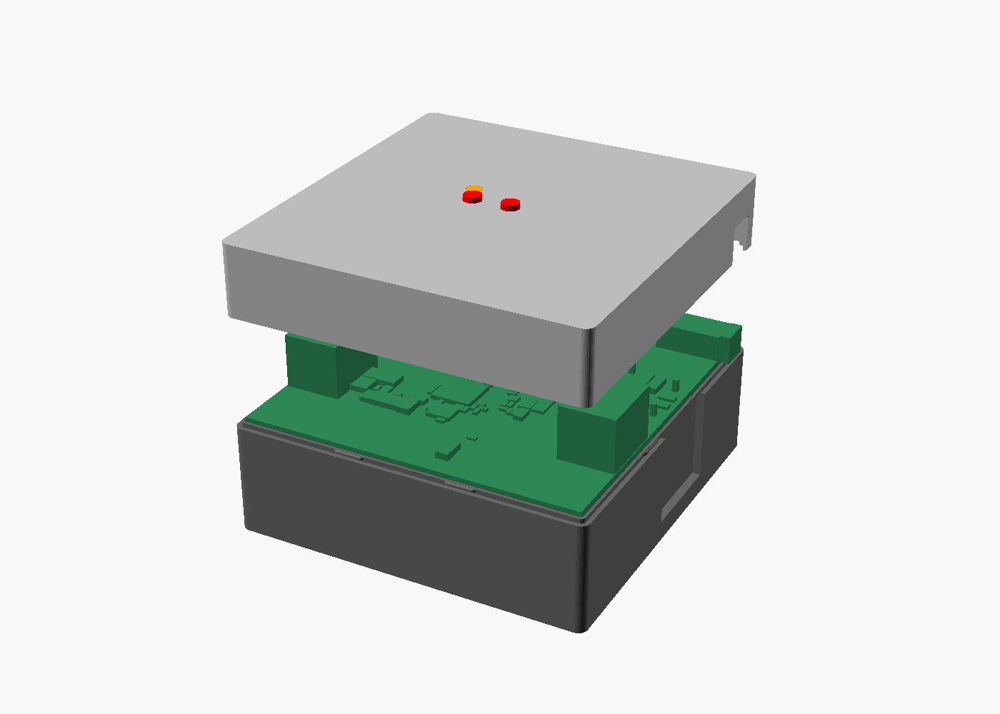

# jank mini case

## mini 2.2, stage 1f: the plan for stage 2 (not built yet)

The STLs and renders below are stage 2's draft on the **older** placement (RST, the 2 x 2 buttons, the jacks on top).
`mini_case.scad` has lost RST's pinhole and tube (and `place_args.py` its `rst`) so it still builds; everything else is
redone in stage 2 against stage 1f's board:

- **The jacks** (J2, J3, J7) are under the board now: their three slots move from the lid's skirt to the base, beside
  the DIN slots (MIDI OUT at the side edges' top corners, LINE IN on the top edge under the USB-C). The lid's only
  opening in a wall is the USB-C's.
- **Buttons: U-tongues in the roof, no caps** (the user's). Each button is a tongue cut free on three sides by a
  0.8 mm U slot, its root joined to the roof; a stalk under its free end stops 0.15 mm over the switch's plunger. The
  four tongues make a pinwheel round the cross (`../case/renders/sketch-2.2.png`, panel 1): UP's runs left, NO's down,
  DOWN's right, YES's up, so no two slots meet and all four stay inside the walls (DOWN's slot ends 0.4 mm from the
  bottom wall's inside, YES's root at y 40.7, UP's root at x 48, right of the screen module's outline) and clear of the
  antenna's seat (x 3 .. 45).
- **The tongue:** 5 mm wide, **7.5 mm from the root to the nub**, the free end 1.5 mm past it; the roof (1.4 mm)
  thinned to **0.8 mm** from the inside over the tongue. The stalk is long (the roof is 11 mm over the board for the
  upright antenna): ~10 mm (11 mm roof + 0.6 thinned - 1.5 switch - 0.15), 2.5 mm across, a 3 mm flat foot (the tongue's end turns ~5 degrees at full travel, so the
  foot slides ~0.9 mm on the plunger: an estimate).
- **Does it flex enough? (beam estimate, not printed):** the free end moves 0.15 mm (the gap) + 0.3 mm (the switch's
  travel, the brief's figure; JLC lists the TS-1187A at 1.6 N, no travel) = 0.45 mm. A cantilever's surface strain is
  1.5 x t x deflection / L^2 = 1.5 x 0.8 x 0.45 / 7.5^2 = **0.96 %**. **PETG** (E ~2 GPa: ~19 MPa, far under its ~45
  MPa): fine; the spring adds ~0.45 N (k = 3EI/L^3 ~3 N/mm) to the switch's 1.6 N, ~2.1 N to click. **PLA** (E ~3.5
  GPa: ~34 MPa, near its printed strength, brittle): likely to crack or take a set over many presses. **Print the lid
  in PETG**; PLA would need ~9.5 mm tongues (they no longer fit round the cross). The lid prints roof down, so the
  tongue's extrusion lines run along it (the strong way). Test one tongue first.
- **No RST:** no pinhole. Recovery is in `../README.md` "Restarting and recovering without RST".

## mini 2.2 (stage 2, 2026-11-14): not printed, not fitted

`mini_case.scad`, built by `make_stl.sh` from the routed board (`place_args.py` reads every position from
`../mini2.kicad_pcb`). Everything below "jank mini case" further down is mini 1's / mini 2's text.

| STL | What | Print |
|---|---|---|
| `stl/mini_base.stl` | the base without the DINs: 19.0 mm under the board (the cells' room) | floor down |
| `stl/mini_base_din.stl` | the base with the DINs' slots: 19.95 mm under the board | floor down |
| `stl/mini_lid_led.stl` | lid variant 1: the LED window (a 4.2 mm recess, a 3.2 mm bore, a chimney to 3.5 mm over the board) | roof down |
| `stl/mini_lid_screen.stl` | lid variant 2: the screen's window 24.5 x 13 over the OLED's display, a 28.5 x 17 x 0.6 mm bezel pocket on the outside for a clear cover, an inner frame down to 0.5 mm over the glass | roof down |
| `stl/mini_button_cap.stl` | the buttons' cap: 8 mm head 1 mm proud of the roof, a 9.2 mm flange under it, a 3.4 mm stem to 0.4 mm over the plunger (**print 4**) | head down |
| `stl/mini_led_pipe.stl` | the LED window's light pipe, 3.0 mm (variant 1 only) | head down |

- **Both lids:** the 4 caps' holes (8.4 mm; the caps 9.5 mm apart), **RST's 1.5 mm pinhole** with a guide tube down to
  1 mm over the switch (a paper clip), the jacks' and USB-C's openings as before, the lid 11 mm deep inside (kept for
  the antenna).
- **The FPC antenna:** a 0.4 mm pocket on the **inside of the bottom wall** (the J4 side, y = 58), 42 x 10.5 mm,
  board x 3 .. 45, its lower edge 0.5 mm over the board: the antenna stands upright, perpendicular to the board, its
  lead from J4 (board (42.2, 55.4)) rising beside it. **Assumed size: ~40 x 10 mm** (C1693673's sheet could not be read;
  LCSC's FPCs with a 50 mm lead are about that); `ant_l`, `ant_w` in the scad.
- **The cells:** two cells standing on edge in the band y 41.0 .. 58 (the DIN slots' ribs end at 40.85), a **2 mm
  divider rib** between them from the floor to 0.05 mm under the board: it carries the board under the buttons (no
  posts: the cells fill the width there). **Parameters** (`mini_case.scad` "The cells"): `cell_len` 66, `cell_h` 18,
  `cell_t` 6.7, `cell_y0` 41.0; `CELLS="-D cell_len=62 -D cell_h=15.5" sh make_stl.sh` checks other cells. Each slot
  is 7.5 mm (0.4 mm over a 6.7 mm cell each side); the inside width 66.8 mm (a 66 mm cell: 0.4 each end, its lead
  bent; 62 mm cells: 2.4).
- **The DIN version:** the back cheeks only beside the DINs now (they crossed the case and cut the cells' band).
- **The base pads:** none in the cells' band (the rib holds the board there); the lid's feet moved off the buttons.

Printed case for the jank chip board (`../chip.kicad_pcb`, 49.6 x 52.5 x 1.6 mm), in two versions from one
parametric file: **without** the DIN sockets (3.5 mm jacks only) and **with** J5 / J6 (`din = true`). Ideas taken from
the big jank box (`hardware/box` on the `hardware` branch): DIN plates in slots in the wall (front cheek, back cheek, no
wall behind the body), a stepped wall (the lid's skirt holds the jacks, the base the DINs), a cap through the lid for
the button.

> **Stage: designed and checked in OpenSCAD only. Nothing printed, no part measured.** See "Untested".



## Files

| File | What |
|---|---|
| `mini_case.scad` | The case (`part` and `din` pick the output) and its checks |
| `make_stl.sh` | Exports the STLs, runs the collision checks for both versions, checks every STL is one closed solid, renders the PNGs |
| `place_args.py` | Reads SW1 and LED1 from `../make_board.py` (`PLACE`) for the scad |
| `stl/mini_base.stl` / `stl/mini_base_din.stl` | The base, without / with the DINs (print orientation, floor down) |
| `stl/mini_lid.stl` | The lid, shared by both versions (print orientation, roof down) |
| `stl/mini_button_cap.stl`, `stl/mini_led_pipe.stl` | The button cap and the light pipe (print 1 each) |
| `renders/closed.png`, `closed_din.png`, `open.png`, `open_din.png` | Closed, and the board in the base with the lid lifted |
| `renders/section_din.png`, `section_jack.png` | Sections through a DIN's axis (y = 20) and through the jacks' axis (y = 5.8), DIN version |

`chip_case.scad`, `stl/chip_case_*.stl` and `assembly.png` belong to the older tiny board and are **superseded** (stale positions).

```
sh hardware/chip/case/make_stl.sh        # about 40 s; BOARD_PY=<make_board.py> to read SW1 / LED1 from another copy
```

## Size

| | Outer (X x Y x Z) | Parts |
|---|---|---|
| **No DIN** | **53.2 x 56.1 x 17.3 mm** | base 4.2 high, lid 13.9 high (they overlap 0.9 in the lap) |
| **DIN** | **53.2 x 56.1 x 35.4 mm** | base 22.3 high, same lid |

The jacks' bushings stand 0.45 mm proud of the side faces (the USB-C is recessed behind a 13 mm opening in the top
face). The board edge is 1.8 mm inside the outer face on every side (0.4 side play + 1.4 wall).

## How the board is held

No screw, no insert, no metal: the antenna (bottom edge) needs about 10 mm of air round it, and the board has no mounting holes.
- **Under:** eight small pads in the base (0.05 mm under the board's underside, along the four edges, none under any
  part). With the DINs, the plates hang from the board and stand 0.35 mm over the floor; the DIN base's ribs and back cheeks stop 0.35 mm under the board.
- **Over:** four feet on the lid (2.4 mm round, bottom corners and sides, clear of every part) 0.1 mm over the board's top.
  The board is held between them with 0.1 mm of vertical play and 0.4 mm each side.
- **The lid** is a cap over the board: a half-lap joint (the lid's 0.7 mm skirt outside, the base's 0.55 mm lap inside, 0.15 mm
  play) and six snap bumps (0.35 mm high, 6 mm wide, on the base's lap, into pockets in the skirt: 2 on the top/bottom
  edges each, 1 on each side). If they do not hold, a drop of glue on the lap or a turn of tape closes it.
- **Antenna:** the base's pads at the antenna edge are plastic, 17 mm from the antenna (x 3..9 and 35..41); the wall there is 1.4 mm PLA/PETG. No metal anywhere.
- **The flex antenna (the u.FL, fitted and selected by default, 2026-11-11):** the lid has a flat seat, 0.4 mm deep, over the antenna strip (board y 44..51.5, x 3.6 .. W-3.6), for a 2.4 GHz flex (FPC) antenna stuck inside the lid, away from the cans. Its IPEX cable runs from J4 (board 27.0, 39.95) straight down to it; plastic only.
- **Jacks:** J2 / J3's front blocks (6.0 x 5.5 mm, 2.2 mm past the edge) go through slots in the lid's side walls, open downwards (the lid is
  put on from above); the body's front pushes on the wall beside the slot (0.75 mm lip each side).
- **DINs:** each plate (20.9 x 19.6 x 1.8) slides down into a slot in the base between a front cheek (1.4 mm, in the
  wall; its window leaves 18.3 x 17.4 mm of the face open) and a back cheek (2.0 mm, a partition with an 18.6 mm opening for the body).
  Pull-out loads the front cheek, push-in the back cheek, the floor takes the weight.
- **USB-C:** a 13 x 6.9 mm opening (open downwards, also through the base's wall) for a plug's overmold.
- **Button:** a cap with a 3.4 mm stem through the roof (3.8 mm hole), a 4.6 mm flange 0.2 mm under the roof, resting 0.4 mm over the switch's plunger.
- **LED:** the lid has a 3.4 mm chimney down to 3.3 mm over the board and a 1.95 mm bore; the **light pipe** (1.8 mm,
  its head in a recess flush with the roof) sits 0.5 mm over the LED. A 1.75 mm filament offcut works instead.

## Print

PLA or PETG, 0.2 mm layers, 0.4 mm nozzle, 3 perimeters, 20 % infill, **no supports**:
- **Base:** floor down as exported. The DIN version's front window is bridged over its top (18 mm): turn the cooling up.
- **Lid:** roof down as exported (the slots and the USB opening face up). The chimney and the feet grow upward.
- **Button cap:** flange down. **Light pipe:** head down; a translucent / natural filament lights better. Both are small: print a spare.
- Print the two caps with the case, expect to sand the stem of the cap and the light pipe to fit the first time.

## Assembly

**Without DINs:** 1. Drop the board into the base (top up; the USB-C end at the top, the antenna at the pads' end). 2. Put the button cap, the stem up, into the lid's hole from inside and the light pipe from outside (head in its recess).
3. Put the lid on from above, the skirt over the base's lap, until the bumps click.

**With DINs:** 1. Hand-solder J5 / J6 (README "DIN sockets" of `../README.md`): their pins stand 2.4 mm up through the top side. 2. Drop the board with the sockets into the base: each plate goes down its slot, the bodies through the back cheek's opening. 3. As above.

## Checks (`make_stl.sh`, both versions, last run on the board of aaf494b)

The board model is `../mockup.stl` (block per courtyard, JLC-origin heights), plus the jacks' front blocks, the USB-C legs / jack pegs under the board (assumed 1.5 mm), and each DIN (plate, body and pin tails from `lib/3d/CONN-TH_DIN-504B-M10.wrl`: plate 20.9 x 19.6 x 1.8, body 17.9 x 17.6, 15.3 deep from the face, pins 4.0 up).

| Check | Must be | Result |
|---|---|---|
| base vs the board and every part, 0.3 mm clearance | empty | empty (tightest 0.30 to 0.35: the board's side edge, the jack pegs) |
| lid (without its feet) vs the board and every part, 0.3 mm | empty | empty (tightest 0.30 to 0.35: the jacks' slots) |
| button cap vs the board 0.3 / vs the lid 0.1; light pipe vs the board 0.3 / vs the lid 0.05 | empty | empty (cap 0.4 over the switch, pipe 0.5 over the LED) |
| lid vs base (lap, bumps, pockets) 0.05 | empty | empty |
| base pads vs the board 0.0 / lid feet vs the board 0.0 | empty | empty |
| base pads / lid feet vs the board 0.12 | **not** empty | not empty (they hold the board within 0.12) |
| every STL | one closed solid | 1 body, 0 open / non-manifold edges |

Clearances are found by growing the board model by a ball of the stated size and intersecting (`-D clr_check=0.4` finds a tighter spot).

## Untested

- **Nothing printed.** The fit of the lap, the bumps (0.35 mm: may be too stiff or too loose), the 0.4 mm board play, the cap and pipe press-fit all need a print. Print the lid's lap and a base strip first.
- **The DINs:** body depth 15.3 mm, 17.9 x 17.6 mm body, pin positions come from the 3D model (the HOOYA drawing gives plate 20.9 x 19.6 and 14.8 mm to the farthest pins; the jank box's scaled 13.1 mm body depth does not match the model); no real part was measured. the plate locks in a slot 0.2 mm wider than it (`slot_play` 0.1 mm a face and at each side edge, as the jank box's `slot_play` on the `hardware` branch; the checks hold the plate to 0.05 mm), 0.35 mm round the body in the back cheek and under the floor, 1.3 mm side rims, 2.2 mm far rim.
- **Under the board:** tails 1.5 mm assumed (3D models: USB-C legs 0.9, jack pegs 0.55); the floor is 1.9 mm under the board without DINs.
- **The jacks' front blocks** (6.0 x 5.5 x 2.2) come from the 3D model of the PJ-320D, not the part. Bushings stand only 0.45 mm proud of the face: a plug with a wide collar may need the wall thinned there.
- **USB-C:** the plug's overmold is assumed <= 12.5 x 6.5 mm. The switch's plunger height (1.5 mm) is from the footprint's model.
- **The button and LED positions** (SW1 24.4, 19.55; LED1 22.7, 14.9; board 49.6 x 52.5 since the DIN pads' rings, 2026-11-11) are those of the commit that adds this line. If `make_board.py` moves them, run `make_mockup.py`, then `make_stl.sh` (it reads them from `PLACE`); the lid's chimney and button hole follow, the checks rerun.
- Nothing about the antenna was measured: the case is plastic only, 1.4 mm wall, at the antenna's edge.
