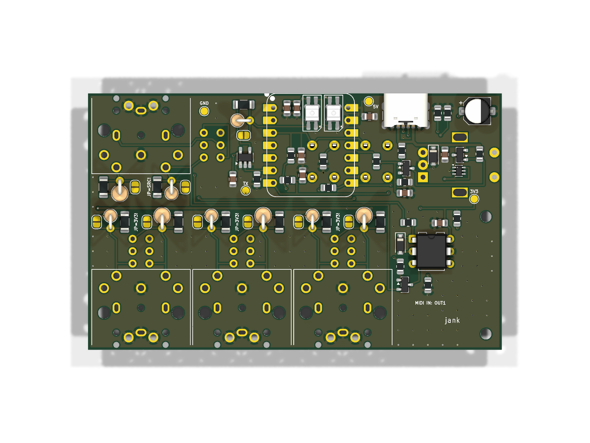

# jank board: schematic and layout for review

A carrier board for a **Seeed XIAO ESP32S3**: jank as one stick with a second USB-C for power, **three controls on the
face (MODE, PLAY/STOP and a push encoder)**, two RGB LEDs and **four MIDI outputs**, each one footprint holding a DIN-5
and a right-angle 3.5 mm TRS at the same place, one of the two fitted, each with a **TRS type A / B slide switch**.
**OUT1 doubles as a MIDI IN** under software control (an H11L1 behind a MOSFET gate; its source cut by a second
MOSFET). **Three outputs (OUT2, OUT3, OUT4) are on the front edge; OUT1 is on the back edge** beside the two USB-Cs. The
**bottom of the board is the device's face** (the box's lid): the controls stand in one row there (MODE under the XIAO,
which stands on 2.54 mm headers, with the LEDs behind it; PLAY/STOP and the encoder right of it), and the four A/B
switches reach through it; the XIAO, the power path, the MIDI IN and the resistors face the box's floor. Everything is
hand-solderable: through-hole connectors, switches, encoder, opto and swappable resistors, SOT-23 / SC-70 ICs,
0805 / 1206 passives. **84.0 x 52.0 mm, 2 layers.**

> **Stage: schematic and layout, round 7 (2026-11-08).** Nothing is ordered, built or measured. Every value marked
> *unverified* below was not checked against the part or a datasheet in this session.

The drawing: [`jank-pcb-schematic.pdf`](jank-pcb-schematic.pdf). The board: [`render-top.png`](render-top.png),
[`render-bottom.png`](render-bottom.png).



## Files

| File | What |
|---|---|
| `make_schematic.py` | The schematic, the project (with the board's rules), the XIAO and switch symbols, the intended nets and `BOM.md`, from one parts table |
| `make_footprints.py` | The CUI SJ1-3523N, the CUI SDS-50J, the combined output footprints (`_AB`: the jack on its own nets, through the switch), the A/B slide switch, the XIAO on headers (`lib/jank.pretty/`) |
| `make_board.py [long|square]` | `jank-pcb.kicad_pcb` (long, 84 x 52) or `jank-pcb-square.kicad_pcb` (67 x 58): placement, routes, pours, stitching vias, silk (KiCad's Python) |
| `make_mockup.py`, `check_stl.py` | `mockup-din.stl`, `mockup-trs.stl` (and their `.scad`): the board and its parts as one solid, checked (`check_stl.py` from the `mini` branch) |
| `check_nets.py` | The netlist against the intent and the design rules (the A/B switches, the MIDI IN, the controls), and the board's pads against the schematic |
| `make_fab.sh` | All of it in order: schematic, ERC, PDF, then for each layout the board, DRC, nets, Gerbers + drill, renders, mockups |
| `jank-pcb.kicad_sch`, `jank-pcb.kicad_pcb`, `jank-pcb.kicad_pro`, `sym-lib-table`, `fp-lib-table` | The KiCad 10 project (generated) |
| `lib/jank.kicad_sym` | The XIAO ESP32S3 and DPDT slide switch symbols (drawn by `make_schematic.py`) |
| `lib/jank.pretty/XIAO-ESP32-S3-DIP.kicad_mod` | Seeed's footprint, unchanged (source below) |
| `lib/jank.pretty/XIAO-ESP32-S3-DIP_Headers.kicad_mod` | The same with its courtyard on the two pin rows only (written by `make_footprints.py`): on headers, low parts fit under the module |
| `lib/stitch.py` | The ground stitching vias, from optimist's SD board (after m-card, CC0-1.0) |
| `jank-pcb-schematic.pdf`, `render-top.png`, `render-bottom.png` | The schematic (A2) and the board's renders |
| `fab/jank-pcb-gerbers.zip`, `fab/gerbers/` | **For JLCPCB** (bare board): the Gerbers and the PTH / NPTH drill files, origin at the lower left |
| `fab/erc.rpt`, `fab/drc.rpt`, `fab/jank-pcb.net.xml`, `fab/intended-nets.json` | The reports, the netlist, the intent |
| `BOM.md` | Parts, one price each, shop and date (generated) |

```
sh hardware/pcb/make_fab.sh        # needs KiCad 10 (kicad-cli and its Python), python3, OpenSCAD
```

**Last run (2026-11-08):**
- ERC: **0 errors, 0 warnings**.
- DRC (long): **0 errors, 0 unconnected, 21 warnings**, all from Seeed's XIAO footprint as published: 14 "silkscreen
  over copper" (its outline over its own pads) and 7 "silkscreen clipped by the board edge" (its USB-C lip drawn past
  the back edge, where the socket really overhangs).
- `check_nets.py`: 241 schematic pins, 46 nets, 0 problems; **272 board pads against the schematic, 0 differences**
  (the square board: 195 pads, 0 differences).
- Mockups: all four STLs one body, **0 open edges**, 0 non-manifold, 0 misoriented.

**XIAO footprint source:** `XIAO-ESP32-S3-DIP.kicad_mod` from Seeed's
[OPL_Kicad_Library](https://github.com/Seeed-Studio/OPL_Kicad_Library), folder "Seeed Studio XIAO Series Library",
last commit to the file b0035c5 (2026-06-23), licence CC BY-SA 4.0. It has both a through-hole pad (0.889 mm drill)
and an SMD pad at each of the 14 positions, rows 15.24 mm apart, 2.54 mm pitch, courtyard 20.98 x 17.8 mm. Seeed's
product page gives both "21 x 17.8" and "21 x 17.5 mm". **The long board uses `XIAO-ESP32-S3-DIP_Headers`**: the same
pads and outline, the courtyard only on the two pin rows (each 3.35 mm wide), because MODE, the LEDs and some 0805s sit
between the rows: **the XIAO must stand on 2.54 mm headers there, not flat on its castellations.** The schematic's
footprint field still names the plain one (one schematic for both boards).

## The pin table (what the firmware must say)

From the XIAO ESP32S3 v1.2 schematic (`XIAO_ESP32S3_SCH_v1.2.pdf`, Seeed, read 2026-11-08) and the ESP32-S3 datasheet v2.2.

| XIAO pad | GPIO | Net | Function | Why this pin |
|---|---|---|---|---|
| 1 D0 | 1 | MIDI_TX1 | OUT1 data (UART TX); **input (Hi-Z) in MIDI IN mode** | Free, not strapping |
| 2 D1 | 2 | MIDI_TX2 | OUT2 data (the same TX signal, GPIO matrix) | Free, not strapping |
| 3 D2 | 3 | **LADDER** | MODE, PLAY/STOP and the encoder's push on one resistor ladder: **ADC1 channel 2** | An ADC1 pin (usable with Wi-Fi on). GPIO3 straps the JTAG source only once EFUSE_STRAP_JTAG_SEL is burned; by default it is ignored (datasheet v2.2 Table 3-5) |
| 4 D3 | 4 | MIDI_TX4 | OUT4 data | Free, not strapping |
| 5 D4 | 5 | MIDI_TX3 | OUT3 data | Free, not strapping |
| 6 D5 | 6 | LED_DATA | Two SK6812MINI-E, through U3 | Free |
| 7 D6 | 43 | **ENC_A** | Encoder A (10 k pull-up, 100 nF) | U0TXD, **499 ohm in series on the module**: harmless for a switch input (below) |
| 8 D7 | 44 | **ENC_B** | Encoder B (10 k pull-up, 100 nF) | U0RXD: an input at boot (below) |
| 9 D8 | 7 | **IN_EN** | High = MIDI IN: Q4 cuts OUT1's source, Q3 closes the opto's loop; low = OUT | Floats at reset (Table 2-1, no pull): R53 100 k holds it low, so **OUT mode is the state at reset** |
| 10 D9 | 8 | **MIDI_RX** | UART RX in MIDI IN mode, through the GPIO matrix; the H11L1's open collector, R51 4.7 k to 3V3 (idle high) | Free, not strapping, not U0RXD |
| 11 D10 | 9 | PWR_CUT | Low = J1 cut (see the power path) | Floats at reset, as the cut needs |
| 12 3V3 | | +3V3 | The MIDI sources (OUT1's through Q4), the opto, the pull-ups | Module's regulator |
| 13 GND | | GND | | |
| 14 5V | | +5V | = the XIAO's USB-C VBUS | |

On the module and not on a pad: the user LED (GPIO21, yellow, active low through 1.5 k), the BOOT button (GPIO0).

`firmware/main/board.h` needs a new block (*not written*: no firmware was changed):

```c
#define BOARD_LADDER_ADC_GPIO 3        /* ADC1_CH2: MODE / PLAY / PUSH, one at a time (README "Controls") */
#define BOARD_LADDER_MV {600, 1340, 2270}   /* MODE, PLAY/STOP, PUSH; idle 3300 (full scale) */
#define BOARD_ENC_A_GPIO 43            /* U0TXD: move the console off UART0 (USB-Serial-JTAG) */
#define BOARD_ENC_B_GPIO 44            /* U0RXD */
#define BOARD_LED_RGB_GPIO 6           /* 2 x SK6812MINI-E, GRB; ui.c drives one pixel today */
#define BOARD_LED_MONO_GPIO (-1)
#define BOARD_MIDI_TX_GPIO 1
#define BOARD_MIDI_TX_MORE_GPIOS {2, 5, 4}   /* as the mini branch's tx_more_up(): the UART TX signal through the GPIO matrix */
#define BOARD_MIDI_SOURCE_GPIO (-1)    /* the sources are the 3V3 rail (OUT1's through Q4) */
#define BOARD_MIDI_IN_EN_GPIO 7        /* new: high = OUT1 is a MIDI IN */
#define BOARD_MIDI_RX_GPIO 8           /* new: UART RX in MIDI IN mode */
#define BOARD_PWR_CUT_GPIO 9           /* new: drive low once a computer has mounted the device; never in host mode */
```

`BOARD_MIDI_TX_MORE_GPIOS` and `tx_more_up()` exist only on the `mini` branch (Lolin32) so far. `BOARD_PWR_CUT_GPIO` is
new: the USB code drives it low when TinyUSB reports a mount in device mode, and leaves it an input otherwise. The
ladder, the encoder and **MIDI IN mode** (the steps below in "MIDI IN on OUT1") are new firmware too; today's
`BOARD_BUTTON_GPIO` (a plain button) has no place on this board any more.

**A finding for today's XIAO wiring:** the main README wires MIDI data to D6 (GPIO43) through 10 ohm. The module has
499 ohm between U0TXD and the D6 pad (v1.2 schematic, R6). The loop becomes 33 + 10 + 499 + 220 + 17.7 ohm, about
**2.3 mA** instead of 6.4 mA (same assumptions as below): below CA-033 and likely too little for some receivers
(*unverified per receiver*). The ROM also prints its boot log on GPIO43. This board puts the encoder there instead.

## The power path

```
J1 USB-C (power only) VBUS_IN --+-- D1 SMF5.0A to GND, C1 10 uF
                                |
                         Q1 AO3401A (P-FET, on unless PWR_CUT is low)
                                |  VIN_SW
                         U2 LM66100 ideal diode (~CE tied to VOUT)
                                |
   +5V -------------------------+---- XIAO 5V pad == XIAO USB-C VBUS (the data port)
     |                                   `-- inside the XIAO: Schottky D2 -> buck -> 3V3; charger -> BAT
     +-- C3 10 uF, C4 100 uF (not fitted), LED1, LED2, U3
```

**Verified** (XIAO ESP32S3 v1.2 schematic, the PDF rendered and read, 2026-11-08):

- The 5V pad (J1 pin "7*2" in Seeed's drawing) is the net **VBUS**, the same net as the USB-C socket's A4/B9 VBUS.
  **No part sits between them**: no diode, no switch, no fuse. So in host mode, whatever is on +5V is on the data
  port's VBUS, with no drop on the XIAO. That is what makes VBUS-out work, and also why a charger on +5V meets a
  computer on the data port.
- The Schottky on the module (D2, LMBR4010BST5G) is **downstream**: VBUS -> D2 -> VIN -> the SGM6029 buck -> 3V3.
  The battery joins VIN through a P-FET (Q1, LP0404N3T5G) whose gate is VBUS. D2 does not touch the host-mode path.
- The module's USB-C has **5.1 k on CC1 and on CC2** (R1, R2): it presents as a sink (device) whatever mode the
  firmware runs.
- The module's 3V3 rail carries Seeed's note "Imax=600mA". The charger (SGM40567) charges at 110 mA from VBUS.
- D+/D- on the module: 22 ohm in series (R3, R4), two capacitors marked DNP, **no TVS**.
- LM66100 (TI SLVSEZ8A): **SC-70-6 (DCK), not SOT-23-6**, 0.65 mm pitch; 1.5 A continuous; RON at most 110 mohm at
  5 V (-40 to 85 C); ~CE is a comparator against VIN: off when VCE > VIN + 0..80 mV, on when VCE < VIN - 80..250 mV.
  With ~CE on VOUT it is the datasheet's ideal diode (section 9.2.1).
- TPS2113A (TI datasheet): **TSSOP-8 or SON-8, not SOT-23-8**, so it was not used.

**What the board does with each source:**

| Sources | Result |
|---|---|
| Charger on J1 only | Q1 on (PWR_CUT floats at reset: R4/R5 put 2.5 V on Q2's gate), U2 conducts, +5V = charger minus about 0.1 V at 0.85 A (U2 110 mohm + Q1 about 60 mohm at -4.5 V, listing). The stick starts in device mode, finds no computer within 3 s and restarts as host: gear on the data port gets +5V. |
| Computer on the XIAO port only | +5V = the computer's VBUS. U2 blocks it from J1 (VOUT > VIN). Nothing else changes. |
| Both | Until the firmware acts, the higher of the two supplies +5V. If the charger is higher, it back-feeds the computer's VBUS through U2. Once the computer has mounted the device, the firmware pulls PWR_CUT low: Q2 off, Q1 off, J1 cut. If the computer is then unplugged, +5V collapses, the ESP resets, PWR_CUT floats, Q1 turns on and the stick restarts on the charger (*unverified: brownout and restart not tried*). |
| Neither | Off. |

**"A computer is never back-fed" cannot be guaranteed by hardware on this board.** The computer's VBUS and the
charger's path meet on the XIAO's own copper, and the only thing that can tell "a computer is there" is the USB
enumeration. The remaining window is from plug-in to mount (*unmeasured; likely well under a second*), and during
it the current into the computer is limited only by the two supplies' difference over about 0.17 ohm. The ideal
diode adds one more: with ~CE on VOUT it switches off only once VOUT exceeds VIN by 0 to 80 mV, so up to roughly
**0.5 A can flow back into J1** before it blocks (the datasheet's IRCB, 0.5 A typical, 1 A max). Two sources are
therefore not hard-shorted, but they are not isolated within 80 mV either. Alternatives the user may prefer: a
slide switch "charger / computer" in place of Q1 (simple, can be forgotten), or leaving Q1/Q2 out and bridging Q1
(the README rule "never feed the 5V pin with a computer on the USB port" then stays the user's to keep).

**The cut circuit:** Q1 source on VBUS_IN, R3 100 k gate to source (off by default); Q2 pulls Q1's gate to GND.
Q2's gate (NG) sits on R4/R5 100 k / 100 k from VBUS_IN, so 2.5 V with a 5 V charger (above the AO3400A's 1.45 V
maximum threshold, LCSC listing, *the AOS datasheet was not read*), and C2 100 nF (5 ms with the divider) rides
over the 60 us low glitch that the ESP32-S3 datasheet (Table 2-2) gives GPIO1 to GPIO14 at power-up. PWR_CUT reaches
NG through R6 1 k; the pad never sees more than VBUS_IN / 2.

**Rating for 500 mA to the gear:** gear 500 mA + the XIAO (*unmeasured*; the ESP32-S3 transmitting can draw a few
hundred mA at 3.3 V, about 0.25 A at 5 V through the buck if it is 90 % efficient, *assumed*) + LEDs 2 x 36 mA at full
white (*12 mA a colour, datasheet IDOUT*) = **about 0.85 A**. U2: 1.5 A max, 0.08 W at 0.85 A, 192 C/W -> about 15 C
rise. Q1: 4 A part. J1 (GCT USB4125): 3 A (LCSC listing). The XIAO's own VBUS copper from the 5V pad to its socket is
not specified by Seeed (*unverified*). A charger that holds to USB default current (500 mA) would sag (*unverified*):
J1 has Rd only, so the board cannot read what the charger offers.

**Host-mode capacitance:** USB asks a host port for at least 120 uF and a device for at most 10 uF. +5V carries the
XIAO's 1 uF and C3 10 uF. C4 (100 uF, 5 x 5.4 mm electrolytic) is drawn but **not fitted**: fit it if hot-plugging
gear in host mode resets the stick (*unverified either way*); a computer then sees more than the device limit at plug-in.


## Controls (face side): MODE, PLAY/STOP, the encoder

**One row on the face**, centres at y = 13.8 mm from the back edge (the encoder's shaft at 14.5): **MODE** (SW1) under
the XIAO with the two LEDs right behind it, **PLAY/STOP** (SW6) and the **encoder** (SW7) right of the XIAO, under the
power path (the power parts sit on the floor side round their legs). Coordinates and lid holes: "The box" below.

**The buttons:** SW1 and SW6, 6 x 6 mm through hole, **HRO K2-1102DP-L3SW-04, 9.5 mm tall** (LCSC C445493, USD 0.0633,
min 10). Its datasheet (HRO K2-1102DP, read 2026-11-08) gives the 4 legs on 6.5 x 4.5 mm with 1.0 mm holes, as
KiCad's `SW_PUSH_6mm` (1.1 mm holes), and the heights by code: L = 9.5 mm, S = 13, X = 17, 5 = 23 mm. Mounted from the
face side; their legs come through to the floor side, **MODE's under the module: trim them to 1.5 mm or less.**

**The encoder:** **ALPS EC11E09244BS**, LCSC **C470742**, **USD 2.3275** (min 1, 4690 in stock on 2026-11-08):
EC11, vertical, **18 detents / 9 pulses**, push switch (0.5 mm travel), **flat (D) metal shaft, actuator length
20 mm** (Alps EC11 catalog table, read via LCSC 2026-11-08; the length taken as measured from the mounting surface,
*unverified on the drawing*). Body 11.7 x 12.5 mm, **about 6.5 mm tall** (*the drawing's figure as read from the PDF's
text, unverified*). KiCad's footprint `RotaryEncoder_Alps_EC11E-Switch_Vertical_H20mm` (A, C, B 2.5 mm apart, the
switch 14.5 mm across, two mounting tabs), mounted on the face side: **the body under the lid, the shaft through it**.
With the lid's inside about 7 mm above the face (the user's figure) the body has about 0.5 mm to spare and the shaft
stands **about 11.5 mm out of a 1.5 mm lid** (room for a knob). **"20-detent class":** the EC11E types with a push
switch that LCSC stocks come with 18, 30 or 36 detents; 18 is the nearest. Considered and not used: Bourns
PEC11R-4220F-S0024 (24 detents, LCSC C143797, USD 2.78): an M7 bushing (it could be nutted to the lid) but another
footprint (*the user's call*).

**The encoder's A / B** go to **GPIO43 (ENC_A) and GPIO44 (ENC_B)**, each with **10 k to 3V3 (R64, R65) and 100 nF to
GND (C10, C11)** (1 ms; the Alps sheet gives 3 ms chattering, 2 ms bounce at most: the firmware still debounces). Its
C pin is GND. **Why those two pads are harmless for an encoder:** GPIO43 is U0TXD: the ROM drives it while it prints
its boot log; if the encoder rests where A is closed, the pad drives into GND through the module's own 499 ohm (at
most 6.6 mA) and the log is lost, nothing else. GPIO44 is U0RXD: an input at boot; the ROM listens on it only in
download mode, which GPIO0 selects, not this pin. Neither is a strapping pin. **The firmware must move the console off
UART0** (to USB-Serial-JTAG, or none), or ESP-IDF keeps GPIO43 / 44 as UART0.

**The ladder (GPIO3, ADC1 channel 2):** R60 10 k from 3V3 to the ladder, C9 100 nF to GND, and per switch one resistor
from the switch's other side to GND:

| State | Resistor to GND | Voltage (3.3 x R / (R + 10 k)) | Decide between |
|---|---|---|---|
| Idle | none | **3.30 V** (the ADC's full scale) | above 2.78 V |
| MODE (SW1) | R61 **2.2 k** | **0.60 V** | below 0.97 V |
| PLAY/STOP (SW6) | R62 **6.8 k** | **1.34 V** | 0.97 to 1.80 V |
| PUSH (the encoder's switch) | R63 **22 k** | **2.27 V** | 1.80 to 2.78 V |

The thresholds are the midpoints; the levels are 0.7 to 1.0 V apart, far beyond 1 % resistors and the ADC's error
(with 12 dB attenuation it reads up to about 3.1 V, so idle simply reads full scale; *the ADC figures unverified*).
**The ladder reads one switch at a time:** two pressed together read as the lower one (MODE + PLAY = 0.47 V reads as
MODE), so chords are not possible. C9 with the 10 k settles in a few ms; sample at 100 Hz or faster and debounce in
firmware. A switch held at power-up only pulls GPIO3 low, which the default eFuses ignore. Parts: R60 10 k (C17414,
USD 0.0034), R61 2.2 k (C17520, USD 0.0050), R62 6.8 k (C17772, USD 0.0028), R63 22 k (C17560, USD 0.0048), all
UNI-ROYAL 0805 1 %, min 100.

GPIO0 in parallel with the XIAO's BOOT button is **not possible**: GPIO0 is on no XIAO pad. With the XIAO on the floor
side, its BOOT and RESET buttons and its own LED are **inside the box**: download mode is then only the firmware's 10 s
hold (`BOARD_FORCE_DOWNLOAD`, *unproven on any S3 build*, now on a ladder level) or opening the box.

## LEDs

Two **SK6812MINI-E** (OPSCO datasheet, LCSC C5149201, read 2026-11-08): **3.2 x 2.8 x 1.78 mm**; pins 1 GND, 2 DIN,
3 VDD, 4 DOUT. **They cannot be mounted the normal way, pointing away from the board:** the MINI-E is a reverse-mount
part (KiCad's footprint `LED_SK6812MINI-E_3.2x2.8mm_P1.5mm_ReverseMount`, with its 3.4 x 3.0 mm cut-out; the keyboard
practice it is made for: soldered on one side, the body in the hole, the light out of the other side; *the lens side is
not stated in the text of the datasheet read; unverified*). So they stay in their cut-outs, **soldered on the floor
side and shining out of the face side**, flush with it. They sit **under the XIAO, right behind MODE**, side by side,
turned 90 degrees: **solder them (and the 0805s under the module, and SW1) before the headers**.

- **Supply 5 V** (+5V). VDD range 3.7 to 5.5 V.
- **The first LED needs a level shifter:** VIH is 0.65 x VDD, 3.25 V at 5.0 V and 3.58 V at 5.5 V, while the ESP's
  VOH is at least 0.8 x 3.3 = 2.64 V. U3, a **74AHCT1G125** on +5V (TTL input, VIH 2.0 V), takes GPIO6 to 5 V; R8
  330 ohm in series to LED1's DIN (swappable, with its bypass JP8 and parallel pads R9, below); R7 100 k holds the
  buffer input low while GPIO6 floats at reset (Table 2-1: GPIO4 to GPIO8 have no pull at reset). LED1's DOUT drives
  LED2 at 5 V levels. 74AHCT is specified from 4.5 V; +5V from a computer can be lower under load (*unverified at 4.4 V*).
- 100 nF at the LEDs (C6, C7), 100 nF at U3 (C5). Firmware: `ui.c` drives one pixel today; the second is new.

## MIDI out

Per output k (1 to 4): **R1k 10 ohm** (axial, 0.25 W) from MIDI_TXk to TIPk, **R2k 33 ohm** (axial, 0.5 W) from the
source to RINGk (+3V3 for OUT2..4; for OUT1 **SRC1 = 3V3 through Q4**, below), each swappable with a bypass jumper and
parallel pads (below). **J(5+k)**: DIN-5 180 degree, pin 5 = TIPk, pin 4 = RINGk, pin 2 = GND, pins 1 and 3 open.
**J(1+k)**: 3.5 mm TRS, tip = JTk, ring = JRk, sleeve = GND, through **SW(1+k)** (below). One of the two is fitted.

**The TRS A/B switches (SW2..SW5, one per output, face side):** a DPDT slide switch between the resistors and the
jack. It swaps the jack's tip and ring between TIPk (data, the sink) and RINGk (the source); the DIN is not switched.
Pins 1 RINGk, 2 JRk, 3 TIPk | 4 TIPk, 5 JTk, 6 RINGk; **1-2 and 4-5 closed = type A** (tip = data, ring = source).
Which end of the travel closes 1-2 is the part's own (*unverified: check with a meter before writing "A" on the box*).
Part: **SHOU HAN MSS22D18G2**, LCSC C431542, USD 0.0996 (min 5): 6 pins 2.5 mm apart, rows 3.4 mm, 0.8 mm holes; body
9.1 x 3.5 x 3.5 mm, handle 1.5 mm (the knob's top 5.0 mm above the face), travel 2.0 mm along the body. The G4
version (C431543) has a taller handle (*length unverified*). Silk "OUTk A|B" by each switch on the face side.

**Currents** (the mini README's numbers apply: CA-033 at 3.3 V, receiver 220 ohm, opto LED 1.5 V given, pad about
17.7 ohm from IOL 28 mA at 0.495 V, datasheet v2.2 Table 5-4, at drive strength 3): **6.4 mA** typical per output,
8.6 mA at most, 5.1 mA at least (OUT1: Q4's 0.06 to 0.1 ohm more, nothing); the 3V3 rail carries 4 x 6.4 = 26 mA, at
most 34 mA. The opto LED voltage and the pad's resistance are *unverified*.

- **Mono plug:** ring to sleeve, 33 ohm across 3V3 = 100 mA and 0.33 W in R2k (rated 0.75 W); on OUT1 through Q4 (a
  4 A part). Four mono plugs: 400 mA on top of the ESP's own draw, against Seeed's "Imax=600mA": a brownout is possible
  (*unverified*).
- **The pads** are GPIO1, 2, 5, 4 (OUT1 to OUT4), none strapping (strapping: 0, 3, 45, 46).
- **Power-up glitch:** the datasheet gives GPIO1 to GPIO14 a 60 us low glitch at power-up; a receiver may see one stray
  byte when the stick powers up (*unverified*).
- **One UART, four pads:** `uart_set_pin` puts UART TX on GPIO1, `tx_more_up()` (mini branch) connects the same TX
  signal to GPIO2, 5, 4 through the GPIO matrix.

**The TRS part:** **CUI SJ1-3523N**, 3.5 mm stereo, right angle, no switch, LCSC C20182914, USD 1.4889. Datasheet
SJ1-352XN, 10/05/2022: pin 1 sleeve, 2 tip, 3 ring; body 12.0 x 11.0 x 5.0 mm; bushing 6.0 mm, 3.3 mm out past the
body's front, its axis 2.5 mm above the board, so it **must stand past the board's edge**. In the schematic J2..J5 (the
TRS) are BOM lines only; on the board their pads are part of J6..J9's footprint.

**The DIN part:** CUI **SDS-50J** (datasheet SDS-J, 08/05/2022): face 20.0 x 21.1 mm, its centre 10.0 mm above the
board, 15.8 mm deep, seven 1.3 mm holes (pins 1 to 5 and two "E" shield pins on GND), two 2.4 mm locating holes.

## MIDI IN on OUT1 (software-switched)

```
 3V3 -- Q4 AO3401A (S -> D, gate = IN_EN) -- SRC1 -- R21 33 ohm --+-- RING1 / DIN pin 4
                                                                   +-- R50 220 -- OPTO_A --+-- U4 H11L1 LED --+-- OPTO_K -- Q3 AO3400A (D .. S) -- TIP1 / DIN pin 5
                                                                                           +---- D2 1N4148W --+          G <- R52 1k <- IN_EN (GPIO7), R53 100k to GND
 TX1 (GPIO1) -- R11 10 ohm -- TIP1;    U4 output (open collector) -- MIDI_RX (GPIO8), R51 4.7k to 3V3; U4 VCC 3V3, C8 100 nF
```

- **One pin, IN_EN (GPIO7), switches both:** low = **OUT mode**: Q4 on (its gate 3.3 V below its source: OUT1's 33 ohm
  sees 3V3 like the others), Q3 off (and its body diode points against the loop's forward current: the opto's loop is
  open). High = **IN mode**: Q4 off (no source), Q3 on. **At reset GPIO7 floats and R53 (100 k) pulls it low: OUT mode**
  (Q4's gate pulled down = on; no separate pull-up is needed on Q4, whose gate sits on the same line). There is **no
  source pin any more** (the round-6 SRC1 GPIO): GPIO44 went to the encoder.
- **IN mode, the firmware's steps:** (1) set **TX1 (GPIO1) to input, no pull**, off the UART's TX matrix (**the TX pad
  must be Hi-Z**, or it and the sender fight through 10 ohm); (2) set **IN_EN high** (Q4 cuts the source, Q3 closes
  the loop); (3) route **UART RX to GPIO8** through the GPIO matrix, 31250 baud, 8N1, no inversion (the H11L1's output
  is low while its LED conducts, the MIDI start bit, *per its datasheet, polarity unverified here*). Back to OUT mode:
  IN_EN low, then TX1 back to the UART.
- **The opto sits on the DIN-pin side** (RING1 / TIP1, after the resistors): the A/B switch only acts on the jack. **A
  TRS in IN mode:** the switch must match the sender's TRS type. In the wrong position the sender's current runs
  backwards: **D2 conducts, the opto's LED sees at most a diode's drop in reverse, no data, nothing harmed**. A DIN
  needs no setting.
- **D2 sits across the opto's LED** (OPTO_A to OPTO_K), not across DIN pins 4/5 (a deviation from the round-5 brief):
  either way a reversed sender's current goes round the LED; across the LED is where the MIDI 1.0 IN circuit draws it
  (*from memory, the spec not re-read*).
- **Risk, unmeasured:** with a 5 V sender, RING1 can rise above 3V3; Q4's body diode (drain to source) then feeds the
  3V3 rail through R21 33 ohm, and TIP1 reaches the Hi-Z TX1 pad's protection through 10 ohm: roughly a few mA taken
  from the opto's share (*estimate*). A 3.3 V sender stays below that.
- **The DIN's shield (pin 2) is on GND** on OUT1 as on the outputs; a spec MIDI IN leaves it open (*the user's call*).
- **Parts:** U4 **EVERLIGHT H11L1** (DIP-6, LCSC C78588, USD 0.3507, min 5); D2 1N4148W (C81598); R50 220 ohm (C17557),
  R51 4.7 k (C17673), R52 1 k, R53 100 k; Q3 AO3400A, **Q4 AO3401A** (as Q1, C15127); C8 100 nF.

### The swappable resistors (the user's ruling, as on the SD board)

Each of the 8 MIDI resistors and R8 is a group of three:

| Part | What | Fitted |
|---|---|---|
| R1k (10 ohm, tip), R2k (33 ohm, ring), R8 (330 ohm, LED data) | An axial resistor standing on 2.54 mm holes: hand-swappable. 0.25 W DIN0207 (6.3 x 2.4 mm); the 33 ohm 0.5 W DIN0309 (9 x 3.2 mm) | Yes |
| JP1k, JP2k, JP8 | A 2-pad solder jumper across it, 1.3 mm pitch: a solder bridge = bypass (0 ohm) | Open |
| R3k, R4k, R9 | 1206 pads in parallel: solder a resistor there to lower the value without desoldering the axial one | No |

**Silkscreen "JP=3V3!"** stands by each ring jumper of OUT2..4 (JP22..JP24): bridged, it puts 3V3 straight on the
ring, and a mono plug then shorts the 3V3 rail with nothing to limit it. **"JP=SRC!"** by JP21 (OUT1): bridged, the
SRC1 line (3V3 through Q4) drives the ring directly. A 1206 in parallel with a 33 ohm shares a mono-plug short's 0.33 W; a 1206 is rated
0.25 W (*the user picks the values*).

## ESD and test points

- **J1:** D1, SMF5.0A (5 V standoff, SOD-123F) from VBUS_IN to GND. CC1/CC2 have only their 5.1 k. Nothing else of J1 is
  connected.
- **The XIAO's port:** its D+/D- are inside the module and cannot be reached from this board; Seeed fitted no TVS
  there (v1.2 schematic). A TVS on +5V could be added beside C3 if wanted (not drawn).
- **The MIDI outputs** have no ESD parts; 10 ohm and 33 ohm are all CA-033 asks for. *Unverified* whether that is enough.
- **Test points** (1.5 mm pads, floor side, labelled): TP1 +5V by J1, TP2 +3V3 in the MIDI IN corner, TP3 GND and TP4
  TX (MIDI_TX1) left of the XIAO.


## The layout

**Outline: 84.0 x 52.0 mm** (4368 mm²; round 6 without PLAY/STOP and the encoder was 76 x 52), a plain rectangle,
2 layers, 1.6 mm (*JLCPCB's default thickness, assumed*). In the Gerbers the origin is the lower left of the top view.
Two **M2 holes** (2.2 mm, not plated), both on the right: H1 at (80.8, 25.0), H2 at (80.8, 48.8); the left corners
belong to OUT1's and OUT2's connectors (the DIN / jack bodies are held by the box's walls).

**Coordinates below:** x from the left edge and y from the back edge, **seen from the top (the floor side)**. Seen from
the face (the board turned over about its front-back axis), **x becomes 84.0 - x**; y stays.

| Edge | What | Where |
|---|---|---|
| Front (y = 52) | OUT2, OUT3, OUT4 (J7..J9), faces on the edge, pitch 20.5 mm, slid left | axes at x = 10.75, 31.25, 51.75 |
| Back (y = 0) | **OUT1** (J6, the same footprint turned 180 degrees) | axis at x = 10.75 |
| Back | The XIAO's USB-C (the data port; on headers, its socket 1.5 mm past the edge) | axis at x = 45.2 |
| Back | J1, USB-C power only (GCT USB4125), its front on the edge | axis at x = 64.5 |

**What sets the size:** the back half is OUT1 (20.6) + the strip beside it (14) + the XIAO (17.9) + PLAY/STOP (7.6) +
the encoder with its switch legs (17.6) = 84 mm; the front edge only needs 62. The depth is the XIAO (21 mm) plus the
front outputs (DIN, switch, groups: 29 mm), with a band of lines between them. The encoder and PLAY/STOP sit under the
power path (its parts on the floor side round their legs), not beside it.

**One footprint per output** (`jank:MIDI_OUT_SDS-50J_or_SJ1-3523N_AB`, J6..J9): the DIN's face on the edge (E pins
2.5 mm in, pegs 7.5, pins 1-3 12.5, pins 4-5 15.0); the SJ1-3523N's body front on the same edge, on the DIN's axis
(1.2 mm pegs at (+/-5.0, 1.0) and (+/-5.0, 3.5), sleeve slot (0, 3.5), tip (+5.0, 8.5), ring (-5.0, 8.5), centre peg
(0, 8.5); slots 1.5 x 0.8 plated, pads 2.2 x 1.5); the jack's pads T, R, S on J2..J5's nets. Inside it copper to a
hole is 0.55 mm at least, drill to drill 0.9 mm (DRC-checked). The minimum channel pitch stays 20.5 mm (the DIN's 20.0
face + 0.5).

**Placement (floor side = top, face side = bottom):**

- **Front outputs:** behind each, its two resistor groups (inputs 27.2 mm from the front edge) and, between them on
  the face side, its A/B switch.
- **OUT1 (back left):** its groups in front of it (33 ohm left, 10 ohm right, inputs 20.3 mm from the back edge), Q4
  on the face side between them, its A/B switch SW2 on the face side in the strip (x 23.5 / 26.9, y 8.0 to 13.0).
- **The strip** (x 21 to 35): SW2 (face side), R8's group at the back, U3, R7, C5, TP3, TP4.
- **Under the XIAO** (between its header rows, x 38.3 to 52.1): the LEDs at the back (centres (45.5, 4.0) and
  (49.85, 4.0)), MODE on the face side (legs at x 45.5 / 50.0, y 10.55 / 17.05), R61 between its legs, and on the
  floor side R60, C9, R64, C10, R65, C6, C7.
- **Right of the XIAO, the controls on the face side:** PLAY/STOP (legs x 56.3 / 60.8, y 10.55 / 17.05; R6 between
  them on top, R62 on the face side in front), the encoder (A, C, B at x 68.0, y 17.0 / 14.5 / 12.0; tabs at x 75.5;
  switch at x 82.5; R63 and C11 on the face side beside it).
- **The power path on top over them:** C3 and TP1 by the XIAO's 5V pad, J1 with R1 / R2 and C4 right of it, R4 / Q2
  / R5 / C2 between PLAY/STOP and the encoder, D1, C1, Q1, U2, R3 over the encoder.
- **Front right corner:** the MIDI IN (U4 with its pin 1 at (65.9, 29.5), R50, D2, Q3, R52, R53, R51, C8, TP2).

**Routing:** TX1..TX3 leave the XIAO's left row on the bottom down the strip; TX4 runs on the bottom under the module.
ENC_A runs on top under the module's front (y 20.4) and ENC_B from the right row (y 18.6), both down to the encoder on
the bottom. IN_EN goes on the bottom right and down to the MIDI IN corner, and on top back along y 21.65 to Q4; MIDI_RX
on the bottom to the corner. The ladder runs from D2 to MODE, under the module (y 9.15) to PLAY/STOP and on the bottom
(y 21.5) to the encoder's switch. RING1 / TIP1 run on top along y 22.15 / 22.65 to the corner. The 3V3 bus (0.4 mm,
y 23.3) is fed by a bottom line inside the XIAO's right row and runs on to Q4 at the left edge and, on the bottom, into
the corner. VBUS runs from J1 over the encoder to Q1 (0.5 mm); +5V leaves U2 by a via onto the bottom (0.4 mm, x 72.4,
then y 4.6) back to the XIAO's 5V pad, C3 and C4; the LEDs and U3 take +5V from the 5V pad on the bottom along the
back edge. Signal tracks 0.25 mm. Ground: both layers poured, stitching vias (82 on the last run); the ground pads of
C1, C3, C5, C9, R5, R62 and J1's shell legs are joined solid to the pour (no room for thermal spokes).

**Rules** (in `jank-pcb.kicad_pro`): clearance 0.2 (default class) and 0.15 minimum, track 0.15 minimum, drill 0.3
minimum, vias 0.6 / 0.3, hole to hole 0.5, copper to edge **0.2** (KiCad's own SK6812MINI-E footprint puts its pads
0.25 mm from its cut-out; JLCPCB's routed-edge minimum is taken as 0.2, *unverified against their current page*).

**The JLCPCB order (bare board):** `fab/jank-pcb-gerbers.zip`, 2 layers, 84 x 52 mm, 1.6 mm. It has **plated slots**
(the jacks' pins, J1's shell legs, the encoder's tabs) and **two internal cut-outs** (the LEDs'), which JLCPCB routes
from the outline layer (*unverified whether they price either*).

### Under the XIAO (the user's ruling: the XIAO on 2.54 mm headers, low parts under it)

Measured on the board file (edge to edge, copper):

| Item | Where | To the XIAO's pads (header rows) | To the nearest trace or via of another net |
|---|---|---|---|
| LED1 cut-out (3.0 x 3.4) | x 44.0..47.0, y 2.3..5.7 | **5.0 mm** (right row; the left row 5.6) | **0.33 mm** (LED_DIN2, top) |
| LED2 cut-out (3.0 x 3.4) | x 48.3..51.4, y 2.3..5.7 | **0.67 mm** (pad 13) | **0.62 mm** (LED_DIN2, top) |
| MODE's legs (2.0 mm pads) | x 45.5 / 50.0, y 10.55 / 17.05 | **1.07 mm** (pad 11) / 1.28 mm (pad 8) | **0.28 mm** (the ladder, top); 0.33 mm (3V3, bottom) |

The rules ask 0.2 mm; DRC passes. **Height under the module** (the XIAO's underside at the header's plastic,
**2.5 mm**, the usual 2.54 mm header body, *unverified for the PZ254V-11-07P in the BOM*): MODE's legs **trimmed to
1.5 mm or less** (1.0 mm to spare), the LEDs' backs about 0.2 mm (*unverified*), the 0805s (at most 1.25 mm), tracks.
**Assembly order:** LEDs, the 0805s under the module, MODE (legs trimmed), then the headers, then the XIAO.

### The box: heights and openings (for drawing it round `mockup-din.stl` / `mockup-trs.stl`)

| Side | Part | Height from that side's surface | Source |
|---|---|---|---|
| Floor (top) | DIN-5 (if fitted) | 21.1 | datasheet |
| Floor | R2k, 33 ohm 0.5 W standing | about 11.5 | *estimate* |
| Floor | R1k, R8, 0.25 W standing | about 9.0 | *estimate* |
| Floor | XIAO on 2.54 mm headers | about 7.0 (its socket's axis about 5) | *estimate* |
| Floor | SJ1-3523N (if fitted) | 5.0; bushing 6.0 mm, axis 2.5 up, 3.3 mm past the edge | datasheet |
| Floor | U4 H11L1 (DIP-6) | about 4.5 | *estimate* |
| Floor | J1 USB-C | 3.3 | *estimate* |
| Floor | the face-side parts' legs (switches, encoder) | about 1.5 (trimmed; MODE's must be) | *estimate* |
| Face (bottom) | **Encoder shaft** | **20** from the face (6 mm, flat) | Alps table (*from the mounting surface, unverified*) |
| Face | **MODE, PLAY/STOP** | **9.5** | HRO code L |
| Face | **Encoder body** | **about 6.5** (11.7 x 12.5 mm) | drawing (*unverified*) |
| Face | **A/B switches SW2..SW5** | **5.0** to the knob's top (body 3.5 + handle 1.5) | drawing (G2) |
| Face | DIN leads, header pins | 3.5 / about 3.0 (untrimmed) | datasheet / *estimate* |
| Face | small face-side SMDs (Q4, R61..R63, C11) | about 1.0 | *estimate* |
| Face | LEDs | flush in their cut-outs | *unverified* |

**The lid at about 7 mm above the face** (the user's figure; inside at 7.0, 1.5 mm thick, outside at 8.5): the
encoder's body fits under it (0.5 mm spare, *if 6.5 holds*) and its shaft stands **11.5 mm out**; MODE and PLAY/STOP
(9.5 mm) stand **1.0 mm out** (the 13 mm code S would stand 4.5 mm out); **the A/B knobs (5.0 mm) stay 2.0 mm below
the lid's inside**: reachable only with a pen tip through their slots (3.5 mm deep), unless the lid is thinned or
recessed over them, or the taller G4 handle fits (*the user's call*).

**The face (lid) openings** (top-view coordinates; **face-view x = 84.0 - x** in brackets; y from the back edge):

| Opening | Centre x, y (mm) | Size (x by y) | Note |
|---|---|---|---|
| MODE (SW1) | 47.75 (36.25), 13.8 | hole 4.0 mm round | plunger 3.4 mm (datasheet) |
| PLAY/STOP (SW6) | 58.55 (25.45), 13.8 | hole 4.0 mm round | as MODE |
| Encoder shaft (SW7) | 75.5 (8.5), 14.5 | hole 7.0 mm round | 6 mm shaft; body 11.7 x 12.5 under the lid |
| LED1 window | 45.5 (38.5), 4.0 | 3.2 x 3.6 | over its 3.0 x 3.4 cut-out; a light pipe or a clear insert helps (*untried*) |
| LED2 window | 49.85 (34.15), 4.0 | 3.2 x 3.6 | as LED1 |
| OUT1 A/B slot (SW2) | 25.2 (58.8), 10.75 | 2.0 x 4.5 | the handle (1.5 wide, 2.0 long) slides 2.0 mm along y; centre = mid-travel |
| OUT2 A/B slot (SW3) | 10.75 (73.25), 32.25 | 2.0 x 4.5 | as SW2 |
| OUT3 A/B slot (SW4) | 31.25 (52.75), 32.25 | 2.0 x 4.5 | as SW2 |
| OUT4 A/B slot (SW5) | 51.75 (32.25), 32.25 | 2.0 x 4.5 | as SW2 |

**The front wall:** OUT2..OUT4's DIN faces on the board's edge (centres 10.0 mm above the floor-side surface), the
jacks' bushings on the same axes, 2.5 mm above that surface and 3.3 mm out past the edge (jack hole about 6.2 mm; DIN
hole about 16 mm, *the user's DIN plugs decide*). **The back wall, left to right:** OUT1's DIN / jack at x 10.75, the
XIAO's socket at x 45.2 and J1's at x 64.5 (USB-C openings about 9.5 x 3.8 mm, *estimate*).

### Mockup (`make_mockup.py`)

`mockup-din.stl` (four DINs) and `mockup-trs.stl` (four SJ1-3523N): the board with its holes and cut-outs, each fitted
part a block of its courtyard and the heights above (the jack with its bushing as a cylinder past the edge), the
face-side parts below (MODE and PLAY/STOP 9.5 mm, the A/B switches 5.0 mm, **the encoder as a 12.5 x 12.5 x 6.5 mm body
and a 6 mm shaft to 20 mm**), the leads as blocks (the XIAO's as its two header rows), one solid each. The parallel
pads and jumpers are not parts. C4 (not fitted) is left out.

## The square variant (`make_board.py square`)

The schematic **before the A/B switches and the MIDI IN** (frozen for it as `fab/square/intended-nets.json` and
`fab/square/jank-pcb.net.xml`; the user's ruling: the square board stays as it is, regenerated by the script, not
redesigned) on a squarer board: **OUT1 and OUT2 on the front edge, OUT3 on the left edge, OUT4
on the right edge**, both USB-Cs on the back edge. Files: `jank-pcb-square.kicad_pcb` (its rules in
`jank-pcb-square.kicad_pro`), `fab/square/jank-pcb-square-gerbers.zip` (+ `fab/square/gerbers/`, `fab/square/drc.rpt`),
`render-top-square.png`, `render-bottom-square.png`, `mockup-square-din.stl`, `mockup-square-trs.stl`. The long board
(84 x 52, above) is the default (`make_board.py` with no argument, or `long`). The BOM's A/B switches, U4 and its parts, SW6, the encoder and the ladder
are not on the square board.

**Last run (2026-11-08):** DRC **0 errors, 0 unconnected, 21 warnings** (the same 21 as the long board, all Seeed's XIAO
footprint); `check_nets.py`: **195 board pads against the schematic, 0 differences**; both mockups one body, **0 open
edges**.


**Outline: 67.0 x 58.0 mm** (3886 mm²; the long board, with its A/B switches, the MIDI IN and the controls, is 84 x 52 = 4368 mm²). **Not 50 x 50, and why:** each output is a
DIN-5 footprint 20.5 x 16 mm plus its two resistor groups (about 19 x 4.5 mm), four of them take about 1800 mm²; the
XIAO with its two side lanes is 21 x 22 mm and its socket must be on the back edge, J1 beside it, and the power path
(15 parts) beside J1. Two outputs on the front edge set the width to at least 41 mm plus the side outputs' depth
(16 mm DIN + 6 mm groups each, the XIAO between them): **67 mm**. The height is the back corner (the power path and the
LED / button cluster, 20 mm), one side DIN (20.5 mm) and the front band (17.5 mm): **58 mm**. A tighter pass could reach
about **67 x 52** by moving the button-transistor network (Q2, R4-R6, C2) into the empty area below the XIAO and
re-packing both back corners to 14 mm (*not done*: it reroutes PWR_CUT, PG and NG across the right lane).

**Edges** (x from the left edge, y from the back edge, seen from the floor side; seen from the face, x becomes 67.0 - x):

| Edge | What | Where |
|---|---|---|
| Front | OUT1, OUT2 (DIN / jack), pitch 20.5 mm | axes at x = 23.25 and 43.75 |
| Left | OUT3, face on the edge | axis at y = 30.5 |
| Right | OUT4, face on the edge | axis at y = 30.5 |
| Back | XIAO socket (1.5 mm past the edge), J1 power USB-C | x = 33.5 and x = 60.0 |

The DIN faces and the jacks' bushings stand as on the long board (DIN face centre 10.0 mm above the floor-side
surface; jack bushing axis 2.5 mm above it, 3.3 mm past the edge), on all four outputs.

**Placement:** the side outputs carry their resistor groups behind them, as on the long board; the front outputs'
groups sit in the front corners (OUT1's left, OUT2's right), stacked. Back right corner: J1 and the power path. Back
left corner: SW1 (face side) with the two LEDs in their cut-outs, U3, R7, C5-C7 and the R8 group. The 3V3 bus runs
across the board between the side outputs and the front ones; the test points TP2 (3V3), TP3 (GND) and TP4 (TX) are
in the middle, below the XIAO, with **M2 holes** H1 at (2.6, 16.8) and H2 at (40.0, 36.0) (the corners belong to the
connectors).

**Two differences from the long board's routing, to note:**
- **OUT4's TX line runs on the top layer under the XIAO module** (from D3 between the right row's pads 10 and 11):
  in the square variant **the XIAO must sit on 2.54 mm headers**, not flat on its castellations (its bottom pads would
  sit on that line, only the solder mask between).
- **LED2's ground pad is connected solid to the pour** (no thermal relief: the board edge and its cut-out leave room for
  one spoke only): it takes a little more heat to solder.

**Lid (face side) openings, square board** (top-view coordinates; face-view x in brackets; heights as on the long board):

| Opening | Centre x, y (mm) | Size |
|---|---|---|
| Button (SW1, 9.5 mm) | 15.75 (51.25), 5.45 | hole 4.0 mm round |
| LED1 window | 5.0 (62.0), 6.6 | 3.6 x 3.2 mm |
| LED2 window | 5.0 (62.0), 2.2 | 3.6 x 3.2 mm |

**Heights per edge** for the box: front, left and right walls each carry outputs (DIN face 20 x 21.1 mm, centre 10.0 mm
up; or the jack's 6 mm bushing, axis 2.5 mm up, 3.3 mm out); the back wall carries the two USB-Cs (the XIAO's socket at
the module's top, about 5 mm up on headers, *estimate*; J1 about 1.6 mm up, *estimate*). Floor side tallest: the DIN,
21.1 mm; face side tallest but SW1: the leads, 3.5 mm untrimmed.


## Unverified, all in one place

- **The SJ1-3523N:** its holes against a real part (the drawing only); that the 1.2 mm holes are plastic pegs; that its
  blades fit 1.5 x 0.8 mm slots.
- **The SDS-50J:** its holes against the drawing (no part measured), its E pins' function (taken as shield).
- **The MSS22D18G2 A/B switches:** which end of the travel closes 1-2 / 4-5 (type A); the G4 handle's length; how the
  knobs are reached under a lid 7 mm up.
- **The encoder EC11E09244BS:** its body height (about 6.5 mm read from the drawing's text), the 20 mm actuator length
  measured from the mounting surface, the fit of its tabs in KiCad's EC11E footprint (2.8 x 1.5 mm slots).
- **The ladder:** the ESP32-S3 ADC's range and error at 12 dB attenuation (the thresholds leave 0.35 V or more).
- **The SK6812MINI-E:** which side its light leaves, how far it shows on the face side, how far its back stands above
  the floor side under the XIAO.
- **SW1, SW6:** the K2-1102DP-L3SW-04's 9.5 mm (datasheet code table); MODE's legs trimmed to 1.5 mm under the XIAO.
- **Under the XIAO:** the header body's 2.5 mm (PZ254V-11-07P not checked); the module's underside (no parts assumed).
- The XIAO's outline (21 x 17.8 or 17.5 mm), the overhang of its socket (1.5 mm from Seeed's footprint); its VBUS
  copper current rating; its draw while transmitting.
- **The MIDI IN:** the H11L1's output polarity (from memory); a 5 V sender's current into the 3V3 rail through Q4's
  body diode and into the TX1 pad (*estimate: a few mA*); the DIN shield on GND (a spec IN leaves it open).
- AO3400A and AO3401A thresholds and RON (Q1..Q4): LCSC listings, not the AOS datasheets.
- The cut window (plug-in to mount), the restart on the charger after a computer is unplugged, the reverse current
  through U2 when two sources sit within 80 mV; a charger's real current limit with Rd only on J1.
- The 74AHCT1G125 below 4.5 V; SK6812 at 3.3 V supply (not tried).
- The opto LED voltage, the pad's resistance, the mono-plug brownout, the power-up glitch on MIDI.
- Whether C4 is needed for hot-plugging in host mode.
- USB4125's 0.3 mm gap between A5 and B5 is hand-solderable with care (*the user's call*).
- JLCPCB: 0.2 mm copper to a routed edge, plated slots and internal cut-outs at no extra cost.
- Every height marked *estimate* above; every price (one reading on 2026-11-08, `BOM.md`).
- **Square variant:** OUT4's TX line under the XIAO module on top (the XIAO on headers, not flat); LED2's solid ground
  connection; the 67 x 52 estimate for a tighter pass (not laid out). It has no A/B switches, no MIDI IN, no encoder.

## Next steps

1. User reviews the layout (`render-top.png`, `render-bottom.png`, or `jank-pcb.kicad_pcb` in KiCad), this README and
   `BOM.md`, and rules on: the lid (height, thickness, how the A/B knobs are reached), the button height (9.5 or 13 mm),
   the encoder (18 detents, or the 24-detent Bourns with its bushing), C4.
2. User prints `mockup-din.stl` or `mockup-trs.stl` and checks it against the real parts (the jack, the DIN, the
   switches, the encoder and the XIAO on its headers) before ordering the board.
3. User orders the bare board at JLCPCB (`fab/jank-pcb-gerbers.zip`) with the other board, and the parts.
4. User solders (the LEDs, the 0805s under the module and MODE before the XIAO's headers). Claude flashes nothing; the
   firmware changes above (board.h, the ladder, the encoder, MIDI IN mode, the console off UART0) come as their own step.
