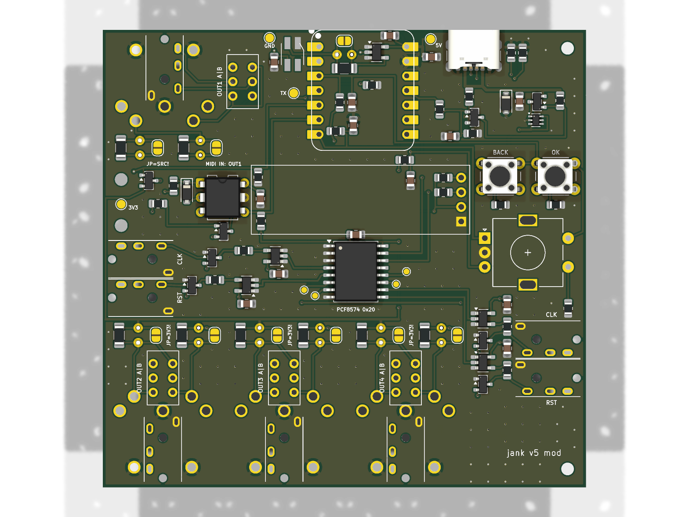

# jank board: schematic and layout for review

Part of the **[jank device](../../README.md)** · the other half: [the box](../box/README.md)

A carrier board for a **Seeed XIAO ESP32S3**: jank as one stick with a second USB-C for power, **a 0.91" OLED, an
encoder and two buttons (OK, BACK) on the lid side**, one RGB beat LED and **four MIDI outputs**. **v5 fits both
connectors on every output**: a right-angle 3.5 mm jack (XKB PJ-320D-B-SMT, surface mount) on the **top** and a DIN-5
(HOOYA DIN-504B-M10) on the **bottom**, **the jack beside the DIN** (v5c, 2026-11-09: between two DIN plates at a 23.0 mm
pitch, so nothing of the jack goes through the board under a DIN body) on the same nets (in parallel: **plug one at a
time**), and a **TRS type A / B slide switch** per output for the jack. **Both faces sit at the box wall** (the box
brings the board edge to 1.0 mm inside its outer face). **OUT1 doubles as a MIDI IN** under software control (an H11L1 behind a MOSFET
gate; its source cut by a second MOSFET). **Three outputs (OUT2, OUT3, OUT4) are on the front edge; OUT1 is on the back
edge** beside the two USB-Cs. **The top of the board is the lid side**: the XIAO, the screen, the encoder, the buttons,
the LED, the jacks and the A/B switches; the bottom carries only the DINs and the standing resistors (hand-soldered), and the
board stands about 20 mm above the box's floor on the DINs. Everything is hand-solderable: through-hole DINs,
switches, encoder, opto and swappable resistors, the jacks' four tabs, SOT-23 / SC-70 ICs, 0805 / 1206 passives, an LED
with lengthened pads. **The modular board (the one built): 87.0 x 79.5 mm, 2 layers.** (The plain 84 x 67 variant is
parked since v5c: with the 23 mm pitch its OUT4 resistor group lands on the encoder; `make_fab.sh` builds `-mod` only.)

> **Stage: schematic and layout, v5 (2026-11-08).** Nothing is ordered, built or measured. Every value marked
> *unverified* below was not checked against the part or a datasheet in this session.

The drawing: [`jank-pcb-mod-schematic.pdf`](jank-pcb-mod-schematic.pdf). The board: [`render-top-mod.png`](render-top-mod.png),
[`render-bottom-mod.png`](render-bottom-mod.png).



## v5c (2026-11-09): the jack beside the DIN, both faces at the wall

The user, on seeing v5's stacked connectors: *"the jacks are not reachable from the outside of the box ... put the midi
jack between the DIN plugs on the pcb, making sure the pins don't collide (DIN on one side, jack on the other)"*, and
*"DIN AND jack should be at the wall"*.

- **Each output's 3.5 mm jack moved 11.5 mm along the edge**, into the 2.1 mm gap between two DIN plates (the pitch
  went from 21.1 to **23.0 mm**; the board from 84 to **87 mm** wide so OUT4's resistor group clears the right
  channels' drivers, which moved 3 mm right with the wall jacks and the holes H1 / H2). OUT4's jack is right of the
  last DIN; **OUT1's jack is left of its DIN at the back-left corner** (DIN axis x 17.5, jack x 6.0).
- **The jack is now the surface-mount twin, XKB PJ-320D-B-SMT (C2884940)**: same body, bushing and pegs, four 1.5 x 2.5
  tabs on the top instead of legs through the board (the legs would have come out under the neighbouring DIN bodies).
  Its two 1.3 mm pegs sit in the gap, 0.4 mm from each DIN body. The side-wall jacks J11..J14 stay the through-hole
  PJ-320A (nothing is under them).
- **The DIN plate is 1.0 mm behind the board edge, the jack body front 0.5 mm past it.** The box puts the board edge
  1.0 mm inside its outer face on the connector edges: **the DIN faces are flush with the outside, the jack bodies 0.5 mm
  inside it with the bushings 1.5 mm proud**. The 1.0 mm also keeps the jack's rear tab pads 0.3 mm from the next DIN's
  pin 1 / 3 pads (the rows interleave: DIN pins at 13.3 and 15.8 in, jack tabs at 2.5 .. 11.0 in).
- **OUT1's A/B switch SW2 is the surface-mount XKB SS-3235S-L2 (C500056)**, over the DIN body at (17.5, 8.1): a
  through-hole switch's pins would hit the DIN under the board, and the strip east of the DIN carries the XIAO's MIDI IN
  lines (IN_EN, MIDI_RX, TX1). Same pinout (1-2-3 / 4-5-6, 2 and 5 the commons), knob 3.0 mm, travel 1.5 mm along x.
  SW3..SW5 stay the through-hole MSS22D18 (their pins land behind the DIN bodies).
- Routes: each jack's tip and ring reach their tabs through a via next to the pad (the switches' routes run on the
  bottom); OUT1's TIP throw crosses under the switch through two vias.
- Prices of the two new parts not read (LCSC refused the page on 2026-11-09): **0.00 in the BOM**, fill in before
  trusting the total.
- **The MIDI resistors are 1206s placed by JLC (later on 2026-11-09, the user: "the upright resistors are just post
  fixes"):** R3k 10 ohm (C17903), the source two 68 ohm in parallel, R4k + R8k (C17976; 34 ohm, 0.5 W together, for a
  mono plug on a TRS output: 0.33 W), R9 330 ohm for the LED (C17930). R8k sits where the 33 ohm group's bypass jumper
  JP2k was (gone). The axial pads (R1k, R2k, R8) stay, empty ("DNP fix"): a bench fix solders an axial part there with
  the 1206s removed. The 10 ohm group keeps its bypass jumper JP1k.
- **The screen is the 0.96" 128 x 64 OLED** (HS96L03W2C03, C5248080; the user, 2026-11-09): 27.3 x 27.8 on its header
  at (34.58, 24.0); the PCF8574 moved right of it; SDA / SCL swapped on the XIAO (SDA D8 = GPIO7, SCL D9 = GPIO8); the
  expander's right channels on P2 / P3, P4..P7 on test pads.

## v5 in short (what changed from round 7 / 2026-11-08)

- **Both connectors fitted, two rows on the front wall:** the jacks above the board, the DIN faces below it (OUT1 the
  same on the back wall). The DIN's footprint is mirrored onto the bottom; its plate sits **1.0 mm behind the edge**
  (the jacks' fronts stay on the edge) so its pin 2 clears the jack's back (below, "Both connectors").
- **The lid side is the top:** the XIAO, the OLED, OK, BACK, the encoder, one LED, the jacks, the A/B switches. Seen
  from the front with the lid up the outputs read **2, 3, 4 left to right** (OUT2 is now at x 10.45).
- **Pins:** OUT2, OUT3 and OUT4 share **one TX pad** (GPIO2); OUT1 keeps its own (GPIO1, Hi-Z in IN mode). That frees
  GPIO7 / GPIO8 for **I2C** (the OLED); IN_EN and MIDI_RX moved to GPIO5 / GPIO6, the LED to GPIO4.
- **The buttons are OK (menu / select) and BACK** (were MODE and PLAY/STOP): the same parts and ladder values.
- **One LED**, top-emitting (SK6812MINI-HS); the second LED and the reverse-mount cut-outs are gone.
- **4 M2 holes** (two right corners, two on the left edge between OUT1 and OUT2).
- **The standing resistors hang under the board** (beside the DINs); their jumpers and parallel pads stay on top.
- **BOM:** one board, 4 jacks + 4 DINs + 4 A/B switches, the OLED, one LED: **USD 17.49** at unit prices, **USD 30.84**
  with each shop's minimum order (`BOM.md`).

## Files

| File | What |
|---|---|
| `make_schematic.py` | The schematic, the project (with the board's rules), the XIAO and switch symbols, the intended nets and `BOM.md`, from one parts table |
| `make_footprints.py` | The v5 output footprint `MIDI_OUT_PJ-320A_top_DIN-504B-M10_bottom`, the LED `LED_SK6812MINI-HS_3.7x3.5mm_HandSolder`, the OLED header `OLED_0.91in_128x32_I2C_HS91L02W2C01`, the A/B slide switch, the XIAO on headers, and the older output footprints (`lib/jank.pretty/`) |
| `make_board.py` | `jank-pcb.kicad_pcb`: placement, routes, pours, stitching vias, silk (KiCad's Python). Its `square` layout (an older 67 x 58 board) is unused and not built |
| `make_mockup.py` | `mockup.stl` (its `mockup.scad` is rebuilt, not kept): the board and its parts as one solid, both sides, checked by `../check_stl.py` |
| `make_assembly.py` | `fab/bom.csv` and `fab/cpl.csv`: JLCPCB's assembly files (README "Assembly") |
| `check_nets.py` | The netlist against the intent and the design rules (the A/B switches, the shared TX pad, the MIDI IN, the controls, the OLED), and the board's pads against the schematic |
| `make_fab.sh` | All of it in order, for both projects (v5 and the modular variant, `MODULAR=1`): schematic, ERC, PDF, the board, DRC, nets, Gerbers + drill, the assembly files, renders, mockup |
| `jank-pcb.kicad_sch`, `jank-pcb.kicad_pcb`, `jank-pcb.kicad_pro`, `sym-lib-table`, `fp-lib-table` | The KiCad 10 project (generated) |
| `lib/jank.kicad_sym` | The XIAO ESP32S3 and DPDT slide switch symbols (drawn by `make_schematic.py`) |
| `lib/jank.pretty/XIAO-ESP32-S3-DIP.kicad_mod` | Seeed's footprint, unchanged (source below) |
| `lib/jank.pretty/XIAO-ESP32-S3-DIP_Headers.kicad_mod` | The same with its courtyard on the two pin rows only (written by `make_footprints.py`): on headers, low parts fit under the module |
| `lib/stitch.py` | The ground stitching vias, from optimist's SD board (after m-card, CC0-1.0) |
| `jank-pcb-schematic.pdf`, `render-top.png`, `render-bottom.png` | The schematic (A2) and the board's renders |
| `fab/jank-pcb-gerbers.zip` | **For JLCPCB** (bare board): the Gerbers and the PTH / NPTH drill files, origin at the lower left (the `fab/gerbers/` folder and the reports are rebuilt by `make_fab.sh`, not kept) |
| `fab/bom.csv`, `fab/cpl.csv` | **For JLCPCB's assembly**: the SMD parts it places and where (generated by `make_assembly.py`); `fab/full/` the same with the through-hole parts, for later |
| `BOM.md` | Parts, one price each, shop and date (generated) |
| `jank-pcb-mod.*`, `BOM-mod.md`, `fab/mod/`, `render-*-mod.png`, `mockup-mod.stl`, `jank-pcb-mod-schematic.pdf` | The modular variant (README "Modular variant") |

```
sh hardware/pcb/make_fab.sh        # needs KiCad 10 (kicad-cli and its Python), python3, OpenSCAD
```

**Last run (2026-11-08, v5):**
- ERC: **0 errors, 0 warnings**.
- DRC: **0 errors, 0 unconnected, 28 warnings**: 21 "silkscreen over copper" (Seeed's XIAO outline over its own pads,
  the A/B switches' outlines and their "OUTk A|B" labels over tracks, one LED outline line over its data track) and 7
  "silkscreen clipped by the board edge" (the XIAO's USB-C lip drawn past the back edge, where the socket really
  overhangs).
- `check_nets.py`: 243 schematic pins, 45 nets, 0 problems; **278 board pads against the schematic, 0 differences**.
- Mockup: `mockup.stl` one body, **0 open edges**, 0 non-manifold, 0 misoriented.

**XIAO footprint source:** `XIAO-ESP32-S3-DIP.kicad_mod` from Seeed's
[OPL_Kicad_Library](https://github.com/Seeed-Studio/OPL_Kicad_Library), folder "Seeed Studio XIAO Series Library",
last commit to the file b0035c5 (2026-06-23), licence CC BY-SA 4.0. It has both a through-hole pad (0.889 mm drill)
and an SMD pad at each of the 14 positions, rows 15.24 mm apart, 2.54 mm pitch, courtyard 20.98 x 17.8 mm. Seeed's
product page gives both "21 x 17.8" and "21 x 17.5 mm". **The board uses `XIAO-ESP32-S3-DIP_Headers`**: the same pads
and outline, the courtyard only on the two pin rows, because the LED driver and some 0805s sit between the rows: **the
XIAO must stand on 2.54 mm headers, not flat on its castellations.** The schematic's footprint field still names the
plain one.

## The pin table (what the firmware must say)

From the XIAO ESP32S3 v1.2 schematic (`XIAO_ESP32S3_SCH_v1.2.pdf`, Seeed, read 2026-11-08) and the ESP32-S3 datasheet
v2.2. All 11 GPIO pads are used.

| XIAO pad | GPIO | Net | Function | Why this pin |
|---|---|---|---|---|
| 1 D0 | 1 | MIDI_TX1 | OUT1 data (UART TX); **input (Hi-Z) in MIDI IN mode** | Its own pad: it must go Hi-Z alone |
| 2 D1 | 2 | **MIDI_TXB** | **OUT2, OUT3 and OUT4 together** (three 10 ohm groups on one pad; the same TX signal, GPIO matrix) | Free, not strapping |
| 3 D2 | 3 | **LADDER** | OK, BACK and the encoder's push on one resistor ladder: **ADC1 channel 2** | An ADC1 pin (usable with Wi-Fi on). GPIO3 straps the JTAG source only once EFUSE_STRAP_JTAG_SEL is burned; by default it is ignored (datasheet v2.2 Table 3-5) |
| 4 D3 | 4 | LED_DATA | One SK6812MINI-HS, through U3 | Free; R7 holds it low at reset |
| 5 D4 | 5 | **IN_EN** | High = MIDI IN: Q4 cuts OUT1's source, Q3 closes the opto's loop; low = OUT | Floats at reset (Table 2-1, no pull): R53 100 k holds it low, so **OUT mode is the state at reset** |
| 6 D5 | 6 | **MIDI_RX** | UART RX in MIDI IN mode, through the GPIO matrix; the H11L1's open collector, R51 10 k to 3V3 (idle high) | Free, not strapping, not U0RXD |
| 7 D6 | 43 | **ENC_A** | Encoder A (10 k pull-up, 100 nF) | U0TXD, **499 ohm in series on the module**: harmless for a switch input (below) |
| 8 D7 | 44 | **ENC_B** | Encoder B (10 k pull-up, 100 nF) | U0RXD: an input at boot (below) |
| 9 D8 | 7 | **SCL** | I2C clock to the OLED (R70 10 k to 3V3) | Any GPIO takes I2C through the matrix; not strapping |
| 10 D9 | 8 | **SDA** | I2C data to the OLED (R71 10 k to 3V3) | As SCL |
| 11 D10 | 9 | PWR_CUT | Low = J1 cut (see the power path) | Floats at reset, as the cut needs |
| 12 3V3 | | +3V3 | The MIDI sources (OUT1's through Q4), the opto, the OLED, the pull-ups | Module's regulator |
| 13 GND | | GND | | |
| 14 5V | | +5V | = the XIAO's USB-C VBUS | |

The XIAO prints D4 / D5 as its SDA / SCL; on the ESP32-S3 that is only a default, the I2C pins go anywhere through the
GPIO matrix, so the OLED uses D8 / D9 (GPIO7 / 8), where its lines leave the module's right row straight for the screen.

**GPIO -> footprint -> channel:** GPIO1 -> J6 at the back, DIN axis x 17.5 -> OUT1; **GPIO2 -> J7 (DIN x 10.45, OUT2), J8
(x 33.45, OUT3) and J9 (x 56.45, OUT4)**; each jack 11.5 to the right of its DIN (OUT1's 11.5 to the left). Seen from the front with the lid up the front wall reads OUT2, OUT3, OUT4 from left to
right.

**One pad for three loops (the coordinator's figure: 28 mA):** the ESP32-S3's IOL is given as 28 mA at VOL 0.495 V at
drive strength 3 (datasheet v2.2 Table 5-4), about 17.7 ohm. One loop (CA-033 at 3.3 V: 33 + 10 ohm here, 220 ohm and
an opto LED of 1.5 V at the receiver) sinks **6.4 mA typical, 8.6 mA at most**. Three loops on one pad: **3 x 8.6 =
25.8 mA at most, under 28 mA**; typically the pad's own drop (3 x 6.4 mA x 17.7 ohm = 0.34 V) lowers each loop to about
**5.7 mA, 17 mA in the pad**. **If the jack and the DIN of one channel are both plugged** that channel's current doubles
(two receivers in parallel): four loops on GPIO2 can reach 34 mA. Plug one per channel (the receiver figures are
*unverified*).

On the module and not on a pad: the user LED (GPIO21, yellow, active low through 1.5 k), the BOOT button (GPIO0).

`firmware/main/board.h` needs a new block (*not written*: no firmware was changed):

```c
#define BOARD_LADDER_ADC_GPIO 3        /* ADC1_CH2: OK / BACK / PUSH, one at a time (README "Controls") */
#define BOARD_LADDER_MV {600, 1340, 2270}   /* OK, BACK, PUSH; idle 3300 (full scale) */
#define BOARD_ENC_A_GPIO 43            /* U0TXD: move the console off UART0 (USB-Serial-JTAG) */
#define BOARD_ENC_B_GPIO 44            /* U0RXD */
#define BOARD_LED_RGB_GPIO 4           /* 1 x SK6812MINI-HS, GRB */
#define BOARD_LED_MONO_GPIO (-1)
#define BOARD_MIDI_TX_GPIO 1           /* OUT1 alone (Hi-Z in MIDI IN mode) */
#define BOARD_MIDI_TX_MORE_GPIOS {2}   /* OUT2 + OUT3 + OUT4 on one pad: set it to GPIO_DRIVE_CAP_3 */
#define BOARD_MIDI_SOURCE_GPIO (-1)    /* the sources are the 3V3 rail (OUT1's through Q4) */
#define BOARD_MIDI_IN_EN_GPIO 5        /* high = OUT1 is a MIDI IN */
#define BOARD_MIDI_RX_GPIO 6           /* UART RX in MIDI IN mode */
#define BOARD_I2C_SDA_GPIO 8           /* the OLED (SSD1306, 128 x 32) */
#define BOARD_I2C_SCL_GPIO 7
#define BOARD_OLED_I2C_ADDR 0x3C       /* the sheet's "0x78" is the 8-bit write address */
#define BOARD_PWR_CUT_GPIO 9           /* drive low once a computer has mounted the device; never in host mode */
```

**Firmware notes:** `tx_more_up()` (midi.c) routes the UART TX signal to GPIO2 through the GPIO matrix; **GPIO2 must be
set to drive strength 3** (`gpio_set_drive_capability(2, GPIO_DRIVE_CAP_3)`; ESP-IDF's default is 2), since the 28 mA
figure is the strength-3 one. OUT2..4 always send the same bytes (one pad); only OUT1 can be on its own or an input.
The I2C bus has the board's 10 k pull-ups: 100 to 200 kHz is safe, 400 kHz depends on the bus capacitance (README
"Assembly", *unmeasured*; the module's own pull-ups, if any, unverified).
`BOARD_PWR_CUT_GPIO`, the ladder, the encoder, the OLED and **MIDI IN mode** are new firmware.

**Why not D6 for MIDI:** the bare-XIAO build (`docs/boards.md`) wires MIDI data to D6 (GPIO43) through 10 ohm. The
module has 499 ohm between U0TXD and the D6 pad (v1.2 schematic, R6): about **2.3 mA** instead of 6.4 mA, too little
for some receivers (*unverified per receiver*); the ROM also prints its boot log on GPIO43. The encoder is there instead.

## The power path

```
J1 USB-C (power only) VBUS_IN --+-- D1 SMF5.0A to GND, C1 10 uF
                                |
                         Q1 AO3401A (P-FET, on unless PWR_CUT is low)
                                |  VIN_SW
                         U2 LM66100 ideal diode (~CE tied to VOUT)
                                |
   +5V -------------------------+---- XIAO 5V pad == XIAO USB-C VBUS (the data port)
     |                                   `-- inside the XIAO: Schottky D2 -> buck -> 3V3; charger -> BAT
     +-- C3 10 uF, C4 100 uF (not fitted), LED1, LED2, U3
```

**Verified** (XIAO ESP32S3 v1.2 schematic, the PDF rendered and read, 2026-11-08):

- The 5V pad (J1 pin "7*2" in Seeed's drawing) is the net **VBUS**, the same net as the USB-C socket's A4/B9 VBUS.
  **No part sits between them**: no diode, no switch, no fuse. So in host mode, whatever is on +5V is on the data
  port's VBUS, with no drop on the XIAO. That is what makes VBUS-out work, and also why a charger on +5V meets a
  computer on the data port.
- The Schottky on the module (D2, LMBR4010BST5G) is **downstream**: VBUS -> D2 -> VIN -> the SGM6029 buck -> 3V3.
  The battery joins VIN through a P-FET (Q1, LP0404N3T5G) whose gate is VBUS. D2 does not touch the host-mode path.
- The module's USB-C has **5.1 k on CC1 and on CC2** (R1, R2): it presents as a sink (device) whatever mode the
  firmware runs.
- The module's 3V3 rail carries Seeed's note "Imax=600mA". The charger (SGM40567) charges at 110 mA from VBUS.
- D+/D- on the module: 22 ohm in series (R3, R4), two capacitors marked DNP, **no TVS**.
- LM66100 (TI SLVSEZ8A): **SC-70-6 (DCK), not SOT-23-6**, 0.65 mm pitch; 1.5 A continuous; RON at most 110 mohm at
  5 V (-40 to 85 C); ~CE is a comparator against VIN: off when VCE > VIN + 0..80 mV, on when VCE < VIN - 80..250 mV.
  With ~CE on VOUT it is the datasheet's ideal diode (section 9.2.1).
- TPS2113A (TI datasheet): **TSSOP-8 or SON-8, not SOT-23-8**, so it was not used.

**What the board does with each source:**

| Sources | Result |
|---|---|
| Charger on J1 only | Q1 on (PWR_CUT floats at reset: R4/R5 put 2.5 V on Q2's gate), U2 conducts, +5V = charger minus about 0.1 V at 0.85 A (U2 110 mohm + Q1 about 60 mohm at -4.5 V, listing). The stick starts in device mode, finds no computer within 3 s and restarts as host: gear on the data port gets +5V. |
| Computer on the XIAO port only | +5V = the computer's VBUS. U2 blocks it from J1 (VOUT > VIN). Nothing else changes. |
| Both | Until the firmware acts, the higher of the two supplies +5V. If the charger is higher, it back-feeds the computer's VBUS through U2. Once the computer has mounted the device, the firmware pulls PWR_CUT low: Q2 off, Q1 off, J1 cut. If the computer is then unplugged, +5V collapses, the ESP resets, PWR_CUT floats, Q1 turns on and the stick restarts on the charger (*unverified: brownout and restart not tried*). |
| Neither | Off. |

**"A computer is never back-fed" cannot be guaranteed by hardware on this board.** The computer's VBUS and the
charger's path meet on the XIAO's own copper, and the only thing that can tell "a computer is there" is the USB
enumeration. The remaining window is from plug-in to mount (*unmeasured; likely well under a second*), and during
it the current into the computer is limited only by the two supplies' difference over about 0.17 ohm. The ideal
diode adds one more: with ~CE on VOUT it switches off only once VOUT exceeds VIN by 0 to 80 mV, so up to roughly
**0.5 A can flow back into J1** before it blocks (the datasheet's IRCB, 0.5 A typical, 1 A max). Two sources are
therefore not hard-shorted, but they are not isolated within 80 mV either. Alternatives the user may prefer: a
slide switch "charger / computer" in place of Q1 (simple, can be forgotten), or leaving Q1/Q2 out and bridging Q1
(the rule "never feed the 5V pin with a computer on the USB port", `docs/usb.md`, then stays the user's to keep).

**The cut circuit:** Q1 source on VBUS_IN, R3 100 k gate to source (off by default); Q2 pulls Q1's gate to GND.
Q2's gate (NG) sits on R4/R5 100 k / 100 k from VBUS_IN, so 2.5 V with a 5 V charger (above the AO3400A's 1.45 V
maximum threshold, LCSC listing, *the AOS datasheet was not read*), and C2 100 nF (5 ms with the divider) rides
over the 60 us low glitch that the ESP32-S3 datasheet (Table 2-2) gives GPIO1 to GPIO14 at power-up. PWR_CUT reaches
NG through R6 1 k; the pad never sees more than VBUS_IN / 2.

**Rating for 500 mA to the gear:** gear 500 mA + the XIAO (*unmeasured*; the ESP32-S3 transmitting can draw a few
hundred mA at 3.3 V, about 0.25 A at 5 V through the buck if it is 90 % efficient, *assumed*) + LEDs 2 x 36 mA at full
white (*12 mA a colour, datasheet IDOUT*) = **about 0.85 A**. U2: 1.5 A max, 0.08 W at 0.85 A, 192 C/W -> about 15 C
rise. Q1: 4 A part. J1 (GCT USB4125): 3 A (LCSC listing). The XIAO's own VBUS copper from the 5V pad to its socket is
not specified by Seeed (*unverified*). A charger that holds to USB default current (500 mA) would sag (*unverified*):
J1 has Rd only, so the board cannot read what the charger offers.

**Host-mode capacitance:** USB asks a host port for at least 120 uF and a device for at most 10 uF. +5V carries the
XIAO's 1 uF and C3 10 uF. C4 (100 uF, 5 x 5.4 mm electrolytic) is drawn but **not fitted**: fit it if hot-plugging
gear in host mode resets the stick (*unverified either way*); a computer then sees more than the device limit at plug-in.


## Controls (top, the lid side): the screen, OK, BACK, the encoder

**The arrangement (lid view, the front edge towards the user):** the **OLED in the middle** of the band between the
XIAO and the front outputs, **BACK and OK side by side right of the screen** (BACK nearer the screen, OK at the right
edge), **the encoder right of the screen's lower half, under BACK and OK**: a right thumb turns the encoder and reaches
OK / BACK just above it, the screen beside both. The beat LED sits at the back left, by the XIAO.

**The buttons:** SW1 (**OK**, menu / select) and SW6 (**BACK**), 6 x 6 mm through hole, **HRO K2-1102DP-L3SW-04, 9.5 mm
tall** (LCSC C445493; its datasheet, read 2026-11-08: legs on 6.5 x 4.5 mm, 1.0 mm holes, KiCad's `SW_PUSH_6mm`;
heights by code: L = 9.5 mm, S = 13, X = 17, 5 = 23 mm). The references keep their numbers (SW1, SW6); their values,
nets (OK_R, BACK_R) and silk say OK and BACK.

**The encoder:** **ALPS EC11E09244BS**, LCSC **C470742**: EC11, vertical, **18 detents / 9 pulses**, push switch,
**flat (D) metal shaft, 20 mm** from the mounting surface (*unverified on the drawing*); body 11.7 x 12.5 mm, **about
6.5 mm tall** (*unverified*). KiCad's `RotaryEncoder_Alps_EC11E-Switch_Vertical_H20mm`, on the top. A / B on **GPIO43 /
GPIO44**, each with **10 k to 3V3 (R64, R65) and 100 nF to GND (C10, C11)**; C is GND. GPIO43 is U0TXD: the ROM drives
it while it prints its boot log; with A closed the pad drives into GND through the module's 499 ohm (at most 6.6 mA),
the log is lost, nothing else. GPIO44 is U0RXD, an input at boot. **The firmware must move the console off UART0.**

**The ladder (GPIO3, ADC1 channel 2):** R60 10 k from 3V3, C9 100 nF to GND, per switch one resistor to GND:

| State | Resistor to GND | Voltage (3.3 x R / (R + 10 k)) | Decide between |
|---|---|---|---|
| Idle | none | **3.30 V** (the ADC's full scale) | above 2.78 V |
| OK (SW1) | R61 **2.2 k** | **0.60 V** | below 0.97 V |
| BACK (SW6) | R62 **6.8 k** | **1.34 V** | 0.97 to 1.80 V |
| PUSH (the encoder's switch) | R63 **22 k** | **2.27 V** | 1.80 to 2.78 V |

One switch at a time (OK + BACK together read as OK); sample at 100 Hz or faster and debounce in firmware. Parts:
UNI-ROYAL 0805 1 % (C17414, C17520, C17772, C17560). R62 and R61 sit between BACK / OK and the encoder, R63 in front
of the encoder (all on the top).

GPIO0 (BOOT) is on no XIAO pad. With the XIAO on the top, its BOOT and RESET buttons are under the lid: download mode is
the firmware's 10 s hold (`BOARD_FORCE_DOWNLOAD`, *unproven on any S3 build*) or opening the box.

## The screen (J10)

**HS91L02W2C01** (HS, LCSC **C5248081**, USD 2.367, 2544 in stock, 2026-11-08): a 0.91" 128 x 32 OLED module,
**SSD1306, I2C**, VCC 3.0 to 3.3 V (on +3V3; about 23 mA typical, its sheet), white. From its outline drawing (rev A1
2020-04-11, read 2026-11-08): **module PCB 38.00 x 12.00 mm**, **4 holes 1.00 mm at 2.54 mm: 1 GND, 2 VCC, 3 SCL, 4 SDA**,
1.50 mm from one short edge, GND 2.19 mm from the long edge; **no mounting holes**; panel 30.00 x 11.56 from 5.50 mm,
viewing area 24.38 x 7.58 from 6.60 mm, **active area 22.38 x 5.58 mm from 7.62 mm** (along the length from the pin
edge); across, measured on the sheet (no figure): VA 3.2..10.7, AA 4.2..9.7 mm from the GND side. **2.60 mm thick, the
glass 1.20.** Footprint `OLED_0.91in_128x32_I2C_HS91L02W2C01`: the 4-pin header (1.0 mm holes, pad 1 square) with the
module drawn on F.Fab / F.SilkS; its courtyard is the header only, the module **floats over the board on a 1 x 4
2.54 mm header** (XFCN PZ254V-11-04P, C2691448), its underside at the header's 2.5 mm plastic (*unverified*), so only
low parts (0805s, the DIP's pins, tracks) are under it. **Its far end has nothing under it:** a 2.5 mm foam pad or a
rib in the lid holds it (*the box's call*). I2C pull-ups R70 / R71 10 k on the board.

## LED

One **SK6812MINI-HS** (OPSCO, LCSC **C2922787**, USD 0.1085, 91 565 in stock): **3.7 x 3.5 x 1.95 mm, top-emitting**,
5 V (3.7 to 5.5), VIH 0.7 x VDD. Its datasheet (SK6812MINI-HS-012 rev B/0, read 2026-11-08) gives **1 GND, 2 DIN,
3 VDD, 4 DOUT** and the pads 1.5 x 1.0 mm, 1.8 apart across, rows 1.8 apart (top view: 3 VDD top left, 2 DIN top right,
4 DOUT bottom left, 1 GND bottom right). **KiCad's `SK6812MINI` symbol numbers the pins differently** (1 DOUT, 2 VSS,
3 DIN, 4 VDD), so the board uses the `LED:SK6812` symbol (1 VSS, 2 DIN, 3 VDD, 4 DOUT, the same numbers as this
part) and its own footprint `LED_SK6812MINI-HS_3.7x3.5mm_HandSolder` (the pads 2.1 mm long, outward, for an iron; the
GND corner cut drawn on the silk). Chosen over the WS2812B-2020 (2.0 x 2.0 mm, pads under the body: not for an iron).
U3 **74AHCT1G125** on +5V lifts GPIO4 to 5 V, R8 330 ohm (swappable group) to DIN, R7 100 k holds the line low at reset,
C6 100 nF at the LED, C5 at U3; DOUT is open. The LED stands at **(33.0, 4.2)**, left of the XIAO; U3, R8's jumper /
parallel pads sit under the XIAO, R8 itself standing under the board.

## MIDI out

Per output k (1 to 4): **R1k 10 ohm** (axial, 0.25 W) from its TX net (MIDI_TX1 for OUT1, **MIDI_TXB for OUT2..4**) to
TIPk, **R2k 33 ohm** (axial, 0.5 W) from the source to RINGk (+3V3 for OUT2..4; for OUT1 **SRC1 = 3V3 through Q4**),
each swappable (below). **J(5+k)**: DIN-5 180 degree, pin 5 = TIPk, pin 4 = RINGk, pin 2 = GND, pins 1 and 3 open.
**J(1+k)**: 3.5 mm TRS, tip = JTk, ring = JRk, sleeve = GND, through **SW(1+k)**. **v5: both are fitted**, in parallel
on TIPk / RINGk: plug one per channel (both at once doubles that channel's current, above).

**The TRS A/B switches (SW2..SW5, one per output, top side):** a DPDT slide switch between the resistors and the jack
(SW2 the surface-mount SS-3235S-L2, v5c above; SW3..SW5 the MSS22D18 below);
it swaps the jack's tip and ring between TIPk (data, sink) and RINGk (source); the DIN is not switched. Pins 1 RINGk,
2 JRk, 3 TIPk | 4 TIPk, 5 JTk, 6 RINGk; **1-2 and 4-5 closed = type A**. Which end of the travel closes 1-2 is the part's
own (*unverified: check with a meter before writing "A" on the box*). **SHOU HAN MSS22D18G2**, LCSC C431542: 6 pins 2.5 mm
apart, rows 3.4 mm, 0.8 mm holes; body 9.1 x 3.5 x 3.5 mm, handle 1.5 mm (**5.0 mm** to the knob's top), travel 2.0 mm.

**Currents** (CA-033 at 3.3 V, receiver 220 ohm, opto LED 1.5 V, pad about 17.7 ohm): **6.4 mA** typical per output
alone, 8.6 mA at most; OUT2..4 share GPIO2 (above: at most 25.8 mA in the pad). The 3V3 rail carries 4 x 6.4 = 26 mA
for MIDI plus the OLED's ~23 mA. **Mono plug:** ring to sleeve, 33 ohm across 3V3 = 100 mA and 0.33 W in R2k (rated
0.75 W). Four mono plugs: 400 mA against Seeed's "Imax=600mA": a brownout is possible (*unverified*). **Power-up
glitch:** GPIO1 to GPIO14 show a 60 us low glitch at power-up; a receiver may see one stray byte (*unverified*).

**The jack:** **XKB PJ-320D-B-SMT**, LCSC **C2884940** (price not read). From XKB's drawing X-PJ-320D-B-SMT (rev A1
2025-06-26): body 12.0 deep x 6.0 wide x 5.0 high, its front 0.5 mm past the board's edge; a round bushing 2.0 mm past
it (5.0 across), plug hole 3.6 mm; **axis 2.5 mm above the board's top**. Two 1.3 mm pegs on the axis 1.5 and 8.5 mm
behind the front. Four surface-mount tabs, pads 1.5 x 2.5 at 3.5 either side of the axis: terminals 2, 3, 4 on one side
3.0, 6.0, 10.0 behind the front (4 = tip, 3 = ring, 2 = the second ring, left open), terminal 1 (sleeve) on the other
side 11.5 behind the front. Named T, R, SW, S after the PJ-320A's pads so the nets stay. **Which side the 2/3/4 tabs
are on, seen from the top, is read off the drawing's handedness** (*unverified: a tip / ring swap is undone by the A/B
switch, a sleeve mix-up is not*). The PJ-320A (C2884926, USD 0.1458) is the same body with legs; it stays on the side
walls (J11..J14).

**The DIN:** **HOOYA DIN-504B-M10**, LCSC **C2939346**, USD 0.3764 (min 5). From HOOYA's drawing (rev A1 2019-07-10):
**plate 20.9 +/-0.1 x 19.6 +/-0.1 high, 1.8 thick, body 11.8 behind it (13.6 overall); axis 9.7 mm from the plate's
board-side edge**; seven 1.5 mm holes: two legs 2.5 behind the plate's front 10 apart, three pins 12.3 behind it 15
apart, two pins 14.8 behind it 10 apart; no locating pegs; its pin numbers are not on the sheet (the CUI numbering taken,
*unverified: pins 4 and 5 with a meter*).

### Both connectors on one footprint (v5c)

`jank:MIDI_OUT_PJ-320A_top_DIN-504B-M10_bottom` (J6..J9; the name kept). The origin is the DIN's axis on the board
edge; the jack's axis is **JACK_DX = 11.5 to the right** (x across seen from the top, the edge at the front):

| Part | Pin | x | mm in from the edge |
|---|---|---|---|
| PJ-320D-B-SMT (top, surface mount) | pegs (1.3 NPTH) | 11.5 | 1.0, 8.0 |
| | SW, R, T (tabs 2, 3, 4) | 15.0 | 2.5, 5.5, 9.5 |
| | S (tab 1) | 8.0 | 11.0 |
| DIN-504B-M10 (bottom, seen through the board: x mirrored) | E, E (shield, GND) | -5.0, +5.0 | **3.5** |
| | 1, 2 (GND), 3 | **-7.5**, 0, **+7.5** | **13.3** |
| | 4 (RING), 5 (TIP) | **-5.0**, **+5.0** | **15.8** |

- **Mirror:** mounted from the bottom, the DIN's legs come up through the board mirrored in x: pin 5 (tip) is at **+5.0**
  seen from the top, pin 4 at -5.0, pin 1 at -7.5. The resistor groups follow (the 10 ohm group right of each output,
  the 33 ohm left).
- **Nothing of the jack goes through the board under a DIN body:** its tabs are on the top; its two pegs are in the
  2.1 mm gap between the plates (23.0 pitch minus 20.9), 0.4 mm from each DIN body (DRC: no hole inside a DIN's
  courtyard). The DIN's pins come up 1.8 .. 4.3 mm behind the jack's back, its legs 2.45 mm beside the jack's body.
- **Depths:** DIN_BACK = 1.0 (the plate 1.0 behind the edge), JACK_OUT = 0.5 (the body front 0.5 past the edge). Why:
  the box wall is the board edge plus 1.0 (both faces at the wall), and the jack's rear tab pad (S, 11.0 in) keeps 0.3 mm
  from the next DIN's pin 3 pad (13.3 in, 7.5 off its axis = 0.75 off the tab's x).
- **Assembly:** the four jacks' tabs soldered on the top first (nothing under them yet), then the DINs from the bottom,
  soldered on the top. No legs to cut. The DIN's body bottom over the jack's pegs' ends: the pegs are 1.3 mm pegs in a
  1.6 mm board (*unverified: that they do not stand out underneath*).
- Courtyards: the jack on F.CrtYd (its body, tabs' pads and bushing), the DIN on B.CrtYd (its plate x body, 20.9 x
  14.85 mm).

## MIDI IN on OUT1 (software-switched)

```
 3V3 -- Q4 AO3401A (S -> D, gate = IN_EN) -- SRC1 -- R21 33 ohm --+-- RING1 / DIN pin 4
                                                                   +-- R50 220 -- OPTO_A --+-- U4 H11L1 LED --+-- OPTO_K -- Q3 AO3400A (D .. S) -- TIP1 / DIN pin 5
                                                                                           +---- D2 1N4148W --+          G <- R52 1k <- IN_EN (GPIO5), R53 100k to GND
 TX1 (GPIO1) -- R11 10 ohm -- TIP1;    U4 output (open collector) -- MIDI_RX (GPIO6), R51 10k to 3V3; U4 VCC 3V3, C8 100 nF
```

- **One pin, IN_EN (GPIO5), switches both:** low = **OUT mode** (Q4 on, Q3 off, the opto's loop open); high = **IN
  mode** (Q4 off, Q3 on). **At reset GPIO5 floats and R53 pulls it low: OUT mode.**
- **IN mode, the firmware's steps:** (1) **TX1 (GPIO1) to input, no pull**, off the UART's TX matrix (**Hi-Z**, or it
  and the sender fight through 10 ohm); (2) **IN_EN high**; (3) **UART RX to GPIO6** through the GPIO matrix, 31250
  baud, 8N1, no inversion (the H11L1's output is low while its LED conducts, *polarity unverified*). Back: IN_EN low,
  then TX1 back to the UART. OUT2..4 (GPIO2) keep sending in IN mode.
- **The opto sits on the DIN-pin side** (RING1 / TIP1, after the resistors): a jack in IN mode needs the A/B switch to
  match the sender; in the wrong position D2 conducts, no data, nothing harmed. A DIN needs no setting.
- **Risk, unmeasured:** a 5 V sender lifts RING1 above 3V3; Q4's body diode then feeds the 3V3 rail through R21, and
  TIP1 reaches the Hi-Z TX1 pad's protection through 10 ohm: a few mA (*estimate*).
- **The DIN's shield (pin 2) is on GND** on OUT1 as on the outputs; a spec MIDI IN leaves it open (*the user's call*).
- **Parts:** U4 **EVERLIGHT H11L1** (DIP-6, C78588); D2 1N4148W; R50 220; R51 10 k; R52 1 k; R53 100 k; Q3
  AO3400A, Q4 AO3401A; C8 100 nF. They sit in front of OUT1, left of the screen.

### The swappable resistors (the user's ruling, as on the SD board)

Each of the 8 MIDI resistors and R8 is a group of three:

| Part | What | Fitted |
|---|---|---|
| R1k (10 ohm, tip), R2k (33 ohm, ring), R8 (330 ohm, LED data) | An axial resistor standing on 2.54 mm holes, **on the bottom** (v5: they hang under the board beside the DINs; the lid side has no room for 9 to 11.5 mm parts): hand-swappable from below. 0.25 W DIN0207; the 33 ohm 0.5 W DIN0309 | Yes |
| JP1k, JP2k, JP8 | A 2-pad solder jumper across it, 1.3 mm pitch, **on the top**: a solder bridge = bypass (0 ohm) | Open |
| R3k, R4k, R9 | 1206 pads in parallel, **on the top** | No |

**Silkscreen "JP=3V3!"** by each ring jumper of OUT2..4: bridged, 3V3 goes straight on the ring and a mono plug shorts
the rail. **"JP=SRC!"** by JP21 (OUT1).

## ESD and test points

- **J1:** D1, SMF5.0A from VBUS_IN to GND; CC1/CC2 only their 5.1 k.
- **The XIAO's port:** its D+/D- are inside the module; Seeed fitted no TVS there (v1.2 schematic).
- **The MIDI outputs:** no ESD parts (CA-033 asks for 10 and 33 ohm only, *unverified whether enough*).
- **Test points** (1.5 mm pads, top, labelled): TP1 +5V by the XIAO's 5V pad, TP2 +3V3 on the left edge between H3 and H4, TP3 GND
  and TP4 TX (MIDI_TX1) left of the XIAO.

## The layout (v5)

**Outline: 84.0 x 67.0 mm**, a plain rectangle, 2 layers, 1.6 mm (*JLCPCB's default thickness, assumed*). Gerber origin
at the lower left of the top view. **Coordinates:** x from the left edge, y from the back edge, **seen from the top
(the lid side)**; the board's top surface is z = 0 for the heights above it, its bottom surface for the heights below.

**Four M2 holes** (2.2 mm, not plated): **H1 (80.8, 3.2)** and **H2 (80.8, 63.8)** in the right corners; **H3 (3.2,
26.0)** and **H4 (3.2, 34.0)** on the left edge between OUT1's and OUT2's connectors (the left corners are the
connectors themselves). C4 (100 uF, not fitted) moved to the bottom to free the back right corner.

| Edge | What | Where (x of the axis) |
|---|---|---|
| Front (y = 79.5, modular) | **OUT2 (J7), OUT3 (J8), OUT4 (J9)**, left to right seen from the top and from the front with the lid up; DIN plates 1.0 mm in, jack fronts 0.5 mm out, pitch 23.0 | DINs 10.45, 33.45, 56.45; jacks 21.95, 44.95, 67.95 |
| Back (y = 0) | **OUT1** (J6, the same footprint turned 180 degrees: its jack LEFT of the DIN) | DIN 17.5; jack 6.0 |
| Back | The XIAO's USB-C (data; on headers, its socket 1.5 mm past the edge) | 45.2 |
| Back | J1, USB-C power only (GCT USB4125) | 64.5 |

**Placement, top (lid side):**
- **Back:** OUT1's jack (x 3.0..9.0, its tab pads x 1.25..3.75 and 8.25..10.75), OUT1's jumpers and parallel pads
  (y 19..22), its A/B switch SW2 over the DIN body (surface mount, centre 17.5, 8.1), the LED (33.0, 4.2) with C6, TP3, TP4; the XIAO (x 35.6..54.8, y 0..21) with U3,
  JP8 / R9, R60, C9, R64, C10 under the module; J1 and the power path (D1, C1, Q1, R1..R4, Q2, C2, R6, U2, C3, TP1) at
  x 56..81, y 0..20.
- **Band (y 21.5..43.6):** the MIDI IN (U4 at (17.0, 26.6), Q4, R50, D2, Q3, R53, R51, TP2) left; **the OLED** over
  x 25.8..63.8, y 23.5..35.5 on its header J10 (pins at x 62.3, y 25.69..33.31) with R70 / R71 under it; **BACK** (SW6,
  centre (69.15, 25.45)) and **OK** (SW1, centre (78.75, 25.45)); **the encoder** (SW7, shaft at (73.9, 38.7)); R62 / R61 between the buttons and the encoder, R63 in
  front of it.
- **Front:** per output the jack on the edge, its A/B switch behind it (centre (c, 48.0)), the groups' jumpers and
  1206 pads (y 38..43), the 3V3 bus (y 37.8).

**Placement, bottom:** only the four DINs and the 9 standing resistors (R11..R14, R21..R24, R8), both soldered by hand,
and C4 (not fitted). Every other part is on the top (v5b: one-side assembly).

**Routing:** TX1 leaves the XIAO's D0 on the bottom down the strip to OUT1's 10 ohm group; **TXB** (D1) down the strip
on the bottom to a lane (y 36.7) under the three front groups' vias. IN_EN (D4) and MIDI_RX (D5) leave on the top west
across the strip and south to the MIDI IN. The ladder runs on the top under the module and along y 19.6 to OK, BACK and,
down the right edge, the encoder's switch; ENC_A (y 20.4) and ENC_B (y 21.2, its first part on the bottom) run beside
it and down left of the buttons to the encoder. SCL / SDA (D8 / D9) leave the right row on the bottom to the OLED's
header. 3V3 comes down a bottom line inside the right row, feeds the OLED, then the bus (0.4 mm, y 37.8, top) to the
front groups and, up the left edge, to Q4 and TP2. +5V: from U2 by a via onto the bottom (x 72.4, y 4.6) to the
XIAO's 5V pad, and along the back edge on the bottom to U3 and the LED. Ground: both layers poured, 144 stitching
vias; several ground pads joined solid (no room for thermal spokes).

**Rules** (in `jank-pcb.kicad_pro`): clearance 0.2 (0.15 minimum), track 0.15 minimum, drill 0.3 minimum, vias
0.6 / 0.3, hole to hole 0.5, copper to edge 0.2.

**The JLCPCB order (bare board):** `fab/mod/jank-pcb-mod-gerbers.zip`, 2 layers, **87 x 79.5 mm**, 1.6 mm, with **plated
slots** (the side jacks' tabs, J1's shell legs, the encoder's tabs); no internal cut-outs.

### Under the XIAO and under the OLED

The XIAO stands on 2.54 mm headers (its underside at the plastic, **2.5 mm**, *unverified for the PZ254V-11-07P*):
under it only 0805s, U3 (SOT-23-5, about 1.2 mm) and the jumper / 1206 pads. The OLED stands the same way on its 1 x 4
header: under it R70, R71, R53, R51, C8, R65, C11 (0805), U4's right pins (soldered from the bottom) and tracks. **Assembly order:**
the parts under the XIAO, then its headers and the XIAO; the parts under the OLED, then its header and the module.

### For the box: heights and openings

**Below the board** (from its bottom surface, down):

| Part | Depth | Source |
|---|---|---|
| **DIN-504B-M10** (4, the board rests on them) | **19.6** (plate; body 13.6 deep from 1.0 mm behind the edge); its socket's axis **9.7 below the board** | drawing |
| R2k 33 ohm 0.5 W standing (4) | about 11.5 | *estimate* |
| R1k 10 ohm, R8 standing (5) | about 9.0 | *estimate* |
| C4 (not fitted; if fitted) | about 5.8 | *estimate* |
| the top parts' legs (XIAO header pins, J1, buttons, encoder, A/B switches, the jacks' cut legs) | 3.0 at most (the XIAO's pins), the rest about 1.5 | *estimate* |

So **the board's bottom is about 19.6 mm above the floor** when the DIN plates stand on it (**20 mm** with 0.4 mm
of play under them); the DIN holes in the front / back wall are centred **9.7 mm below the board's bottom** (about
9.9 mm above the floor at 19.6).

**Above the board** (from its top surface, up):

| Part | Height | Source |
|---|---|---|
| **Encoder shaft** | **20** (6 mm, flat); body **about 6.5** (11.7 x 12.5) | Alps table (*unverified*) |
| **OK, BACK** | **9.5** | HRO code L |
| XIAO on 2.54 mm headers | about 7.0 (its USB-C's axis about 5) | *estimate* |
| **OLED module** | its underside **2.5** (the header's plastic), **its glass top 5.1** (2.5 + 2.6; the glass 1.2 thick on top) | drawing + *estimate* |
| **A/B switches SW3..SW5** | **5.0** to the knob's top | drawing (G2) |
| **A/B switch SW2** (SS-3235S-L2, surface mount) | **6.2** to the knob's top (body 3.2, knob 3.0) | drawing |
| **PJ-320D-B-SMT** | **5.0**; bushing 5.0 across, axis **2.5 above the board**, 2.5 past the edge (body 0.5 + bushing 2.0) | drawing |
| U4 H11L1 (DIP-6) | about 4.5 | *estimate* |
| J1 USB-C | 3.3 | *estimate* |
| LED | 1.95 | datasheet |
| the DINs' and standing resistors' legs coming through | about 1.5 | *estimate* |

**Lid openings** (centres in top-view coordinates, mm):

| Opening | Centre x, y | Size (x by y) | Note |
|---|---|---|---|
| **OLED window** | **45.0, 28.55** | **24.4 x 7.6** (the viewing area; the active area 22.4 x 5.6 at x 33.8..56.2, y 25.8..31.3) | the glass top 5.1 above the board; the module 38 x 12 at x 25.8..63.8, y 23.5..35.5 |
| **BACK** (SW6) | **69.15, 25.45** | hole 4.0 round | plunger 3.4 |
| **OK** (SW1) | **78.75, 25.45** | hole 4.0 round | |
| **Encoder shaft** (SW7) | **73.9, 38.7** | hole 7.0 round | body 12.5 x 12.5 under the lid |
| **LED window** | **33.0, 4.2** | 3.5 x 3.7 | top-emitting, 1.95 tall |
| OUT1 A/B slot (SW2, surface mount) | 17.5, 8.1 (the switch's centre; the knob mid-travel about 0.75 left of it) | 4.0 x 2.0 (x by y) | knob 1.5 wide, slides 1.5 along x |
| OUT2 A/B slot (SW3) | switch centre 12.15, 60.5 | 2.0 x 4.5 | handle 1.5 wide, slides 2.0 along y (modular board: y = H - 19) |
| OUT3 A/B slot (SW4) | 35.15, 60.5 | 2.0 x 4.5 | as SW3 |
| OUT4 A/B slot (SW5) | 58.15, 60.5 | 2.0 x 4.5 | as SW3 |

**The front wall** (seen from the front, lid up): **the DIN faces below the board** at x 10.45, 33.45, 56.45 (axis 9.7
below its bottom; plates 20.9 wide, 1.0 mm behind the board edge = **flush with the outside** when the box puts the
board edge 1.0 inside its outer face; a hole about 16 mm, *the user's DIN plugs decide*) and **the jacks above the
board between them** at x 21.95, 44.95, 67.95 (axis 2.5 above its top, bushing 5.0 across, body front 0.5 mm inside the
outside, bushing 1.5 mm proud; a 5.2 mm hole). **The back wall:** OUT1's jack at x 6.0 and its DIN at x 17.5, the
XIAO's USB-C at x 45.2 and J1 at x 64.5 above the board (openings about 9.5 x 3.8 mm, *estimate*).

### Mockup (`make_mockup.py`)

`mockup.stl`: the board 1.6 mm with its four holes, z = 0 at its bottom; every fitted part a block
of its courtyard and its height, **the top parts up** (the jacks with their bushings past the edge, the OLED on its
header as a 38 x 12 x 2.6 block 2.5 mm up, the encoder's body and shaft, the buttons 9.5, the A/B switches 5.0) and
**the bottom parts down** (the DINs 19.6, the standing resistors), the legs as blocks, **one solid**.
`mockup-din.stl` and `mockup-trs.stl` are gone (v5 fits both): **the box's `jank_box.scad` still imports
`../pcb/mockup-din.stl`** and must take `mockup.stl`, turned so the top is up.

## Assembly (the user's rulings, 2026-11-08: JLCPCB Economic assembly, top side, SMD parts only)

`make_assembly.py` (run by `make_fab.sh`) writes JLCPCB's files the way optimist's `hardware/long-both-sides` does:
`bom.csv` (Comment, Designator, Footprint, LCSC Part #) and `cpl.csv` (Designator, Mid X, Mid Y, Layer, Rotation). It
builds them from the board file and the parts table of `make_schematic.py`. Every placed part is on the top, because
Economic assembly is one side; JLCPCB quoted two sides (Standard) at USD 85 in fixed fees. The script refuses a bottom part.

**Two file sets:**

| Files | What for | Parts |
|---|---|---|
| **`fab/bom.csv`, `fab/cpl.csv`** | **The order** (with `fab/jank-pcb-gerbers.zip`). SMD parts only: JLCPCB charges a feeder fee per part number and a hand-soldering line per through-hole part, and four through-hole parts had no stock there | **37 parts, 17 lines**: all the 0805s, D1, D2, Q1..Q4, U2, U3, LED1 |
| `fab/full/bom.csv`, `fab/full/cpl.csv` | Later, if JLCPCB should also fit the through-hole parts (and has them in stock) | **50 parts, 26 lines**: the above plus J1, OK / BACK, the encoder, the four A/B switches, U4, the OLED J10 on its header J10H, and the XIAO's headers U1H1 / U1H2 |

In the full set, three parts have no footprint of their own and are added at their place: U1H1 and U1H2 on the XIAO's
pin rows, J10H on J10's pins. J10 itself is the module, which sits on the header.

**Out of assembly stock at JLCPCB on 2026-11-08** (the user's parts match): J1 (USB4125, C5246813), J10 (the OLED,
C5248081) and SW1 / SW6 (K2-1102DP, C445493). They are in the full set only.

**The user solders by hand (with the default set):**
- **Through hole, on the top:** J1, OK and BACK (SW1, SW6), the encoder (SW7), the A/B switches SW3..SW5 and U4
  (H11L1); SW2 is surface mount (hand-soldered too). Also the OLED's 1 x 4 header and the module on it (J10), and the XIAO's two 1 x 7 headers.
- **The XIAO** (U1, Seeed's, not at LCSC), onto its headers.
- **The 9 standing resistors**, under the board: R8, R11..R14, R21..R24.
- **The jacks and DINs**, J6..J9. Their footprints carry both parts; J2..J5 are BOM lines only.

**Not fitted:** C4 and the 1206 parallel pads (R31..R34, R41..R44, R9). The jumpers, test points and holes are not parts.

**Basic and extended** (JLCPCB's parts list, read 2026-11-08 through its search API):
- **The default set has 13 basic lines** (every 0805, AO3400A, AO3401A, 1N4148W) **and 4 extended**:
  - SMF5.0A (D1, C193402);
  - LM66100DCKR (U2, C2869734);
  - SN74AHCT1G125 (U3, C7484);
  - SK6812MINI-HS (LED1, C2922787).
- **The TVS has no basic equivalent:** JLCPCB's search returned no basic part under "SMF5.0A", "SMF5.0CA", "SMAJ5.0A",
  "SMAJ", "SMBJ", "SMF", "SOD-123F TVS" or "TVS 5V SOD-123FL". SMF5.0A C193402 (MDD) stays, the stock leader.
- The full set adds 8 more extended parts: USB4125, H11L1, MSS22D18G2, K2-1102DP, EC11E09244BS, the OLED, and the two
  header types.
- JLCPCB's fee per extended line is *not read here*.

**Pull-ups, one value (the user's ruling):** R51 (the opto's output) and R70 / R71 (I2C) are now **10 k** like R60,
R64 and R65, so the 4.7 k line is gone.
- **R51:** the H11L1's output rises through 10 k in well under 1 us into a few tens of pF, against 32 us per MIDI bit
  at 31250 baud. Fine.
- **I2C:** the rise time is about 0.85 x 10 k x the bus capacitance. That is about 0.25 us at 30 pF and 0.42 us at
  50 pF, against fast mode's (400 kHz) 300 ns limit. The bus is short (the module, about 40 mm of track), but its
  capacitance is *not measured*.
  - If the OLED misbehaves at 400 kHz, run it at 100 to 200 kHz (standard mode's limit is 1 us), or refit 4.7 k.
  - Pull-ups on the module itself (*unverified*) would only shorten the rise.

**The files, by JLCPCB's rules:** `make_assembly.py` asserts these before it writes.
- One row per designator; every designator in both files of a set; every BOM line with a "C" code.
- Coordinates in mm from the board's lower left corner, Y up. This is the Gerbers' and the drill files' origin (the
  board's aux origin).

**Mid X / Mid Y:** an SMD part's footprint origin (its middle in KiCad's SMD footprints); a through-hole part's middle of
its pads (KiCad's origin there is pin 1).

**Rotation:**
- KiCad's orientation, **corrected where the community rotation table matches**. The table is the one Bouni's
  kicad-jlcpcb-tools downloads, matthewlai/JLCKicadTools `cpl_rotations_db.csv`, read 2026-11-08:
  - `SOT-23*`: **-90** (Q1..Q4 and U3, SOT-23-5);
  - `SOT-363`: **+180** (U2).
- Optimist's board applied no correction: it writes KiCad's rotation and leaves the check to JLCPCB's preview.
- **The rest are KiCad's rotation, unverified:**
  - D1, D2 (pad 1 = cathode in KiCad);
  - LED1 (our footprint is the datasheet's top view at 0 degrees);
  - every part of the full set.
- **Check LED1, D1, D2, Q1..Q4, U2 and U3 in JLCPCB's placement preview before paying.**

**What moved to the top for one-side assembly (v5b; the outline unchanged, 84 x 67 mm):**

| Part | Was (bottom) | Now (top) |
|---|---|---|
| C5 | (50.4, 2.9) | (49.9, 1.0), by the XIAO's 5V pad; U3's +5V goes straight to that pad |
| R7 | (45.8, 9.4) | (46.8, 9.6), under the module, by the data line's via |
| R65 | (52.5, 23.0) | (52.5, 22.6), under the OLED |
| C11 | (53.5, 26.6) | (53.5, 26.2), under the OLED |
| R5 | (61.4, 16.3) | (64.3, 18.0), under Q2 |
| R52 | (9.0, 30.6) | (9.6, 30.2) |
| C8 | (22.6, 28.0) | (27.4, 29.35), right of U4 |
| R62, R61 | under BACK / OK | (69.15, 30.4) / (78.75, 30.4), between the buttons and the encoder |
| R63 | (80.9, 41.8) | (80.9, 48.4), in front of the encoder |

To make room for R61 and R62, **the encoder moved 2.2 mm forward**: its shaft is now at **(73.9, 38.7)** (was 36.5).
TP2 moved to the left edge between H3 and H4, at (3.2, 30.3).

**Order of work:**
1. **JLCPCB:** the 37 SMD parts, on the top.
2. **The user, on the top:** the through-hole parts (J1, the switches, the encoder, U4, the headers, the OLED).
3. **The user, under the board:** the 9 standing resistors (from the bottom, soldered on the top).
4. **The user: the XIAO** onto its headers.
5. **The user: the jacks** (J6..J9, PJ-320D-B-SMT, top): their four tabs soldered on the top, their pegs in the holes
   between the DIN plates. Nothing to cut.
6. **The user: the DINs** (J6..J9, DIN-504B-M10, from the bottom), soldered on the top.

## Modular variant (`jank-pcb-mod`, the user's ruling 2026-11-08: to compare with the board without)

A second project from the same scripts. `MODULAR=1` makes `make_schematic.py`, `make_board.py`, `make_assembly.py` and
`make_mockup.py` write `jank-pcb-mod.*` beside `jank-pcb.*`, and `make_fab.sh` builds both every run.

| | v5 (`jank-pcb`) | Modular (`jank-pcb-mod`) |
|---|---|---|
| Outline | 84.0 x 67.0 mm | **84.0 x 79.5 mm (+12.5 mm in depth)** |
| Schematic, board | `jank-pcb.kicad_sch` / `.kicad_pcb` | `jank-pcb-mod.kicad_sch` / `.kicad_pcb` |
| Gerbers | `fab/jank-pcb-gerbers.zip` | `fab/mod/jank-pcb-mod-gerbers.zip` |
| Assembly (SMD) / full set | `fab/bom.csv`, `fab/cpl.csv` / `fab/full/` | `fab/mod/bom.csv`, `fab/mod/cpl.csv` / `fab/mod/full/` |
| BOM | `BOM.md` | `BOM-mod.md` |
| Renders, mockup | `render-top.png`, `render-bottom.png`, `mockup.stl` | `render-top-mod.png`, `render-bottom-mod.png`, `mockup-mod.stl` |
| Last run | ERC 0, DRC 0 errors (28 warnings), nets 0 problems | ERC 0, DRC 0 errors (30 warnings: the 28 plus 2 silk-over-copper labels), nets 0 problems (364 board pads) |

**What it adds:** four mono 3.5 mm outputs for modular gear: **CLOCK and RESET on the left side wall** (J11, J12) and
**CLOCK and RESET on the right side wall** (J13, J14).
- Each is the through-hole XKB PJ-320A (the MIDI outputs' jacks are the surface-mount PJ-320D-B-SMT) used mono: **tip = the signal, sleeve = GND, ring and switch unconnected**. It sits on
  the top, its front on the side edge (footprint `jank:Jack_3.5mm_XKB_PJ-320A_Horizontal`).
- **Driver chain per output:** a **74AHCT1G125** on +5V (the same part as U3; four single gates rather than one
  74AHCT125, because the single-gate parts route better at the two ends of the board), then **1 k** in series, then a
  **BAT54S** from the tip to GND and to +5V (the clamp), then the jack.
- **Input:** a **PCF8574T** I2C expander (U5, NXP, SOIC-16 wide, LCSC C7605) on the OLED's SDA / SCL, sharing the
  10 k pull-ups, **address 0x20** (A0..A2 to GND), 3V3.
- **Expander pins:**

| Pin | Use |
|---|---|
| P0 | CLK_L |
| P1 | RST_L |
| P5 | CLK_R |
| P4 | RST_R |
| P2, P3, P6, P7 | Spare, on test pads TP5..TP8 |

- **Why P4 / P5 and not P2 / P3** for the right side: they sit on the expander's east row, towards the right wall; P2
  and P3 would have had to cross the chip. The firmware maps the pins anyway.
- **Decoupling:** 100 nF at U5 (C12) and at each buffer (C13..C16).
- **No XIAO GPIO changes:** the expander is the only new device on the bus.
- **Firmware:** write the expander's byte to raise a pulse, write it again to end it. The quasi-bidirectional pins
  drive low hard and pull high weakly, which is enough for the buffers' TTL inputs (VIH 2.0 V).

**Where:**
- **The band:** the extra 12.5 mm of depth is a band between the screen's row and the front outputs (y 36.9..49.4).
  The front block, the bus and the TXB lane moved down with it.
- **U5** sits in the middle of the band, at (44.0, 42.0).
- **The left channels' parts** (U6, U7, R72, R73, D3, D4, C13, C14) are west of U5.
- **The right channels' parts** (U8, U9, R74, R75, D5, D6, C15, C16) are in the corner under the encoder.
- **+5V** comes from U2's via down the right side on the bottom (x 70.6), then crosses the band.
- **3V3 to R51 / U4** now comes along the band's top edge (y 36.8) instead of a line down the strip.
- **The 3V3 riser** up the left edge moved to x 0.5, outside the left jacks' pegs.

**For the box (side-wall openings):** each jack's bushing is **Ø5.0, its axis 2.5 mm above the board's top**, 2.0 mm out
past the side edge (a 5.2 mm hole). The body is 12.2 deep, 6.2 wide, 5.0 high on the board. Centres along y (from the
back edge):

| Wall | Jack | Signal | y (mm) |
|---|---|---|---|
| Left (x = 0) | J11 | CLOCK | **39.85** |
| Left | J12 | RESET | **46.55** |
| Right (x = 84) | J13 | CLOCK | **53.8** |
| Right | J14 | RESET | **60.5** |

The holes: H1 (80.8, 3.2), H2 (80.8, 76.3), H3 (3.2, 26.0), H4 (3.2, 34.0). The front outputs, the bus and the DINs are
12.5 mm further forward than on v5. The front wall is the same, 12.5 mm further from the back; the back wall is
unchanged.

**Cost delta per board:**
- **BOM** (`BOM-mod.md` against `BOM.md`): **+USD 3.23 at unit prices** (USD 20.72 against 17.49), +USD 2.91 with
  each shop's minimum order (33.75 against 30.84).
- **JLCPCB assembly** (`fab/mod/`): 55 SMD parts on 19 lines, against 37 on 17. That is two more extended lines
  (PCF8574T, BAT54S): the buffers are U3's part, the 1 k and 100 nF are already basic lines. The four jacks are hand
  work.
- The bigger board itself (87 x 79.5 against 84 x 67) is *not priced here*.
- The prices of the PCF8574T and the BAT54S are JLCPCB's parts-list prices (2026-11-08).

**Unverified (modular):**
- **The drive into a Eurorack input:** through 1 k into a typical 100 k input the tip sits at about 4.95 V. The
  74AHCT1G125 is good for several mA, but nothing was measured, nor a module with a lower input impedance or a long cable.
- **The pulse jitter is the expander's write latency.** A one-byte write is about 20 bit times: about 0.2 ms at
  100 kHz, 50 us at 400 kHz. The pin changes at the data byte's acknowledge. **An OLED frame on the same bus**
  (512 bytes: about 46 ms at 100 kHz, 12 ms at 400 kHz) delays a clock edge unless the firmware sends the frame in
  small chunks between pulses.
- The 10 k pull-ups' rise time with the expander's capacitance added (README "Assembly").
- The BAT54S clamp against a patched-in external voltage (the 1 k limits the current); the side jacks' fit in the
  box's side walls.

## Unverified, all in one place

- **The assembly files:** every rotation in JLCPCB's preview (the community corrections for SOT-23 / SOT-363 and
  KiCad's own for the rest); the through-hole middles; the three header rows added without footprints (U1H1, U1H2,
  J10H: their rotation 90 taken for a header drawn along x); whether JLCPCB fits the OLED module on its header and the
  XIAO's headers; the fees for extended parts and through-hole joints; the assembly stock of J1, J10, SW1 / SW6 on the day of ordering.

- **Both connectors together (v5c):** two DIN plates 2.1 mm apart with the jack's pegs between them (plate tolerance
  +/-0.1); the DIN body's bottom over the jack pegs' ends; the jack's tab pads 0.3 mm from the next DIN's pin pads.
  **A dry fit of two DIN-504B-M10 and one PJ-320D-B-SMT on a scrap of 1.6 mm board before ordering.**
- **The PJ-320D-B-SMT:** which side its 2/3/4 tabs are on (the drawing's handedness); its bushing's 5.0 mm; its price.
- **The SS-3235S-L2 (SW2):** that its 1-2-3 / 4-5-6 numbering matches the schematic's (2 and 5 the commons); its price.
- **The DIN-504B-M10:** which leg is pin 4 and which pin 5; its axis height 9.7; the body's width (taken as the plate's).
- **The shared TX pad:** the 28 mA figure is the IOL test point at drive strength 3, not a limit read here; the receiver
  currents per loop; two connectors of one channel plugged at once (four loops).
- **The OLED HS91L02W2C01:** the across-the-module positions of its viewing and active areas (measured on the sheet);
  whether it has its own I2C pull-ups; whether its pins come fitted (a 1 x 4 header is in the BOM); the header's 2.5 mm
  plastic; its far end unsupported; 0x3C as its 7-bit address.
- **The SK6812MINI-HS:** its pinout read from the datasheet's pad drawing (top view); hand soldering on the lengthened
  pads.
- **The MSS22D18G2 A/B switches:** which end of the travel is type A; reaching the 5.0 mm knobs under the lid.
- **The encoder EC11E09244BS:** its body height (6.5), the 20 mm measured from the mounting surface, its tabs in KiCad's
  slots.
- **The ladder:** the ADC's range and error at 12 dB attenuation.
- **Under the XIAO:** the header body's 2.5 mm.
- The XIAO's outline and its socket's overhang; its VBUS copper current; its draw while transmitting.
- **The MIDI IN:** the H11L1's output polarity; a 5 V sender's current into the 3V3 rail and into the TX1 pad; the DIN
  shield on GND.
- AO3400A / AO3401A thresholds and RON: LCSC listings, not the AOS datasheets.
- The power path's cut window, restart and reverse-current cases; a charger's current limit with Rd only on J1.
- The 74AHCT1G125 below 4.5 V; the opto LED voltage, the pad's resistance, the mono-plug brownout, the power-up glitch.
- Whether C4 is needed for hot-plugging in host mode.
- USB4125's 0.3 mm gap between A5 and B5 by hand.
- JLCPCB: 0.2 mm copper to a routed edge, plated slots at no extra cost.
- Every height marked *estimate*; every price (one reading on 2026-11-08, `BOM.md`).

## Next steps

1. User reviews v5 (`render-top.png`, `render-bottom.png`, `jank-pcb.kicad_pcb` in KiCad), this README and `BOM.md`;
   rules on: the control arrangement (screen, BACK / OK right of it, the encoder under them), the 87 x 79.5 mm size, the
   OLED's support, the shared TX pad.
2. User dry-fits two DIN-504B-M10 and a PJ-320D-B-SMT side by side, and prints `mockup-mod.stl` against the real parts,
   before ordering.
3. The box takes `mockup.stl` and the heights and openings above.
4. User orders the board **assembled** at JLCPCB (`fab/jank-pcb-gerbers.zip`, `fab/bom.csv`, `fab/cpl.csv`: SMD only; README
   "Assembly"), the XIAO from Seeed, the jacks and DINs from LCSC; user solders the XIAO, the jacks, then the DINs. Claude flashes
   nothing; the firmware changes above (board.h, the ladder, the encoder, the OLED, MIDI IN mode, GPIO2's drive
   strength, the console off UART0) come as their own step.
